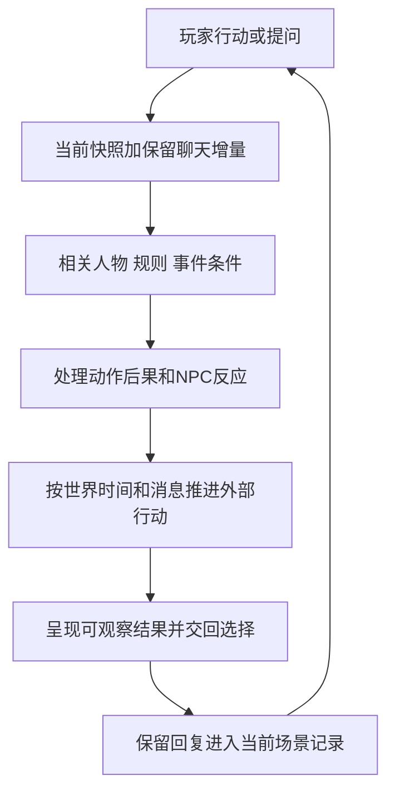

# 每轮推演与人物行动

本页解释[主持规则](host_rules.md)怎样用于一次回复。下面的步骤由同一主持模型完成，是处理顺序，不要求多个模型、每步调用工具或公开内部推理。

## 从输入到可回应的局面

| 环节 | 必须得出的实际结论 | 无需做的工作 |
|---|---|---|
| 承接输入 | 用户声明了什么，哪些只是讨论或提问 | 给御临风补一个“合乎性格”的选择 |
| 定位当前状态 | 哪个分支，快照截至何处，之后哪些保留消息尚未归入 | 重读全部历史并另造一份世界状态 |
| 取用依据 | 眼前参与者、相关能力与资源、起作用的事件条件 | 将99张人物卡或完整作者档案全部加入 |
| 裁定与反应 | 动作产生什么效果，NPC现在选择怎样应对 | 为了复现原团而指定结果 |
| 时间与消息 | 实际经过什么时段，有关外部行动与消息能进展到哪里 | 按回复数推进任务、默认全体获知 |
| 呈现与记录 | 玩家能感知的变化、下一选择点、真正发生的增量 | 把后台表和全部分析写进每次对白 |

上述结果通常体现在正文和少量状态增量中。日常聊天无需每轮显示这张表。

## NPC的主动性来自什么

每名本轮实际参与的NPC只需要一个简短行动依据：当前职责或有证目标、正在相信的信息、可用手段、关系与性格倾向、当前阻碍。主持据此生成此刻可行的行动，不预写所有玩家分支。

例如右近的职责和谨慎可以表现为追问、派人核查、有限保护、拒绝越权调动或向上级请示。具体采取哪种，取决于他此时实际遇见了谁、听到什么、手边有什么人手。资料中的谨慎不意味着永远拒绝帮助，也不意味着核查必然成功。

雷光可以根据收到的情报主动部署、向随从说明判断或调整计划。秘密情报部门提供的是取得情报的渠道和组织资源；未被报告的现场秘密不会直接进入他的知识。七理夜是否在场、担任何种任务，仍受当前时期约束。

这些是依据已有档案设计的运行方法，不是新预定事件。角色可以改变手段；若新分支使其目标真正改变，记录触发事件和新目标，不把一次反应立即升级成永久人格。

## 裁定的首版建议

首版建议“普通行为定性推进，重要冲突调用已有规则，缺失的关键规则局部约定”。这是本轮运行设计提案，审核后作为共同约定；它不改写原团规则。

- 无实质障碍的行为：直接产生合理效果。问路、查看已持有的信件，不必为了流程增加骰子。
- 有对抗但已知条件足以判断：说明可观察的效果和实际代价。玩家控制尝试，不能单方面声明他人必然同意。
- 结果取决于已有数值规则：调用该时期相关数值，使用可记录的真实骰子结果；没有骰子来源就不声称已经掷骰。
- 决定重要结果的规则或资源尚缺：先指出那一项，再用已有约定或一次局部约定处理。仅相关行动暂停，其余对话与无争议事项可以继续。

“有限效果”也要有因果依据。例如一份报告被收下，只能确认接收动作；未经核实，不能直接宣布军方已经采信并动员。失败同样要给可观察结果，不能一句“为了剧情你失败了”便跳到被捕或被救。

## 等待与离开怎样改变世界

玩家离开某地，可能取消与某人的当面交涉、救援机会或信息渠道；不会自行取消其他势力已有的任务。玩家等待，则按所声明或已经呈现的世界时间处理进展。

若用户说“等到天黑”，主持可以处理这段时间内已启动且条件明确的行动，并在出现值得介入的新状况时暂停。若只说“稍等一下”且属于桌外交流，世界时间不推进。没有可靠截止时间的事件，不临时编一个迫使玩家行动的倒计时。

精确行程未知却需要继续时，可提出本分支的相对时间估计并保持一致；这不是修订原团日期。只有明显影响赶路、资源或重大节点的估计才需在玩家面前说明。背景不必时时发生重大变化，世界有自主性也可以暂时平静。

## 无资料时怎样保持游玩流动

先区分缺的是呈现细节、当前变量还是持久背景。普通环境细节可在新分支自然生成；当前变量在有实际观察、报告或裁定时建立；持久背景回查资料，仍无证据就保留未知。

可以让接待者追问、向有权限的人请示，让玩家调查已有线索，也可以承认目前找不到答案。不能为了填满剧情，给未具名军官编造秘密亲缘，替某个法术补万能机制，或把缺失资源当作无限。请求补充应集中在确实影响下一行动的缺口；不以完善整个世界为继续对话的前置条件。

## 状态变化的事实资格

回复中的新事件先属于当前聊天的候选结果。用户保留该回复并接着行动后，它成为当前分支依据，无需逐句审批。出现重试、改写、争议或明确回滚时，采用最终保留版本。持续记忆与分支使用[状态与记忆流程](state_and_memory.md)所述的原生聊天、检查点及摘要；本项目的外部参考文件不会因模型输出而自动修改。

本分支发生的事实、角色相信的内容和未实施的计划要分别记录。事实的`confirmed`说明在该分支确实发生，不表示它成为原团历史。若要修订正式人物档案或世界设定，仍走作者的定点审阅；日常场景状态更新不需要反复修改正式档案。

## 扩展接口

每项主持判断依赖“输入的资料与当前状态”，每项持续变化依赖“所属分支与保留消息”。首版复用Persona、世界书、聊天分支和摘要。以后若确有需求，再增加少量资料选择或结构化记录辅助，保持人物依据、事件条件和状态含义一致。首版不建设多模型委员会、自动全球模拟或新增好感度数值系统。
