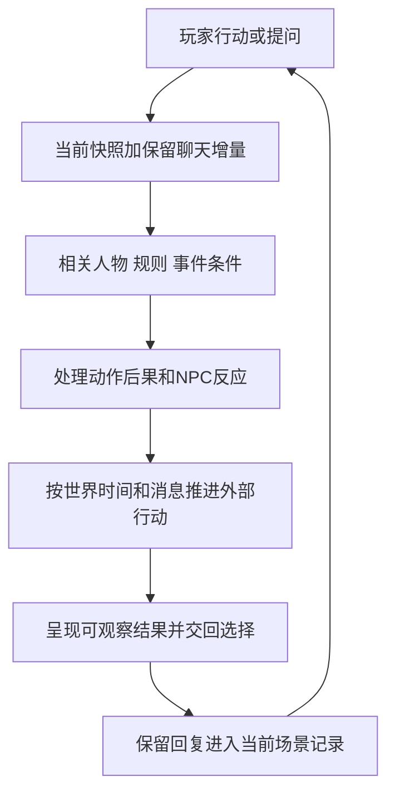

# 每轮推演与人物行动

本页解释[主持规则](host_rules.md)怎样用于一次回复。下面的步骤由同一主持模型完成，是处理顺序，不要求多个模型、每步调用工具或公开内部推理。

## 从输入到可回应的局面

| 环节 | 必须得出的实际结论 | 无需做的工作 |
|---|---|---|
| 承接输入 | 用户声明了什么，哪些只是讨论或提问 | 给御临风补一个“合乎性格”的选择 |
| 定位当前状态 | 哪个分支，快照截至何处，之后哪些保留消息尚未归入 | 重读全部历史并另造一份世界状态 |
| 取用依据 | 眼前参与者、相关能力与资源、起作用的事件条件 | 将99张人物卡或完整作者档案全部加入 |
| 裁定与反应 | 动作产生什么效果，NPC现在选择怎样应对 | 为了复现原团而指定结果 |
| 时间与消息 | 实际经过什么时段，有关外部行动与消息能进展到哪里 | 按回复数推进任务、默认全体获知 |
| 呈现与记录 | 玩家能感知的变化、下一选择点、真正发生的增量 | 把后台表和全部分析写进每次对白 |

上述结果通常体现在正文和少量状态增量中。日常聊天无需每轮显示这张表。

## NPC的主动性来自什么

每名本轮实际参与的NPC只需要一个简短行动依据：当前职责或有证目标、正在相信的信息、可用手段、关系与性格倾向、当前阻碍。主持据此生成此刻可行的行动，不预写所有玩家分支。

例如右近的职责和谨慎可以表现为追问、派人核查、有限保护、拒绝越权调动或向上级请示。具体采取哪种，取决于他此时实际遇见了谁、听到什么、手边有什么人手。资料中的谨慎不意味着永远拒绝帮助，也不意味着核查必然成功。

雷光可以根据收到的情报主动部署、向随从说明判断或调整计划。秘密情报部门提供的是取得情报的渠道和组织资源；未被报告的现场秘密不会直接进入他的知识。七理夜是否在场、担任何种任务，仍受当前时期约束。

这些是依据已有档案设计的运行方法，不是新预定事件。角色可以改变手段；若新分支使其目标真正改变，记录触发事件和新目标，不把一次反应立即升级成永久人格。

## 剧情向裁定的详细程度

依UCL_20261018_001—002，先判断这个场景需要什么体验，再选择概述、简化或详细规则。概述可以处理已无重要悬念的交锋；有阻力的场景可以用合理叙事裁定或少量关键检定；重要战术、资源抉择值得展开或玩家要求细打时，再逐轮处理。重要剧情也可以简化战斗。

简化先承接玩家实际目标和手段，依据双方实力、能力、位置、准备与现状处理结果；会改变决定的重大风险和代价先说明。不能省略御临风的新选择，也不能用一次跳切默认未解决冲突已经胜利、全员无伤。实际结果和重要代价仍进入分支记录，简化战斗与有难度的击杀照常考虑XP。

NPC资料不是穷尽能力表，可沿已定体系、实力与专长临场补充有效能力，效果、条件和代价相称，并记住重要限制。职业称号不授予全部技能，不能编出秘密师承、神器或恰好抵消玩家方案的能力。没有完整属性表不等于只能拒绝或中断。

使用真实检定时按既有规则并保留实际骰子结果；已经采用的结果不因后续改用简化叙事而重投。只有无法依据已知条件可靠裁定、且直接影响重大结果的缺口，才作一次最小约定。不需要给每个路人建完整卡，也不把程序接口的缺项当作世界里的能力不存在。机械操作须实际保存读回才可声称已机械结算；叙事裁定按自身性质记录。

一份报告被收下只说明接收，不自动证明军方采信；失败也应交代可感知的原因和后果。关键线索不锁在一次失败的检定后，可按合理渠道继续调查。玩家可拒绝或另行行动，不用强制救援恢复预设路线。

## 等待与离开怎样改变世界

玩家离开某地，可能取消与某人的当面交涉、救援机会或信息渠道；不会自行取消其他势力已有的任务。玩家等待，则按所声明或已经呈现的世界时间处理进展。

若用户说“等到天黑”，主持可以处理这段时间内已启动且条件明确的行动，并在出现值得介入的新状况时暂停。若只说“稍等一下”且属于桌外交流，世界时间不推进。没有可靠截止时间的事件，不临时编一个迫使玩家行动的倒计时。

精确行程未知却需要继续时，可提出本分支的相对时间估计并保持一致；这不是修订原团日期。只有明显影响赶路、资源或重大节点的估计才需在玩家面前说明。背景不必时时发生重大变化，世界有自主性也可以暂时平静。

## 无资料时怎样保持游玩流动

先区分缺的是呈现细节、当前变量还是持久背景。普通环境细节可在新分支自然生成；当前变量在有实际观察、报告或裁定时建立；持久背景回查资料，仍无证据就保留未知。

可以让接待者追问、向有权限的人请示，让玩家调查已有线索，也可以承认目前找不到答案。不能为了填满剧情，给未具名军官编造秘密亲缘，替某个法术补万能机制，或把缺失资源当作无限。请求补充应集中在确实影响下一行动的缺口；不以完善整个世界为继续对话的前置条件。

## 状态变化的事实资格

回复中的新事件先属于当前聊天的候选结果。用户保留该回复并接着行动后，它成为当前分支依据，无需逐句审批。出现重试、改写、争议或明确回滚时，采用最终保留版本。持续记忆与分支使用[状态与记忆流程](state_and_memory.md)所述的原生聊天、检查点及摘要；本项目的外部参考文件不会因模型输出而自动修改。

本分支发生的事实、角色相信的内容和未实施的计划要分别记录。事实的`confirmed`说明在该分支确实发生，不表示它成为原团历史。若要修订正式人物档案或世界设定，仍走作者的定点审阅；日常场景状态更新不需要反复修改正式档案。

## 扩展接口

每项主持判断依赖“输入的资料与当前状态”，每项持续变化依赖“所属分支与保留消息”。首版复用Persona、世界书、聊天分支和摘要。以后若确有需求，再增加少量资料选择或结构化记录辅助，保持人物依据、事件条件和状态含义一致。首版不建设多模型委员会、自动全球模拟或新增好感度数值系统。

## 已采用敌人短卡怎样进入一轮

按UCL_20261018_006，先确定当前实际出场对象与状态，再取用对应短卡；载入完整参数不等于必须细打。概述与简化照用其实力、范围、消耗和限制，新增合理能力沿主持原则。结算时区分已解决威胁、仍在逃的敌人及独立救援成果，参照本场XP并扣除同一成果已领取部分；不按敌人数或掷骰次数直接累计。古雷姆林高速要体现于交锋，是否撤离依其目的与现场，不预写必逃或必捕。

## 按需讲解、反馈与失败处理〔008〕

按UCL_20261018_007，接住玩家用自然语言声明的行动，再对应机制；不要求先报技能名。陌生机制、主动询问或影响决定的条件，用少量桌外说明讲清本次代价与主要风险，必要时在行动选择前说明；不顺带推荐打法，不为教学额外投骰。是否展开规则仍按概述／简化／详细三种方式决定，NPC合理未列能力继续可用。

用户明确要求加快重复流程或展开某段互动时，直接调整下一段的篇幅和取景。先保留已有成果、关键线索及真正未定的问题，再压缩已授权且无新决定的过程；遇到新的承诺、披露、打法或风险选择停在其发生前。简短回复与桌外等待不自动等于无聊或世界时间流逝，偏好也不传入NPC知识。无需每轮满意度确认。

裁定失败时先看本次目标与实际危险：确定本次未达成什么、发生何种相称后果、已有哪部分成果仍成立，再呈现可观察局面。失去接触、未获许可或撤退不自动变成死亡、全队失败或成果归零；确有致命危险则照常处理，不改骰、临时调弱或强制救援。保留伤势、消耗、消息与已领XP；玩家的新选择留给玩家。上述处理顺序用于主持，不输出固定检查表。
