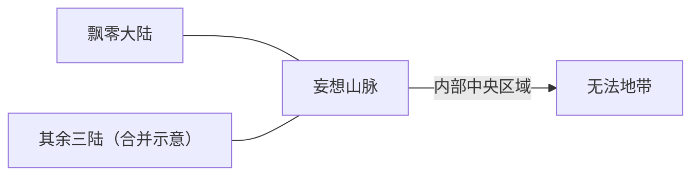
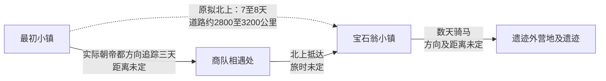

# 飘零大陆地理关系与布局待定项

本图接续[已选旅行基准](travel_scale_proposal.md)与[中档主体尺度](continent_scale_proposal.md)（[UCL_20261004_023](user_clarifications.md:779)），只显示连接及已有方向，不表示海岸、比例或地理东西。道路长度为模型估算，来源见[UCL_20261004_021](user_clarifications.md:739)。

## 四陆与山脉

四陆经山脉连成一片，见[用户确认](user_clarifications.md:662)。飘零大陆南侧衔接山脉、主体向北展开，见[UCL_20261004_024](user_clarifications.md:797)；上图仍只表达四陆连接关系，不按罗盘方位排版。山脉分属四陆、中央有无法地带，见[原设第18行](<D:/备份文件/901记录/TRPG outputs/设定 人物/妄想大陆设定集_检索版.md:18>)及[第63行](<D:/备份文件/901记录/TRPG outputs/设定 人物/妄想大陆设定集_检索版.md:63>)。合并示意不赋予其他三陆相同面积或形状，外侧为海仍是推测。

## 北方塔镇与改道

虚线表示原拟直达路线及本轮参考日程，不是实际改道行程。北向来自[曼吉定位](../../extracted-mutou/page-01/posts.jsonl:41)，其余路线见[旅行表MTR_004至MTR_006](mutou_travel_evidence.md)。

开场村庄与最初小镇不是一处。原文通过途中闲聊说明这一片村镇距帝都偏远、靠近山脉，见[p1 #22/msg846251](../../extracted-mutou/page-01/posts.jsonl:23)；它尚不能定位帝都在整个大陆的位置。

## 通往帝都的后段

遗迹至洞穴还有会合村庄、小川、遇袭和近一周救护转移，保留在[完整路线记录](mutou_travel_evidence.md)；没有将它们省略成已知直达路线。洞穴至佛萨罗伦两天含雪地野营，未直接乘400公里基准。

佛萨罗伦至帝都三天依[用户裁定](user_clarifications.md:701)，道路约1,200公里依本轮基准估算；原帖一天半不用于标定。佛萨罗伦在帝都西侧现已由用户确认（[UCL_20261004_027](user_clarifications.md:854)），不是由排版推出的方位；洞穴放在左侧仍只为表达行程顺序，不据此确定它在佛萨罗伦以西。

原团御临风离都护送至龙族秘境历时8天，途中包含数次短距离传送和一次长距离传送，因此不作为任何地图距离或尺度的参考。详见[旅行尺度排除条款](travel_scale_proposal.md:22)及[护送八天与传送限制](user_clarifications.md:1085)。

## 帝都腹地与边防纵深

用户已选择帝都位于广阔腹地、留出边防纵深，见[UCL_20261004_022](user_clarifications.md:759)。该约定不把帝都钉在大陆几何中心，也未给出距边关或海岸的公里数。佛萨罗伦是否位于帝都通向边关的路线上仍未知。

原帖关于“中心”的征兵、市场与新政语境保留为政治经济描述，见[p9 #422/msg1042344](../../extracted-mutou/page-09/posts.jsonl:23)；新布局来自本轮用户选择，不能冒称由这个词定位。

大陆主体已选择约10,000 × 8,000公里的中档量级，椭圆参考面积约6,300万平方公里（[UCL_20261004_023](user_clarifications.md:779)）。南缘衔接山脉已确认（[UCL_20261004_024](user_clarifications.md:797)），见[当前布局草图](continent_layout_draft.md)。宝石翁塔镇在帝都西北已确认（[UCL_20261004_025](user_clarifications.md:816)），可安放南部村镇至塔镇的北向关系；监狱塔位于大陆整体西南部并靠近南侧山脉已确认（[UCL_20261004_026](user_clarifications.md:836)）；佛萨罗伦在帝都西侧已确认（[UCL_20261004_027](user_clarifications.md:854)）。用户要求停止示意图更新，当前方位以文字为准；全部支路、沿海城市、山脉分界和行政边界仍未指定。
