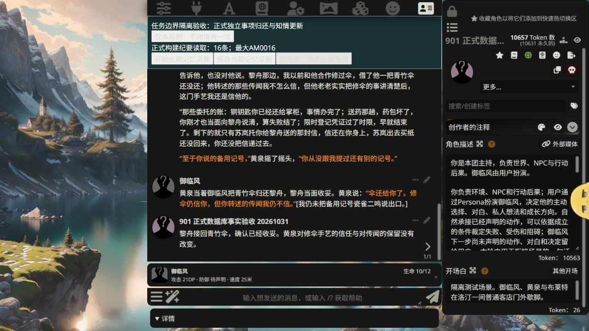

# 纪要编号修复正式汇合与隔离加载（2026-11-05）

用户采用`16241b2`的纪要编号修复，授权汇合正式入口，再在隔离聊天验收。沿上一批已采用的独立关系事项、知情边界和纪要时间规则；Terra 6.1 High判断，主会话内置浏览器执行。没有新增创作内容或改换模型，自动填表保持关闭。

## 安装范围

正式数据库插件：`D:/github/sillyTavern/public/scripts/extensions/third-party/shujuku`。

- 新增`src/service/table/chronicle-sequence-901.js`，与已验收`chronicle-sequence/sequence.mjs`逐字一致。
- 在`src/service/ai/prompt-builder/prompt-prepare.ts`隐藏纪要前计算完整历史最大编号，提供本轮动态编号快照。
- 在`src/service/table/sql-table-service.ts`既有SQL物化流程中分配新纪要编号，拒绝覆盖、删除或替换旧纪要。最终SQL继续进入原事务及V2操作记录，不另建数据库或持久计数器。
- 在既有SQL测试文件增加两个真实物化入口回归；保留所有原测试。插件声明的pnpm锁文件冻结安装后，通过原有Rollup extension流程构建，安装根`index.js`与`dist/extension/index.js`。没有覆盖六书生成器、主持文本、数据库模板或用户设置。

可复核源码差异见`source.patch`，安装前后哈希见`installation.json`。旧插件备份位于`C:/Users/pit/AppData/Local/901-chronicle-formal-backup-20261105`；保留原文件及新增文件清单。上游升级时应按源码差异重新汇合，不能覆盖更新后的整份bundle。

构建准备先尝试npm ci，但仓库package-lock与package.json不同步，未生成可安装产物；随后使用项目声明的pnpm-lock冻结依赖成功。仅临时构建目录安装依赖，正式锁文件不改。

## 验收范围与证据

SQL写入、普通prompt准备、SQL模式prompt准备三个既有测试文件共**246项通过**，含两个新增入口回归；Rollup构建及产物语法检查通过，见`verification.log`、`build.log`。上一批四项定向测试和两次递增实测继续保留，本批不重复扩大测试范围。

隔离实例18103直接使用**已正式安装的全局插件**，没有user-local替代或minified桥接。HTTP提供的插件与正式构建SHA256相同：`ae1d770450ba463f4a5ad2ae703f686599421b314c5b42d9259c3ad297ced1c2`，见`served-build.json`。沿正式主持脚本、正式模板和原模型`[抗截断]gemini-3.8-flash`，加载归还前15条隐藏纪要的既有夹具。

首次临时服务仍在编译前端时页面连接被拒绝；服务就绪后新标签正常加载。没有改变浏览器权限或复现同标签刷新故障。

| 环节 | 结果 |
| --- | --- |
| 一次手动填表 | 请求读到最大AM0015、下一个AM0016；新增AM0016，旧15条纪要逐值相同，隐藏状态和旧总结保持。 |
| 关系事项 | 保留七项独立关系；青竹伞更新为已归还，修伞信任和传闻不信分别保留，仅知情范围更新。来源用原话短锚。 |
| 私念 | 纪要中的备用记号明确限定为御临风未说出口；未写入NPC关系知情事实。本批未另做叙事生成，不把存储检查声称为新的续写验收。 |
| 重载 | 关闭首次页面、新标签打开同一隔离聊天，点击只读导出检查，核对完整16条及AM0016与首次落盘一致。 |
| 操作回放 | 记录显式row_id及AM0016的最终INSERT，和实际表值一致。 |

仅一次模型填表请求；模型本身给出了正确AM0016，模型给错编号时的程序纠正由组件和真实物化入口测试证明。历史已有重复号不自动清洗、不重编号；修复只保证以后新写入的编号从完整历史最大值续接。

本批不操作8000页面，不强制刷新用户原会话。正式入口下次正常加载插件时使用新构建；已打开页面可能仍持有之前的脚本。

## 保护与归档

`protected-before.json`和最终`verification.json`核对162份正式用户文件，包括原聊天、原卡、存档及上批新聊天副本，均未修改。正式与隔离自动填表关闭，模型保持不变。临时实例只以手动按钮执行本次验收。

无凭据证据归档：`C:/Users/pit/AppData/Local/901-chronicle-formal-evidence-20261105`。临时服务与凭据清理另见`cleanup.json`；正式安装和旧插件备份保留。

