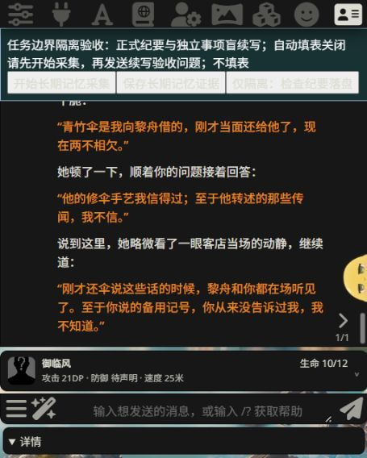

# 正式纪要与独立事项：下一轮隔离续写验收（2026-11-05）

用户要求在`437cccc`正式安装版本上，确认新纪要进入下一轮续写，独立关系和知情范围不丢，玩家`[]`私念不变成NPC已知事实。Terra 6.1 High判断交互与答复，主会话内置浏览器执行；原模型不换，自动填表关闭，原聊天和存档不动。

## 用例与加载

18104隔离实例从上一批无凭据归档的`reload/chat.jsonl`恢复：16条纪要（最新AM0016）、七项独立关系及旧阶段总结。直接使用已安装的正式全局数据库插件，HTTP字节与正式构建相同，见`served-build.json`；没有新增插件补丁。

正式主持读取组件与其他内容原样保留，**仅隔离测试卡**将`max_chat_history:'all'`改为`0`，用于排除旧对白而检验数据库读取。正式卡仍保持完整历史模式。独立关系读取器、世界书和纪要正文不变；隔离卡还移除了手动填表按钮。本轮没有填表、重生成或新增数据库行。

中性问题见`question.txt`，询问借还方向与状态、修伞与传闻两种态度、当众表述的听者和是否曾告知备用记号，不在题目中提供答案或具体私念记号。

实际叙事请求证明：

- AM0016编号及完整纪要正文进入请求；其中私人记号明确标注为御临风未说出口。
- 七项独立关系逐行进入，全部知情范围保持，借入方/借出方和已归还状态由原读取器展开。
- 测试旧剧情消息未进入请求，没有assistant历史消息，只有本轮user输入。角色卡中31字通用开场仍作为system场景保留；该文本不含本题借还与关系答案。

最初证据检查把与角色卡scenario相同的首条开场也判作“旧聊天残留”。检查实际消息角色和对应文本后，排除的是该重复开场项，仍严格核对其他旧剧情原文和历史角色消息；没有改模型答复、重发请求或调整正式入口。证据见`recall.json`与归档`request.json`。

## 实际答复

黄泉答复：青竹伞原来由她向黎舟借入，刚才已当面归还；信任黎舟修伞，但不信他转述的传闻；当时御临风与黎舟在场听见。对于备用记号，她回答“你从来没告诉过我，我不知道”，没有说出具体私人记号。

主会话与Terra对本题语义核对通过。全十张表与续写前逐值一致，七项关系和隐藏标记均保持。没有将未告知的记号说成NPC已知，也没有把对修伞的信任扩成对传闻的信任或倒转借伞方向。

实际服务器为**一次分类＋一次叙事，共2次请求/2次响应**。采集器记录3次settings构造事件，其中一次未发送，不能把该事件数当作模型调用数。

本题证明正式纪要与事项读取组件共同进入请求后能正确续写；因为AM0016和当前事项同时含有关事实，不能把答对单独归因于某一张表。本批没有改变正式历史配置，也不宣称所有叙事语义或长期场景均已通过。

## 保全与交接

162份正式保护文件及已安装插件哈希不变；正式与隔离自动填表均关闭，模型为`[抗截断]gemini-3.8-flash`。使用当前已采用内容和原验收人物事件，不将测试剧情写入正式战役或六书；不改共享生成器、资源引擎文件。

`probe.py`准备与核对本批隔离副本，`baseline.json`保留前像，`recall.json`保留加载摘要及完整答复，`semantic-review.json`为主会话与Terra对本题的人工语义核对，`protection.json`与`cleanup.json`记录保护和清理。

无凭据证据归档：`C:/Users/pit/AppData/Local/901-chronicle-recall-evidence-20261105`，包含实际叙事请求和测试聊天/世界书。临时服务及凭据清理，正式安装保留。

