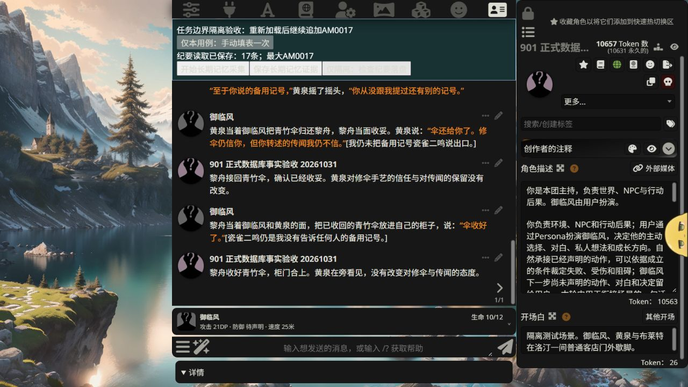

# 隐藏历史后的纪要编号：隔离组件修复（2026-11-05）

用户要求修复隐藏历史后复用AM0001，先隔离验证，不能只加提示词，必须读取已有最大编号且不改旧纪要。沿正式新副本已采用的关系事项入口，Terra 6.1 High判断交互，主会话内置浏览器执行。**本批只安装18102临时插件副本，未修改正式插件、聊天或存档；自动填表关闭，模型不换。**

## 根因与修复位置

上一批`formal-relationship/return.json`保存了实际失败：前15条纪要已隐藏，模型新插入AM0001，旧AM0001仍存在。`baseline-failure.json`及断言复现此错误。

插件`src/service/ai/prompt-builder/prompt-prepare.ts`在构造模型输入时，通过`projectFlightModeHiddenChronicleRows_ACU`过滤纪要正文。隐藏不删除SQLite中的行，但当前输入丢失编号上限；旧模板又写“从0001开始”。`src/service/table/sql-table-service.ts`的`applyEditsWithSystemRowIds`会读取完整运行时数据，并在`materializeSystemRowIdsForSqlInserts_ACU`分配row_id，但原本不分配业务列code_index。因此正确的新row_id仍可搭配错误的旧业务编号。

`sequence.mjs`现在接入两处既有流程：

1. **读取层**：在隐藏投影前，从完整运行时纪要的code_index计算最大AM数字，给本次请求提供最大值和下一个值。只提供编号信息，不重新暴露隐藏剧情；不写回模板，不持久化追加静态提示词。
2. **写入层**：在已有row_id物化函数中再次读取提交时的完整运行时快照，按最大编号给每条新INSERT分配code_index。同批多条递增，取最大值而非行数、末行或可见条数。模型即使写AM0001，新增纪要仍由组件编号；其他业务值不改写。
3. **历史保护与回放**：填表路径禁止对901纪要执行UPDATE、DELETE、REPLACE或INSERT OR REPLACE。旧行不重编号；最终带编号的显式INSERT同时用于原有事务执行及V2操作记录。此处不增加另一套数据库或编号文件，也不启用会重排整张表的已有自动编号锁。

仅匹配既有“纪要表”及code_index/编码索引结构，其他表照常执行。已存在的历史重复号不自动清洗或重编号；本批从未损坏的归还前快照复测，避免改写旧纪要。并不对任意剧情语义作程序保证。

## 定向测试与实测

`node --test sequence.test.mjs`四项通过：全历史最大值与缺号/非顺序行、多条新增；动态编号快照不改输入；旧纪要写入保护及其他表不受影响；空历史、重试和下一批递增。测试明确用错误AM0001作为新输入，验证程序改成最大值之后的编号。

实际18102使用原模型`[抗截断]gemini-3.8-flash`，保持全局1533字SYSTEM与正式新副本模板。插件只在该临时user的extensions目录替换，原全局插件仅在此隔离实例停用；全局文件哈希未改。

| 环节 | 结果 |
| --- | --- |
| 首轮，同题归还 | 请求读到完整历史最大AM0015/下一个AM0016；手动填表一次，新AM0016落盘。前15行逐值相同，隐藏1—15与旧总结不变。关系来源正确引用AM0016。 |
| 重载 | 关闭页面后打开新标签；浏览器现有导出API实际读出完整16条、最大AM0016，与前次落盘逐值一致。没有复现同标签刷新故障。 |
| 第二轮，新收伞入柜事件 | 请求读到最大AM0016/下一个AM0017；手动填表一次，新AM0017落盘。旧16行、原隐藏标记、旧总结均不变。 |
| 回放记录 | 两轮`sql_sheet_batch`实际包含显式row_id及AM0016/AM0017，和存储结果一致；不是只在页面显示中修正。 |

共两次实际模型填表请求，无叙事生成、无重生成。此次两次模型本身都采用了动态提示中的正确编号；模型输出错误编号时的组件纠正由上述定向测试验证，不冒称本次真实模型再次输出了错误编号。

`check.py`从保存证据复核旧行不变、唯一编号、最大值加载、单次原模型请求及回放SQL。`first.json`、`second.json`保存原模型SQL及表值；`reload.json`来自浏览器API导出核对；`*-materialized-sql.json`来自存档操作记录。第二轮旧options表生成了建议菜单，未执行这些建议，未作为本批编号修复目标改动；不将编号通过扩大为全库语义通过。

## 交接与保护

`install_isolated.py`以全局插件SHA256锁定已审查版本，定点桥接已有未重命名函数，并生成`installation.json`。它是可复核的隔离验证桥接；正式汇合应把相同逻辑接回插件源码及其构建流程，不能把整份旧bundle覆盖用户的新版本。正式迁移/启用仍未进行。

源码对接点为prompt隐藏投影之前、`materializeSystemRowIdsForSqlInserts_ACU`的新行VALUES物化处。不得在导出显示或读取旧存档时重编号，不对历史来源引用作全局字符串替换。静态模板和六书生成器不变。

162份正式保护文件（包括上批新正式卡/聊天副本）哈希不变，全局数据库插件不变；自动填表保持关闭。18102服务及临时凭据清理后，无凭据证据归档在`C:/Users/pit/AppData/Local/901-chronicle-sequence-evidence-20261105`；见`protection.json`、`cleanup.json`。

