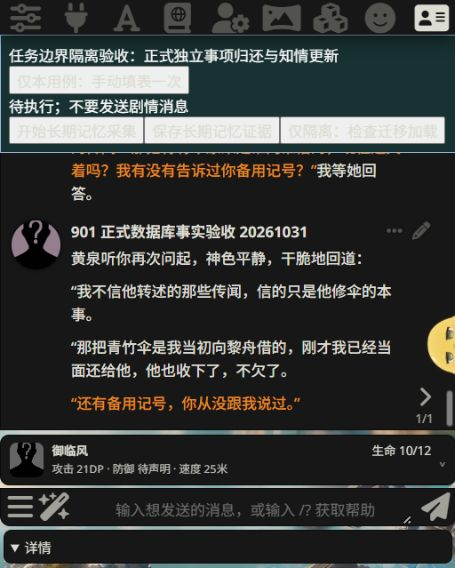

# 独立关系事项正式新副本安装（2026-11-05）

用户采用`af06db1`，授权把独立关系事项及知情更新汇合正式入口，**只迁移到新聊天副本**，保留原聊天/存档、原模型，自动填表保持关闭。Terra 6.1 High判断交互及答复，主会话使用内置浏览器执行，并核对落盘。

## 已安装入口

在8000酒馆选择角色卡 **901 帝都初始卡 独立事项版 20261105**，打开其聊天 **901 原聊天迁移副本 20261105**。

- 新卡：`D:/github/sillyTavern/data/default-user/characters/901 帝都初始卡 独立事项版 20261105.png`。
- 新聊天：`D:/github/sillyTavern/data/default-user/chats/901 帝都初始卡 独立事项版 20261105/901 原聊天迁移副本 20261105.jsonl`。
- 来源是原卡现有31条消息。逐条保留消息正文、swipes、时间、玩家标记及全部variables；只调整副本的数据库模板/指导表/空checkpoint及聊天归属标识。原九表均为空，新事项表也为空，不从原对白推断补写关系，不导入验收人物或借伞剧情。
- 新卡主持脚本嵌入已验收的逐项读取器，继续`max_chat_history:'all'`；没有带入上一轮盲测用的零历史配置，也不包含验收采集按钮。
- 新副本接入独立事项表、重要角色表关系文本停用说明、总结读取说明。状态/来源/知情范围任一出现新证据即更新对应列；不同事项独立保存，借入方向由结构展开。
- 正式1533字填表SYSTEM、其他旧表规则、模型及自动开关保持原样。全局settings唯一变化是新增卡的五本额外世界书绑定；基础书继承原卡，六书正文不变。模板变更保存在新副本，不批量迁移其他聊天。

`installation.json`记录新卡/新聊天哈希和settings前后哈希。`migration.json`记录迁移保全，`protection.json`证明159份原受保护文件不变，settings仅增加新卡世界书绑定；验收后正式新副本哈希也不变。原卡仍可使用，已有页面未被强制刷新或改选。

## 实际隔离验收

18101环境使用正式新卡与新聊天的复制件；没有操作8000页面。首次访问早于服务完成前端编译，连接拒绝；服务就绪后新页面正常加载，未进行同标签刷新故障复现。

1. 新卡脚本及显示正则在隔离环境确认启用后，浏览器调用插件现有导出API，实际读取**十张空表、31条消息**。见`migration-load.json`和`migration-ui.png`。没有为此调用模型。
2. 单独测试卡使用归还前真实验收快照，替换为**正式已安装host的原文**和正式新副本的表说明，填表SYSTEM与正式逐字一致。同题手动填表一次，模型`[抗截断]gemini-3.8-flash`。实际请求包含新DDL及知情更新条件；七项关系完整，借伞变已归还，传闻态度仍不信、知情范围更新为御临风/黄泉/黎舟，修伞信任保留。见`return-input.json`、`return.json`。
3. 随后一次分类、一次续写，实际请求直接读入七条当前事项。答复明确“我不信他转述的那些传闻，信的只是他修伞的本事”“是我当初向黎舟借的……已经当面还给他……不欠了”，并表示备用记号从未被告知。玩家[]私念未被NPC说出。见`recall.json`、`recall-ui.png`。

共三次模型请求，无重生成。此次保留正式完整历史，是正式入口综合续写验收；不冒称无原文盲测。无原文条件下的独立读取证据见上一批`relationship-facts`。三项Python及三项Node回归通过；迁移断言检查原消息/变量保全、九表值不变及新表为空。

### 留存观察

本批**关系目标通过，但不宣称整个数据库无缺陷**：旧纪要模板在前15条已隐藏后，新纪要重用了`AM0001`；旧行未被覆盖。本次关系来源采用原话短锚，没有使用该重复编号，未形成错链。见`observations.json`。此项未在本批扩展为编号组件改造；正式自动填表继续关闭，后续修复编号时应同时提供隐藏历史的最大编号依据，不能只再堆“不得重复”。

证据检查最初直接匹配多行SYSTEM失败，是Node日志将字符串拆为带`\n`的多段显示；已按原顺序逐行核对全部SYSTEM文本，并核对隔离配置与正式完全一致。没有修改模型输出或重新请求。

## 文件及归档

`integrate.py`仅创建新卡/聊天并追加世界书绑定；`new-template.json`和`host.js`是本批可检查的作者源产物。原聊天大副本和完整PNG不重复纳入Git，保存在正式安装位置及无凭据证据归档；`.gitignore`只排除这两个本地生成物和Python缓存。

`acceptance.py`构建和检查18101隔离用例。临时服务与凭据清理后，无凭据证据保留于`C:/Users/pit/AppData/Local/901-formal-relationship-evidence-20261105`，清理结果见`cleanup.json`。不改全局数据库插件或资源引擎共享输出；以后生成主持入口时，应沿本批新副本作用域接入reader，不能给尚未迁移的旧聊天直接加必需新表。

