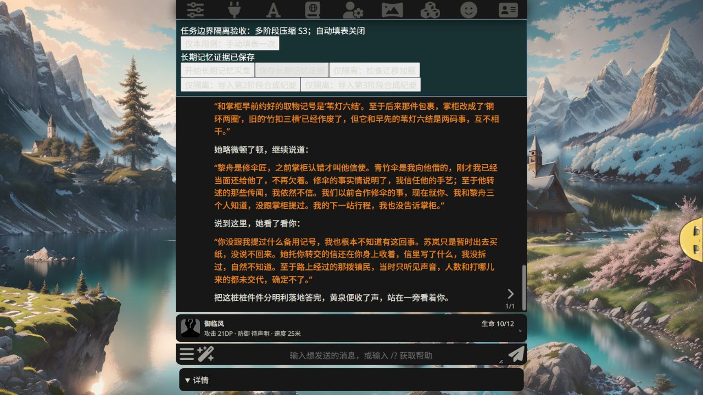

# 连续三阶段压缩的长期记忆补测（2026-11-05）

结论分开记录：**三阶段压缩保真、持久化、实际加载和覆盖不足拒绝均通过；最终续写的知情边界未完全通过。**模型将“已证三人知道”扩成“只有三人知道”，并断言没告诉掌柜。数据库内容没有因此改变，本批未修订或安装新的正式规则。

沿正式提交 `e264077` 已验收的第1阶段和AM0016归还快照，在18110隔离副本继续完成第2、3阶段。Terra 6.1 High判断，主会话内置浏览器执行；同一当前模型，正式设置、插件、原聊天和存档未改，自动填表始终关闭。使用computer-use与verification-before-completion进行交互及证据核验；夹具失败按systematic-debugging定位。

## 测试范围与来源

第1阶段是上一批实际接受的15条压缩阶段；第2阶段包含既有AM0016及合成AM0017—0030，第3阶段包含合成AM0031—0045。合成种子仅用于达到原有15条阈值和制造可核验的状态变化，不是实际游玩、模型自动生成的纪要或正式Canon。来源见 `baseline.json`、`synthetic-seeds.json` 和 `lab.py`。

通过隔离卡明确标记的按钮调用插件公开 `importTableAsJson` 持久化种子，再回读检查。S2仅将第4关系“曾合作修伞”的来源与已证知情扩至御临风、黄泉、黎舟，依据合成AM0017中的当面说明；其余关系原样保留。这是有据预置，不冒称真实填表自动更新。S3关系不变。

S2另设包裹领取标记“竹扣三横”，S3明确替换成“铜环两圈”并废除旧标记；与早期“苇灯六结”的取物约定分开。原始私念“瓷雀二鸣”始终未公开。每次实际压缩都通过模型填表和真实编译/覆盖/提交/隐藏链，未离线制造成功摘要。

本版只把当次可见纪要写成新阶段，**不反复概括或合并旧阶段**。所有旧总结持续保留并参与实际请求；结论限本次三个阶段，不代表无限轮次或上下文预算永不耗尽。

## 逐轮结果

| 截止阶段 | 累计纪要/隐藏数 | 当次压缩字符 | 全部总结字符，含旧59字总结 | 实际续写请求字符 |
| --- | ---: | ---: | ---: | ---: |
| S1，已有接受快照 | 15；另有AM0016可见 | 1673 | 1732 | 本批未重跑 |
| S2 | 30/30 | 1429 | 3161 | 33197 |
| S3 | 45/45 | 1344 | 4505 | 34546 |

这些是实测字符数，不是token或费用；旧阶段持续增长，压缩不等于上下文恒定。

两次正常压缩各新增一条总结，解码后当次15条来源与七项独立关系的所有字段、类型、顺序精确一致；旧纪要、全部旧总结及其他表均不变。每次运行态等于落盘。第3阶段后新标签重载十表及隐藏范围仍一致。见 `stage2-accepted.json`、`stage3-accepted.json`、`reload.json` 和 `longitudinal.json`。

两次真实续写请求分别包含两个/三个压缩阶段及原旧总结，各恰一次；七项当前关系及知情范围完整。已隐藏纪要没有在总结外重复注入，旧聊天对白和历史assistant消息未加载，同题只出现一次。主持仅在隔离副本设置history0用于盲测，正式header和模板沿当前版本。见两个 `stage*-recall.json` 及归档中的实际请求。

早期“镇民人数和来向未交代”“黄泉不知未拆信内容”在两个实际请求中都只来自第1压缩阶段，其他位置没有相同事实全文；续写均保留了未知边界。苏岚买纸、暂离和信件持有人也正确，但“买纸”同时有角色表佐证，不把它单独归因于第1阶段。包裹新旧标记的替换和与原公开记号的区别正确，借伞方向、归还、修信任/传闻不信及私人备用记号未泄漏均正确。

## 覆盖不足的真实拒绝

第三阶段先在临时插件字节中故意删除AM0031压缩来源行，它包含标记替换事实。该事实即使部分词汇在其他行出现，也不能抵消缺失的一条来源。实际手动填表返回false，浏览器调用栈显示beforePersist经隐藏入口触发覆盖守卫拒绝。

拒绝后十表、全部先前总结、45条原纪要、七关系、storageFrame和运行态均不变；hidden仍1—30，第三阶段15条仍可见。见 `stage3-rejected.json`、`stage3-rejected-browser.json`。随后移除故障、核对HTTP字节与正式构建完全一致，并重载确认同一起点，再正常压缩成功。这是人为遗漏实验，不冒称模型自行遗漏。

## 语义失败和观察

S3答复：“现在就你、我和黎舟三个人知道，没跟掌柜提过。”当前事项只列三名**已证获知者**，合成AM0033明确是“没有证据表明掌柜也听说”，AM0043只说没有新增披露。它们不能证明其他人不知道，也不能证明此前从未向掌柜说过。因此该次续写知情范围判失败，不能用机械加载检查全true代替语义通过，也不能仅称无影响措辞。本次不能确定这是压缩独有的问题。

S2答复给镇民未知人数/来向补了“没数过、没看清”的观察过程，来源没有写明；未编造具体人数或方位，但属于轻微增补。S3改为未交代、确定不了。两轮都把归还说成“刚才”；资料没有明确间隔，作为相对时间观察。见 `semantic-review.json`。不修改旧纪要来迎合答复，也不在本批补测中扩大为新增提示规则或数据库结构修复。

## 夹具问题与保护

最初核验器只读检查点，漏读公开导入的data_replace日志，误报导入未落盘。本批仅补只读核验器支持已观察到的data_replace/sheet_replace；SQL操作须有对应持久化检查点，未知操作直接拒绝。随后与页面API及新标签重载比较通过，不是放宽断言。

第一次在导入所在AI楼执行手动重填，插件因无法精确识别data_replace影响的历史行而在请求模型前拒绝，0次模型调用。将种子导入与无剧情总结轮分楼后恢复正常；没有绕过正式守卫。记录见 `seed-refill-error.json`、`fixture-adjustments.json`。

故障恢复时HTTP哈希检查发现文本读取规范化了102处CRLF；在运行正常验收前改为保留原字节，恢复精确正式构建。故障版除删除来源行外也有换行规范化，不能称仅一处字节差异；拒绝调用栈与回滚证据保留。

本批7请求/7响应：S2总结+分类+叙事、S3拒绝+正常总结+分类+叙事。请求模型仍为 `[抗截断]gemini-3.8-flash`，响应报告 `gemini-3.8-flash-n`，见 `model-evidence.json`。162份正式保护文件和插件哈希不变，正式/隔离自动填表均关闭。

仅提交本批测试材料与W进度，保留其他未提交修改。无凭据归档在 `C:/Users/pit/AppData/Local/901-multistage-compression-evidence-20261105`，包含各轮测试聊天、世界书、真实请求和结果，不含settings、secrets、config或原始服务日志。测试完成后关闭18110、清理临时副本；见 `cleanup.json`。

