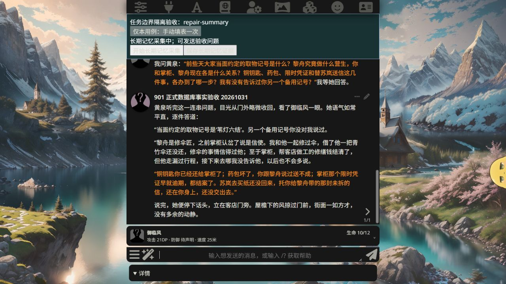

# 关系分项与借还方向：旧版同题对照和定点修复

用户授权：先用旧版同题对照定位，再修复关系分项丢失及借伞方向反转；合并修正已有规则，不继续堆叠；仅隔离副本、Terra High判断、主会话IAB执行，不换模型、不动正式设置/原存档。

基线为 `prompt-consolidation-lifecycle`（提交39ba5aa）及其无凭据归档。所有情节是既有受控fixture，不是Canon。旧版为当前正式1533字符SYSTEM与精简前8904字符九表说明，完整保留旧触发规则，未为对照静默修正。模型、采样配置、DDL、表内容和原题保持相同，仅替换填表提示词与表说明。

## 对照边界

- legacy-closeout：从上一批below实际快照（14条纪要）开始，追加完全相同closeout题，检查原有传闻判断是否保留。
- legacy-summary：独立从上一批closeout实际快照（15条纪要）开始，追加完全相同summary题。该输入关系列已缺失传闻判断，但AM0012仍有原事实；与上一批summary的输入一致。**不是legacy-closeout接续链路**。
- 旧版实际续写：旧版summary实际落盘后，沿用同一RECALL问题与只对该题启用的 `max_chat_history:0`；检查借伞施受方及私念边界。
- 原始“黎舟借黄泉一把青竹伞”保持不改，后半句“黄泉答应归还”及closeout原话明确支持黄泉借入、向黎舟归还。若另做明确表达控制，将单独标记，不冒充原题修复。

故障链路分开核对：源纪要 → 填表输出SQL → 实际表值 → 大总结 → 实际叙事请求 → 模型答复。旧版单次通过或失败只证明该用例结果，不推断普遍可靠性。

## 当前结果

旧版对照和本批隔离复验已完成，**总体未通过，不安装本批候选**。关系语义误改仍在；借伞方向本次盲读正确，但总结措辞尚有歧义，不判稳定修复。

1. `same-input-proof.json`：两道旧版填表题的所有表值、用户题及预置回复与上一批对应输入完全相同。
2. `legacy-closeout.json`：旧版也在整列UPDATE中丢失“尚不信其传闻”，并将本轮拟新增纪要计入阈值提前总结。关系遗漏并非精简版独有退化。实际更新只保留信任修伞及借伞，表明同字段不同事项被当成单一关系变化压缩。
3. `legacy-summary.json`：独立总结题旧版此次写出“黎舟借给黄泉青竹伞至今未还”，且保留镇民人数与来向未知，但仍未承接传闻判断。
4. `legacy-recall.json`：相同当前叙事模型在无原聊天正文的请求中加载该总结，答“我信得过他的手艺，借他的青竹伞还没还”，方向正确，私念不暴露。旧版一次正确不代表稳定性保证，也不足以单独证明歧义是唯一原因；与上一批含糊总结及反转共同支持明确方向的修复。

## 定点修复范围

以3110字符候选为基础，只替换重要角色表note/updateNode、大总结note三个字段。SYSTEM、DDL、UID、导出、主持叙事提示及模型不改。

- 关系更新：把“模型重写整列但不得漏项”的说明替换为SQLite现有 `REPLACE` 最小原文分项替换/对象段内新增，交由SQL保留其他原文。空值初始化仍可正常写入，不新建关系数据库。此处原本仅做规则候选，后续模型反复不遵守的结果与隔离组件修复见下。模型仍须正确定位原分项，不能把提示要求声称为运行时强制校验。
- 关系和总结表达：按事项保留，明确行为/态度的主体、对象与适用事项；借还、债务及交付必须保留施受方及待履行者。去掉对应旧重复说法后在原条目内合并，不追加SYSTEM补丁，也不把测试人物或答案写进规则。

最终候选规则3192字符，比上一候选净增82（SYSTEM不变）；字数不是成功标准。实际SQL/表值及后续总结、叙事结果见下。

## 提示词修复失败与写入前校验

首次REPLACE候选仍把三个分项整体替换并删去传闻判断，保留于 `repair-closeout-first-attempt.json`。重写同一updateNode，明确按对象/事项对应及逗号分项后，模型仍跨组替换，见 `repair-closeout-second-attempt.json`。没有继续追加第三轮同类提示要求。

`relation-guard.mjs` 为此处增加小范围写入前检查：只检查重要角色表的 `REPLACE(relation_text,...)`；如果旧片段跨逗号/分号分项且新片段删去其中原文项，则在提交前抛错，由现有 `ModelOutputRetryError` 流程重试。单分项的合法变化、对象段内新增、完整保留原分项的新增均允许。它不猜测或补写事实，不是通用SQL校验器，也不保证单分项变更的语义正确。

针对已捕获失败SQL的回归先红后绿，四项测试通过。仅在一次性用户扩展部署；原插件不改。第一次采用同名用户扩展时，发现服务的公共静态路由先返回全局index，虽然扩展列表显示local；因此那轮 `guard-not-loaded.json` **不是guard实际运行证据**。改用唯一目录 `shujuku-901-relation-guard`，只在隔离settings禁用原扩展，实际静态返回已核对包含guard。

`install_isolated_guard.py` 是隔离测试的可复现bundle连接脚本，依据唯一命名函数锚点接到现有隐藏列校验处。正式集成应在数据库插件源码的模型输出校验try/catch中调用该独立函数并正常构建，不能把隔离bundle改写当作正式发布流程。

## 校验缺口与配置定位

- `guard-single-attempt.json`：实际错误REPLACE被拒绝，表未发生任何写入；旧测试profile的 `tableMaxRetries:1` 使其直接返回false。仅隔离repair模式调整为3次总尝试，旧版对照仍为1次，模型与采样不变。
- `guard-literal-bypass.json`：下一轮模型改为整列字面量赋值，绕过仅REPLACE检查，UI虽true但实际传闻判断丢失，回归判失败。
- 将该捕获SQL加入回归，先红后绿；同一guard增加整列字面量赋值拒绝，带精确 `WHERE row_id=编号 AND COALESCE(relation_text,'')=''` 的空值初始化例外。六项测试通过，提示词未继续修改。此为受限SQL形式的候选检查，不宣称覆盖任意SQL表达式或语义错误。

## 实际纠错链：语义失败仍在

`guard-semantic-misreplacement.json`：第一次整列重写被拒绝，第二次实际请求携带 `[901关系分项校验]` 反馈。模型改成 `REPLACE(relation_text, '尚不信其传闻', '信任其处理修伞之事')` 后提交成功，旧判断仍被删。**这是合法单分项SQL中的语义错项替换，候选关系修复未通过**。这轮还漏改掌柜和黎舟的任务相关关系列，任务表则已正确结案，不能把UI true视为整体语义通过。

不追加人物特例、关键词黑名单或更多SQL形状限制，不把该guard推荐到正式入口。后续summary沿用该真实落盘：关系表有上述缺陷，但AM0012保留不信传闻的原始证据；检查总结能否承接不同事项及明确借还方向，不预填正确答案。

## 总结与实际续写结果

`summary-source-proof.json` 确认实际总结请求同时含有AM0012“不信他转述的传闻”、当前有缺陷的人物行、黄泉答应归还的源纪要，以及候选中的完整承接和明确施受方要求。不是来源未加载。

- `repair-summary.json`：旧总结不改、追加一条、隐藏15条纪要均正确；仍漏传闻判断，借伞写成“黄泉借黎舟青竹伞尚未归还”，没有按候选要求消除施受方歧义。
- `repair-recall.json`：实际续写请求包含新总结及人物行，不包含原closeout聊天正文。黄泉回答“借了他一把青竹伞还没还”，本轮借入/待归还方向正确；公开记号、身份订正、三类任务结案、未完送信正确，备用私念未变成NPC知识。但未恢复传闻判断。
- 本次借伞答对不能证明稳定修复：旧版同题也答对过，且总结本身仍有歧义。不能将一次随机输出差异当作可靠修复效果。

9次手动填表操作实际产生10次填表请求（其中一次由guard反馈触发自动重试），另2次分类、2次续写，共14次真实模型请求；未重抽叙事，模型及采样未换。根因证据支持：自然语言关系列被模型按总体信任态度压缩，SQL单分项校验不能识别不同事项的语义错配；借还信息在压缩时省略介词/施受方向，可能向续写传递歧义。前者在旧版也发生，后者不能仅凭此次对照断言唯一原因或已修复。

## 交接、校验和范围

`check.py` 保持失败断言，`verification.json` 中必要语义项为false；没有修改验收标准以变绿。`relation-guard.test.mjs` 六项机械回归通过，仅证明已支持SQL形状的拒绝/放行，不替代语义验收。候选脚本、完整规则、每次失败及最终实际结果均保留，**不是正式可安装方案**。

若继续解决关系语义覆盖，需评估按“人物＋对象＋具体事项”独立保存和更新，而非继续在同一自然语言单元中猜测该覆盖哪一项；这涉及模板与读取组件，已向用户提出范围选择，尚未实施。人物或答案特例、换模型、更多宽泛提示补丁均未采用。

Terra High判断交互，主会话内置浏览器执行并核验实际请求与落盘。160份正式保护文件哈希一致，全局数据库插件index哈希一致，正式auto保持关闭，模型、原聊天及存档不动。隔离18099服务已停止，临时含凭据副本已删除；无凭据证据归档在 `C:/Users/pit/AppData/Local/901-relationship-direction-evidence-20261104`，包含实际快照/请求/隔离测试卡/候选扩展及58项sha256清单，不含settings、secrets或原始服务日志。

