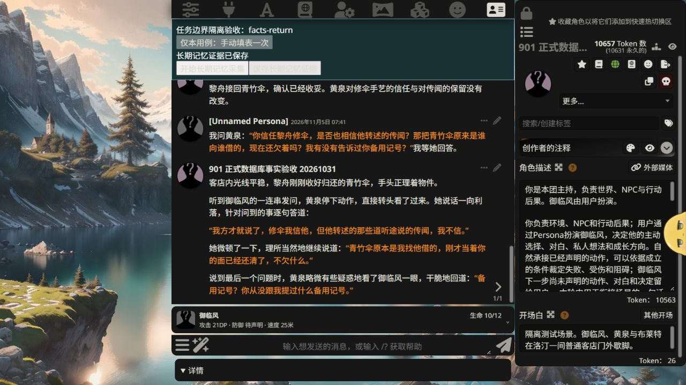

# 独立关系事项：隔离实现与验收

用户2026-11-04批准：将人物＋对象＋具体事项拆成独立记录，并适配总结读取，仅隔离验证。沿用上一批真实失败，不换模型、不动正式设置/聊天/存档；Terra High判断交互，主会话IAB执行。

## 设计与实施顺序

1. 新增 `relationship_facts` 表：主体、对象、事项、关系种类共同标识事实，状态、来源及知情范围另存。人物表的旧relation_text退出本候选读写；委托进度已有任务表和纪要，不重复存成关系状态。其他九表DDL不变。
2. 只迁移受控夹具中已有关系，逐项注明旧值和纪要来源。不把待测的“信任修伞”预填。借入记录固定主体为借入方，对象为借出方；读取消费者机械展开方向，不让摘要再次省略双方。
3. 总结读取完整事项表，负责叙事阶段而不替代当前事项表。续写入口通过插件现有 `exportTableAsJson` 读取各事项，逐行渲染；即使阶段纪要隐藏，独立事实仍直接入请求。无模型调用或新外部服务。
4. 先做迁移/读取定向回归，再在18100隔离副本跑原closeout、阶段总结、无原正文续写。加一次确实改变借还状态的用例，检查合法更新不会被保留策略冻结。保留所有失败。

此结构能避免整段重写造成无关分项消失，但不宣称能机械判断一切语义。是否通过，以实际请求、SQL、存储及续写为准。

## 文件

- `schema.py`：候选表和已有规则的合并修订、受控夹具迁移及来源映射。
- `reader.mjs`：逐项读取与借还方向展开，不做摘要或事实推断。
- `test_schema.py` / `reader.test.mjs`：迁移守恒、独立更新和方向读取回归。
- `probe.py`：一次性副本、同题数据和结果归档；仅18100。

## 2026-11-05实测结果

本组隔离验收通过，正式未安装。叙事及填表模型始终为`[抗截断]gemini-3.8-flash`；Terra High判断页面操作和答复，主会话内置浏览器执行、独立核对实际请求与落盘。共4次实际填表、2次分类、2次叙事，无重生成。另一次手动填表在模型请求前因列名映射失败，未产生模型调用。

| 步骤 | 实际结果与证据 |
| --- | --- |
| 初始迁移 | 六项旧关系逐项迁移，无预填未来信任；旧关系片段全部映射至独立事项或已有任务/纪要，其他表值保持。见`migration.json`。已在首次模型调用前校正初始知情范围，未凭空添加御临风知情；归档中的`initial-corrected`为测试初始版本。 |
| 任务结案与关系新增 | 同题交付后，完成/失败/过期三任务退出活动表，未完成送信保留；跨日时间正确。六项旧关系保留，新增第七项修伞信任，未覆盖“不信传闻”。模型命名事项为“处理修伞”，人工核对与本题“修伞”指同一工作，定向检查接受这两种名称，没有改写模型输出。见`closeout.json`。 |
| 阶段总结 | 15纪要达到阈值后追加总结并隐藏1—15，旧总结不变；七项关系不变，总结同时保留传闻不信与修伞信任。见`summary.json`。 |
| 首次盲续写 | 实际请求不含测试原对白，直接加载七项；答对公开暗号、身份订正、任务状态、两类态度及未归还的借伞方向，未说出私人备用记号。见`recall.json`。 |
| 归还首次失败 | 借伞更新已归还，但“不信传闻”公开说出后，知情范围仍停在仅黄泉。保留`return-knowledge-first-attempt.json`及`verification-knowledge-red.json`，不将其判为通过。 |
| 同题修复复测 | 从归还前真实`results/recall`快照恢复，问答及全部表值与首次一致，仅合并修改原有updateNode。实际SQL保持“不信”，更新来源AM0016及御临风/黄泉/黎舟知情，借伞更新已归还，七项无丢失或重复。见`knowledge-retry-proof.json`、`return.json`。 |
| 归还后盲续写 | 实际请求加载七项更新记录，没有原归还对白；黄泉答“修伞我信他……传闻，我不信”“青竹伞原本是我找他借的……已经还清了”，仍不知道备用记号。旧阶段总结中的未归还不覆盖当前记录。见`return-recall.json`。 |

修复的是原独立事项表的更新条件：**状态、来源或知情范围任一出现新证据，都更新对应列；公开说出原态度也应更新来源和知情范围，保留态度值。**没有追加新SYSTEM规则、重用旧SQL拦截补丁或手工写入本轮正确答案。

首次初始化还发现DDL注释兼作插件列名映射，长注释导致必填主体缺失。已将注释与表头严格对齐，增加对应回归；见`preflight-failure.json`。3项Python与3项Node测试检查独立更新、唯一身份、种子无未来信任、列名契约、借还方向及私念归属。`check.py`核对实际落盘；`semantic-review.json`是主会话与Terra对上述具体答复的人工语义判断，不是独立自动语义判定器。

## 来源、采用范围与后续机械对接

来源沿上一批`relationship-direction`旧版同题对照及`prompt-consolidation-lifecycle`受控夹具；人物名和事件仅用于隔离验收，不写成正式战役事实。用户已授权独立事项结构，仅隔离验证。本批没有修改共享六书生成器、规划、清单或正式生成输出。

本次改动包含数据库表结构及读取组件，不只是加提示词：旧人物relation_text列保留兼容但退出候选读写；新增表自动世界书导出关闭，由主持入口一次性逐行读取，避免重复。总结读取事项表，但作为历史阶段记录，不替代当前事项。

若后续获准汇合，必须将新表、旧关系列退出读写、逐项读取器及总结读取一起接入**已迁移的新副本**。本批只实现受控夹具的明确来源迁移，未实现原聊天的通用自动迁移；读取器遇到未迁移数据会报缺表，不可直接覆盖正式旧聊天。验收专用`max_chat_history:0`用于证明记忆独立可读，不作为正式入口配置方案。本组通过不代表模型能在所有关系语义上可靠归类。

正式160份受保护文件及全局插件核对、隔离关闭/归档记录见`protection-result.json`与`cleanup.json`。证据归档位于`C:/Users/pit/AppData/Local/901-relationship-facts-evidence-20261105`，只保存测试聊天/世界书、测试卡及请求，不包含设置、密钥和原始服务日志。

