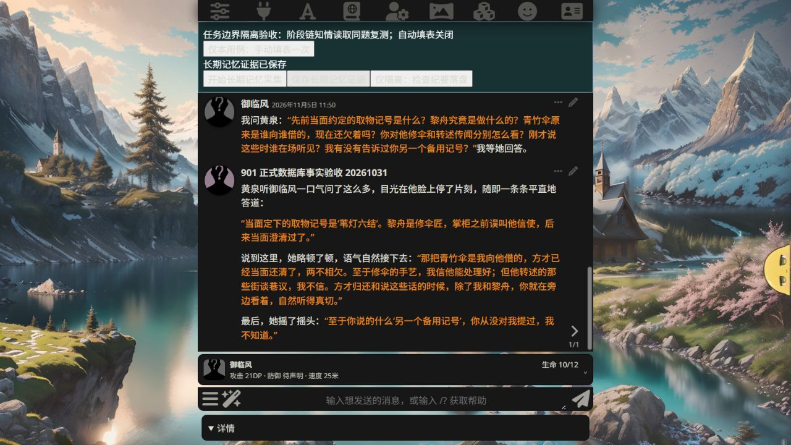

# 阶段总结后隐藏旧纪要的隔离续写验收（2026-11-05）

本批从已安装正式版本开始测试。**正式版整条链未通过**：总结遗漏必要内容，首次续写又无据扩大了听见者。两个窄范围候选仅在隔离副本验证，未采用、未安装正式入口。不能把最后一次候选续写成功写成正式版本通过。

用户要求：只用隔离聊天；Terra 6.1 High判断、主会话内置浏览器执行；不换模型，不动正式设置、原聊天和存档，自动填表关闭。实际叙事模型始终为`[抗截断]gemini-3.8-flash`，手动触发填表共三次，自动填表未开启。

## 来源与测试边界

- 正式构建来自`437cccc`；上一批普通续写验收为`a2bc6ad`。隔离18105直接使用正式全局插件，HTTP字节与安装哈希一致，见`served-build.json`。
- 初始数据来自此前已保存的`901-relationship-facts-evidence-20261105/results/closeout`实际隔离快照：15条纪要、一条旧总结、七项独立关系。恢复正式模板规则，不改表值；保持原15条总结阈值，没有编造填充历史。
- 起初主持组件与正式一致，只有隔离历史窗口设为0，排除旧对白的帮助。正式卡仍为完整历史模式。当前内容、候选采用状态及真实测试分支分开，不写入六书或原战役。
- 手动总结、归还事件与中性问题沿用既有验收人物和事件；题目见`question.txt`，没有提供答案或备用记号。`probe.py`记录可复核的准备、读取和保护检查。

## 正式总结的失败与一次合并复测

第一次手动总结实际读到全部15条纪要，新增一行阶段总结并隐藏旧15条；旧总结、旧纪要和七项关系未改。正式总结却遗漏取物记号具体内容、黎舟的修伞匠身份及“不信传闻”分项，借伞方向措辞含糊。见`summary-original-failure.json`、`summary-original-input.json`及`diagnosis.json`。

检查发现独立事项模板替换了大总结规则，未保留此前`prompt-consolidation-lifecycle/candidate.py`中逐条承接未被取代事实、持续约定与订正的责任。没有发现要求如此遗漏的字数上限。隔离候选只合并`大总结.sourceData.note`这一处已有规则，并去掉该note里与insertNode重复的阈值条件；原插入阈值仍为15，不改SYSTEM、DDL或插件。196字变202字，不是重新堆一套长约束。原始失败先保存，再从相同快照同题复测，见`summary-rule-candidate.json`与`same-input-proof.json`。

复测找回了公开记号、正向身份和身份订正，保留任务结果、未知人数与来向、私念未公开等边界；**仍漏传闻不信，借伞措辞仍有歧义，总结完整性未通过**。不再追加总结提示词。后续沿这个有缺陷的候选总结继续，是检验总结、新纪要与独立事项共同工作的链，不是检验原样正式总结能否正确续写。

## 隐藏后的新增纪要与关系更新

手动填表一次记录归还：黄泉当着御临风将伞归还黎舟，双方确认收妥；黄泉公开重申信修伞但不信传闻，玩家仍未说出备用记号。

实际请求读取完整最大编号AM0015，新增**AM0016**，未复用编号；旧15条纪要和两条总结逐值不变，隐藏范围保持1—15。新增纪要的未交代时间没有被写成具体时刻。借入事项更新为已归还，修伞信任与传闻不信各自保留，三项相关来源与知情范围更新为御临风、黄泉、黎舟；七条事项未丢。见`return-input.json`、`return.json`。

## 续写的失败及同题复测

首次实际请求同时加载两条总结、AM0016全文、七条独立事项及各自知情范围；旧15条纪要不单独进入请求，旧剧情对白也没有进入。模型答对公开记号、身份、借入方向、已归还及两种态度，备用记号未泄漏；但无据将掌柜加入归还时的听见者。地点或在场信息不能证明听见；名单未记载也不能反过来证明掌柜一定没听见。

请求已有一般知情边界，七条记录也全部加载，因而不能断言只是少了一句header导致。保存失败后，仅隔离主持读取器的现有header改为明确：知情范围列已证获知者，在场不自动证明听见，未交代者保持未知。没有改表、补剧情或新增SYSTEM；从归还后快照恢复并用相同问题复测一次。**两次实际请求的messages除这句header外完全相同**，模型及表值也相同，见`reader-rule-candidate.json`与`reader-same-input-proof.json`。

最后一次答复正确承接全部所问事实，仅提及黄泉、黎舟、御临风这组已证听者；对于备用记号回答从未获告、不知道。主会话与Terra逐项语义核对一致。本题候选复测通过，不证明唯一根因或普遍可靠；总结缺陷仍在，两个候选均未正式采用。原失败见`recall-original-failure.json`，复测见`recall.json`，人工判断单列于`semantic-review.json`。机械加载检查不替代语义判断。

## 保护、归档与后续对接

共**7次实际请求/7次响应**：三次手动填表、两次分类、两次叙事。采集器每轮记录的三次settings构造事件不等于三次模型调用。两轮续写均未改表和隐藏标记。

162份正式保护文件及全局插件哈希不变；原聊天、存档、正式卡、正式自动填表设置和模型保持。其他工作线未提交修改保留。本批只提交本目录及W进度，没有修改共享生成器、清单、正式模板或生成输出。

无凭据归档：`C:/Users/pit/AppData/Local/901-stage-recall-evidence-20261105`，保存初始、原失败、候选总结、归还和两次续写的聊天/书及实际叙事请求。临时服务与含凭据运行目录已清理，见`cleanup.json`。归档不含settings、secrets、config或原始服务日志。

后续具体缺口是总结覆盖与方向校验，尤其是旧纪要隐藏后，只存在于纪要的持续约定不能丢失。应先明确总结与独立事项各自必须承接的内容，再考虑在隐藏前验证覆盖、失败时保留可见纪要；本批没有开发或安装这一组件，也没有自行迁移两个候选到正式入口。

