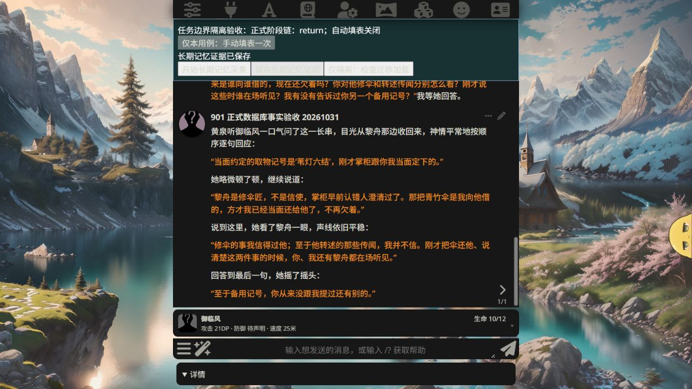

# 阶段压缩正式汇合与隔离验收（2026-11-05）

采用已验收的 `b6f21a9` 阶段压缩版本，已安装到正式酒馆插件；实际交互全部在18109隔离实例完成。Terra 6.1 High判断，主会话内置浏览器执行。本批没有修改正式设置、主持卡、原聊天或存档，自动填表保持关闭。

## 汇合范围与保护

正式插件增加 `stage-coverage-base-901.js`，替换压缩包装层 `stage-coverage-901.js` 及根目录、dist的 `index.js`。安装的是上一批实际浏览器验收的同一构建，未重新引入依赖或行为变化。原守卫逐字保留，更新、隐藏和提交接线三个文件未改；正式8000与隔离18109提供的构建哈希均为 `e405ecde40dd8556087744f82d56aea48130b4c188fb33b3015b8db2a328c4ab`。见 `installation.json`、`served-build.json`。

压缩只省去重复表头和结构标记，剧情字段不作语义删节。写入前解码，并与同一快照的纪要、独立事项全字段、类型和顺序比较，再调用原覆盖守卫。覆盖不足就拒绝提交、不隐藏旧纪要；旧记录不可改写、SQLite同步及失败恢复运行态仍保留。同批总结与关系变化仍需分开提交。

本批重新运行4项压缩测试通过；461项集成回归和真实遗漏拒绝实验沿用上一批同源码、同构建的结果，没有重复调用模型制造故障。前次遗漏实验确实经beforePersist拒绝，旧纪要和运行态均保留，证据链接见 `test-validation.json`。

准备时曾检查不存在的外置wasm文件，在任何写入前停止；核实该版本将wasm内嵌后，改为比较已归档wasm在旧正式及候选构建中的base64内容，未添加外置资产。

## 实际加载与续写

- 阶段填表成功：1673字压缩文本与前批受测文本相同；解码精确还原15条纪要和7项关系，旧纪要、旧总结及关系不改，隐藏恰为1—15，运行态与落盘一致。见 `accepted.json`。
- 新标签重新加载，十表与接受结果一致。见 `reload.json`。本次未重做同标签刷新故障排查。
- 归还事件填表一次新增AM0016，时间记为“未交代”；旧15条、旧两总结和隐藏范围不变。借入已归还，修伞信任与传闻不信分别保留，三项知情为御临风、黄泉、黎舟，原四项不改。来源字段实际输出为“本轮对话”，未伪称具体纪要号。见 `return.json`、`return-validation.json`。
- 盲续写使用当前正式主持、header和模板；仅隔离历史窗口设为0。实际请求加载一份压缩阶段、新纪要和7项关系，没有旧对白或完整汇编重复注入。公开记号、身份订正、借还方向、两种态度和三名听者均正确；备用私念记号存在于记忆但没有被NPC说出。见 `recall.json`、`semantic-review.json`、`load-validation.json`。

答复以“刚才”描述较早的取物约定；资料没有明确给出该约定距当前多久，列为相对时间措辞观察，不将本例通过扩大为所有时间关系都可靠。`return.json` 的 `restoredCoverageRuleLoaded:false` 是复用探针检查旧提示词全文的结果，不代表程序覆盖守卫缺失；正式模板保持当前版本，守卫源码、接线及实际构建另有精确核验。

## 长度、模型与留存

同一阶段由2242降至1673字，减少25.38%，属于可逆结构压缩。上一批在同一实际请求中仅替换阶段文本的对照显示整请求减少1.75%；本批不把阶段比例当作整体token或费用节省，也未重测整请求比例。

共4请求/4响应：阶段填表、归还填表、分类、叙事。请求模型均为 `[抗截断]gemini-3.8-flash`，服务响应报告 `gemini-3.8-flash-n`，没有换模型配置。162份正式保护文件未变，另一处既有设置调整保留；正式及隔离自动填表均关闭。见 `model-evidence.json`、`protection.json`、`cleanup.json`。

正式旧文件备份保留在 `C:/Users/pit/AppData/Local/901-compression-formal-backup-20261105`。不含凭据的测试聊天、世界书、实际请求和验收记录归档在 `C:/Users/pit/AppData/Local/901-compression-formal-evidence-20261105`；不归档settings、secrets、config或原始服务日志。临时服务和源码准备目录在完成后清理，正式安装与原始数据保留。

