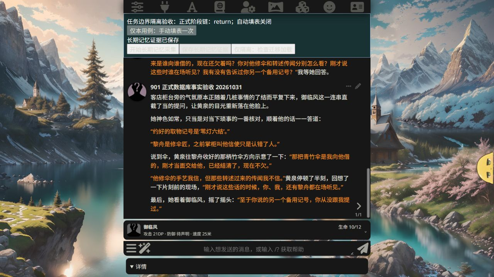

# 阶段保真压缩候选（2026-11-05，仅隔离）

用户要求压缩阶段总结，保留已验收覆盖校验，不丢剧情事实、独立关系或知情范围；覆盖不足保留旧纪要。沿正式`48b8e09`，仅18108隔离验证。Terra 6.1 High判断，主会话内置浏览器执行，不换模型、不改正式设置、原聊天和存档，自动填表关闭。

## 实现与范围

本批采用**可逆结构压缩**：共同表头只写一次，以制表符分列保存每个原始字段；剧情全文和对白没有语义改写或删节。字符串使用JSON转义但省去外围引号，非字符串用`~`标记，字符串开头的字面`~`转义；空串、null、数字、制表、换行及Unicode保留区别。首次JSON数组行版本仅缩小9.1%，改用TSV后同一阶段由2242字降至1673字，减少25.38%。这不是更深的剧情概括，也不承诺今后所有阶段都有相同比例。

独立关系仍逐项保留主体、对象、事项、种类、状态、来源及知情范围，另保留明确借还方向。历史纪要按原顺序读取，后续纪要与当前事项承接变化；不把私念或未交代者升级为NPC已知。

正式已验收的守卫源码作为`stage-coverage-base-901.js`逐字保留。新包装层先解码压缩文本，与写入前同一快照的可见纪要、所有关系字段、顺序及类型严格比较，再由解码事实重建原表示并调用原守卫。不是编号覆盖或模型自评。原有阈值、旧纪要/旧总结不可变、同批关系变化拒绝、SQLite同步、提交失败恢复运行态均保留；同批新纪要仍不提前隐藏。

仅临时构建替换`stage-coverage-901.js`并增加上述base文件；更新入口、隐藏入口和提交组件沿正式源码。候选正式汇合需采用这两份源码及新构建。本批无正式安装，不改六书、表结构、正式header或模板note。隔离主持仅将历史窗口all改为0用于盲测，并加入既有采集控件。

## 验证记录

4项纯函数测试通过，覆盖实际缩短、全字段往返、缺失私念纪要/知情修改/反向借还拒绝、特殊字符与类型、原守卫及可见范围。461项定向插件回归全部通过，含实际SQLite同步与重载、隐藏入口和失败回滚。临时测试准备曾漏复制嵌套index.js，并把复用SQLite测试放错作用域，修正后同组重跑通过；失败日志保留，不算产品运行失败。

实际页面先验证覆盖不足：只在临时服务字节中删除AM0003后，手动填表返回false；真实调用栈在beforePersist的覆盖守卫拒绝。十表、旧总结、七项关系、hidden空集合及全部storageFrame不变，页面导出的运行态也恢复原值。即使私念关键词还出现在其他纪要中，也不能补足缺失来源行。此为人为漏项测试，不冒称模型自行漏掉了该行。

移除故障并核对HTTP哈希后，从同一快照手动阶段填表成功。实际1673字压缩文本解码与15条来源/七项关系逐字段一致；旧行不变，隐藏恰1—15。新标签重载十表与已接受结果一致。离线核验曾被Windows临时文本换行转换影响，确认JSON原值不含CR后改为字节传递重验通过，没有修改运行数据或额外调用模型。

归还手动填表新增AM0016，时间未交代；旧15条、旧两总结、隐藏范围不变。借伞已还，修伞信任与传闻不信分别保留，三项知情范围为御临风、黄泉、黎舟，原四项关系不变。见`return.json`、`return-validation.json`。

实际盲续写请求仅含一份压缩阶段及新纪要、七项关系，旧对白和原完整汇编没有另路重复加载。答复正确给出苇灯六结、修伞匠身份订正、黄泉向黎舟借入后已还、两种态度和三名已证听者；备用记号未获告，未泄露瓷雀二鸣。主会话与Terra语义审读通过，见`recall.json`、`semantic-review.json`。该结论限本组共同加载的单次续写，不证明任意压缩表述都能被模型正确理解。

## 实际长度与限制

`measurement.json`以真实叙事请求为候选，在**同一请求内只把压缩阶段替换为相同来源的完整汇编**构造对照，没有增加模型调用：

| 范围 | 完整表示字符 | 压缩表示字符 | 减少 |
| --- | ---: | ---: | ---: |
| 本阶段 | 2242 | 1673 | 25.38% |
| 含本阶段与独立关系的消息 | 2823 | 2254 | 20.16% |
| 整个请求文本 | 32448 | 31879 | 1.75% |

本地同一o200k_base估计，阶段1844→1442 token，整请求25107→24705；它不是Gemini tokenizer或实际计费量。其他提示内容未改，因此整体节省有限。剧情文本仍线性增长；本版没有实现跨事件语义归纳，也没有通过另存长文再注入来伪造节省。

## 保护与交接

共5请求/5响应：一次人为漏项拒绝、一次正常压缩、一次归还填表、一次分类和一次叙事。请求模型均为`[抗截断]gemini-3.8-flash`，响应报告`gemini-3.8-flash-n`，见`model-evidence.json`，没有换配置或新增评审模型。正式与隔离自动填表均关闭；162份正式保护文件及正式插件哈希不变。拒绝阶段的世界书内容与可见性不变；与加载前夹具相比仅order字段变化，不能宣称整份世界书字节相同，见`rejected-worldbook.json`。

源文件为`compact.mjs`与原守卫副本`stage-coverage-base-901.mjs`；实际构建差异见`source.patch`、`build-source.json`，隔离准备及检查见`lab.py`。候选仍待正式采用，不能直接覆盖正式入口或旧聊天。无凭据归档位于`C:/Users/pit/AppData/Local/901-summary-compression-evidence-20261105`，包含各阶段测试聊天、世界书、实际续写请求及精确受测构建；不含settings、secrets、config或原始服务日志。临时数据、凭据及构建目录清理见`cleanup.json`。

