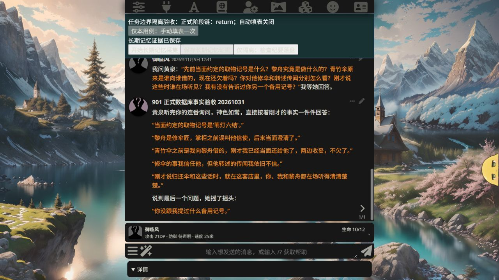

# 阶段汇编覆盖校验与隐藏保护（2026-11-05，隔离候选）

用户授权修复阶段总结遗漏与借伞方向含糊，加入隐藏前覆盖校验；仅隔离验证，不换模型，不动正式设置、原聊天或存档，自动填表关闭。Terra 6.1 High判断、主会话内置浏览器执行。接续`acacec6`记录的真实失败；本批不是正式安装授权。

## 实现范围与代价

模型自由摘要的编号齐全、关键词命中或模型自评都不能证明涵义完整。本批选择可验证的无损回退：新总结正文由组件生成**阶段保真汇编**，按写入前可见纪要顺序保留编码、时间、概览、纪要全文和重要对白，附该快照的独立关系及来源/知情范围。借入事项按主体、对象、关系种类展开借入方、借出方和归还义务，不从“借”字猜方向。原始模型响应另存证据，未经验证的自由摘要不混入记忆。

这是保真机制，**不宣称模型摘要能力已修复，也不承诺缩短上下文**。来源原文中的歧义仍保留，但结构化关系明确借入方向；历史状态保留时序，后续纪要和当前事项承接变化。私念及未知信息仍保留原有知情限定，不因为进入汇编而公开。

`coverage.mjs`从同一阶段快照生成期望正文；隐藏前逐字核对覆盖、旧纪要和旧总结未变、关系快照一致。阈值读取已有配置，仍为15；同批新增纪要不计入本阶段、不提前隐藏。若总结与关系更新发生在同一批，本候选拒绝混合快照，需分批提交；不猜测变化的先后。

`integrate.py`仅修改临时构建：统一与卡级SQL填表在同一事务内用现有`replaceAllData`同步SQLite，逐表核对运行态与待提交值；V2记录追加对应`sheet_replace`，原生快照路径同样编译。实际隐藏入口在暂存隐藏标记前执行覆盖校验。校验失败或组件异常不保存新总结、不隐藏来源，并恢复已保存的运行态；保存失败沿用原事务隐藏状态回滚机制。正式源文件和正式插件均不改。

## 本批发现并修复的实际问题

原组件发现新总结行便隐藏全部旧可见纪要，没有覆盖证明。第一次隔离接入已能拦截人为损坏的汇编，但正常写入只改了JSON：SQLite仍持有模型原摘要，后续导出和新标签读取都返回旧文。虽然V2操作中有正确的`sheet_replace`，不能因此判通过；首轮失败与重载证据保留在`accepted-first-inspection.json`、`first-reload-inspection.json`等文件。

真实SQLite回归先复现“仍读到模型未证实摘要”，再验证提交内同步及重载一致。另一个事务缺口是隐藏前校验抛错时未恢复已执行SQL的provider：红测确认没有reload，修订后恢复旧运行态。不能只确认聊天未保存而忽略运行态残留。

## 来源、候选与机械对接

- 来源：上批`stage-recall/initial.json`的15纪要/一条旧总结/七项关系；两份实际失败摘要用于负例。当前模型配置沿正式入口复制，实际调用另核对。
- 采用范围：仅18106新隔离实例及临时源码构建。上批隔离知情读取header继续用于本次盲续写，正式入口未采用它；总结规则文本保持正式版本，没有追加总结提示词。
- 目标：数据库总结提交、SQLite同步、V2回放、flight-mode隐藏前守卫；不改表结构、六书生成器、清单或正式生成输出。
- 对接文件：`source.patch`、`coverage.mjs`及`integrate.py`；测试正文见`coverage.test.mjs`、`commit-tests.txt`、`hidden-tests.txt`、`sql-sync-tests.txt`。`probe.py`仅准备和核对隔离用例，不向模型直接发送请求，实际交互由内置浏览器执行。

## 验证记录

纯函数5测覆盖两份真实失败摘要、反向同词/同义自由摘要拒绝、逐项保真、私念限定、来源漂移、阈值和同批新纪要。相关插件最终回归461测通过，包含真实SQLite同步/重载、实际隐藏入口拒绝和事务恢复；日志保留红绿过程。

最终构建实际页面验证如下：

1. 故障注入仅在临时服务提供的字节中给已编译汇编追加损坏标记，不进入候选源码。实际手动填表返回false，浏览器堆栈确认在beforePersist覆盖检查处拒绝；全十表、hidden及全部既有storageFrame不变，页面导出的运行态恢复到原值。这是人为损坏触发保护，不冒称模型产生了该错误。
2. 移除故障并核对HTTP哈希，从同一快照手动填表一次。2242字汇编逐字保留15条各字段及七项关系快照，明确黄泉向黎舟借入、黄泉尚须归还黎舟。旧纪要/旧总结/关系逐值不变，隐藏恰为1—15，实时API与落盘一致。新标签重载后全十表仍一致，页面显示15/15来源完整。
3. 仅隔离追加既有归还事件，手动填表一次得到AM0016，时间未交代。旧两总结及15条纪要未改；借伞状态变为已归还，修伞信任与传闻不信各自保留，三项来源和知情范围更新为御临风、黄泉、黎舟。
4. 历史窗口为0，原中性问题实际续写一次。请求含完整汇编、AM0016及七项关系/知情范围；旧纪要不在汇编外重复注入，旧剧情对白不进入请求。答复正确说出公开记号、修伞匠身份订正、借入及已还、信修伞但不信传闻，只确认御临风/黄泉/黎舟这组听者；对备用记号表示未获告，没有泄露瓷雀二鸣。主会话与Terra语义核对通过，见`recall.json`和`semantic-review.json`。

实际共**7次请求/7次响应**：首构建故障拒绝、首构建运行态同步失败、最终构建故障拒绝、最终正常汇编、归还填表，共五次手动填表；最后一次分类加一次叙事。全部使用`[抗截断]gemini-3.8-flash`，未增加评审模型或隐藏重生成。

## 收尾保护与设置例外

161份正式保护文件与正式插件哈希不变，原聊天与存档保留；正式和隔离自动填表均关闭。本批未写正式设置，但其`settings.json`哈希在测试期间变化。只读核对发现当前自定义请求体包含/排除字段与起初隔离副本不同，其中包含model、messages等键；未找到与起始哈希完全匹配的备份，不能保证其他键的完整前后差异。已询问用户变化来源，保留当前正式文件，没有回退。此例外单列于`protection-delta.json`、`settings-change-review.json`和`protection.json`，不宣称全部162文件未变。隔离实际调用模型始终如上，验收结果不依赖后来的正式设置变化。

无凭据归档：`C:/Users/pit/AppData/Local/901-summary-coverage-evidence-20261105`，含各阶段测试聊天/世界书、实际叙事请求和最终候选构建。临时服务、运行凭据及构建目录清理见`cleanup.json`。不归档settings、secrets、config或原始服务日志。正式汇合未执行；本候选只验证保真与隐藏保护，进一步压缩仍需另行解决。

