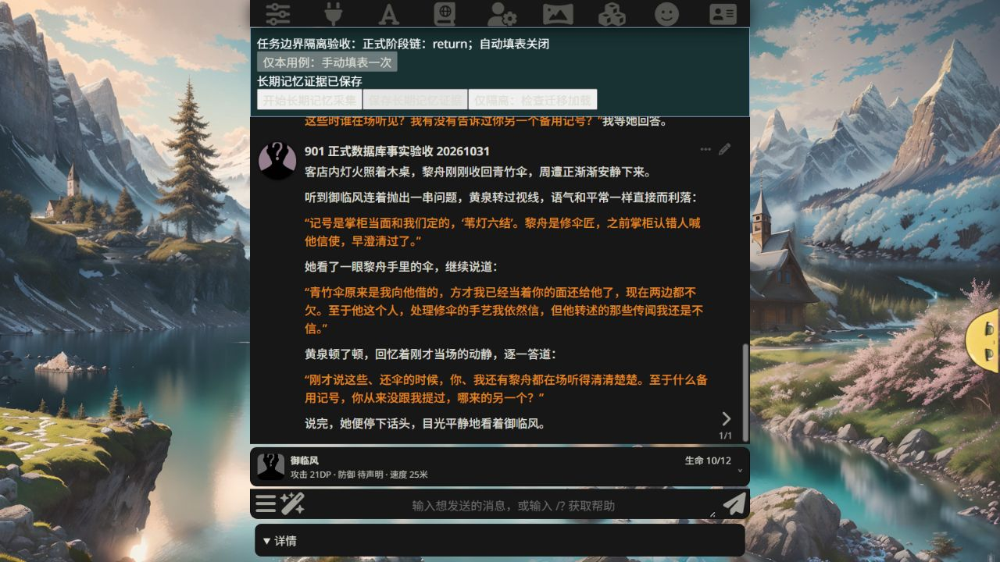

# 阶段保真汇编正式汇合与隔离验收（2026-11-05）

用户采用`bb6db93`的阶段保真汇编、隐藏前覆盖校验和借伞方向修复，授权正式汇合并用隔离聊天验收；另一处正式设置调整按用户确认保留。Terra 6.1 High判断、主会话内置浏览器执行。未写正式设置、角色卡、原聊天或存档，自动填表保持关闭。

## 安装范围

正式插件：`D:/github/sillyTavern/public/scripts/extensions/third-party/shujuku`。定点安装四个源码文件及`index.js`、`dist/extension/index.js`，没有改变六书、模板或依赖。源码补丁沿[已采用候选](../summary-coverage/README.md)，辅助文件统一为原构建的LF后，四份源码逐一与候选构建哈希相同；本批直接部署上批实际浏览器验收过的精确二进制，没有重新编译或夹带临时故障注入。源码中的候选注释保持原样，以维持字节一致。

核心变化仍为组件层：未验证的自由摘要替换为逐字段保留15条可见来源和七项关系的阶段汇编；结构化借入事项明确借入方、借出方和归还义务。提交内同步SQLite；隐藏前校验来源覆盖及旧行、关系快照；失败不保存、不隐藏，并恢复运行态。保留原文中的历史歧义，同时明确结构化方向，不冒称已修复所有来源措辞。

这是**无损汇编，不是摘要压缩**。同批总结与关系更新仍需分开提交，不混合前后快照；本批没有扩大已采用功能。表结构不变，旧聊天不作迁移或重写。

安装前备份：`C:/Users/pit/AppData/Local/901-summary-formal-backup-20261105`。逐文件前后哈希见`installation.json`。正式8000与隔离18107实际HTTP提供的插件均为`afea14c7c3fc2f7176674cefdac8ef52dd98077b1a378cd9a45aaff65b0f3aa4`，见`served-build.json`。这证明服务器提供的新构建；没有操作或强制刷新用户已打开的正式聊天页。

## 隔离条件与实测

18107使用独立数据目录，直接加载正式全局插件，没有用户目录替代插件。当前正式主持脚本、知情header及模板规则原样复制；只为盲测把隔离主持历史窗口all改为0，并增加现有诊断采集控件。没有带入上批未正式采用的知情header或总结note。沿已有真实夹具：15条可见纪要、一条旧总结、七项独立关系；测试角色为901正式数据库事实验收，未操作迁移原聊天副本。

1. 手动阶段填表一次成功。全部15条来源字段完整进入汇编，明确黄泉向黎舟借入青竹伞及尚须归还。旧15条、旧总结和七项关系逐值不变，仅隐藏行1—15；页面实际运行态与落盘十表相同。见`accepted.json`。
2. 关闭页后用新标签重载，同一聊天导出的十表与上述结果完全一致。见`reload.json`。没有再次复现同标签刷新黑屏。
3. 在隔离聊天加入既有归还用例，再手动填表一次。新增AM0016，时间未交代；借入事项变为已归还，传闻不信和修伞信任分别保留，三项知情范围更新为御临风、黄泉、黎舟。旧纪要、两条总结和隐藏集合不变；私念未进入关系公开记录。见`return.json`、`return-validation.json`。
4. 通过实际页面发送既有中性问题，分类一次、叙事一次。请求加载完整汇编、AM0016和七项关系及其知情范围，旧对白及汇编外的旧纪要均未进入。答复正确给出苇灯六结、黎舟修伞匠身份订正、黄泉借入后已还、修伞信任但传闻不信；仅确认三名已证听者，对备用记号表示未获告，没有说出私念瓷雀二鸣。主会话与Terra语义核验通过，见`recall.json`、`semantic-review.json`。结论限本组共同加载的单次盲续写，不归因于单一记忆来源，也不宣称叙事风格所有问题均已解决。

本批共**4次请求、4次响应**：两次手动填表、一次分类、一次叙事；没有自动填表、额外评审模型或失败重生成。请求模型均为`[抗截断]gemini-3.8-flash`，服务端响应报告`gemini-3.8-flash-n`，两者在`model-evidence.json`分列。响应标签不同不证明本批换了模型或设置了请求体覆盖；本批复制时当前正式包含/排除字段均为空，完整沿用另一处调整后的现状。

## 验证与收尾

本批新跑5项覆盖测试通过；沿用相同源码/二进制此前461项插件回归和实际拒绝路径证据，没有把它们冒称为本轮重跑。见`test-validation.json`。正式与隔离自动填表均关闭；从本批起点到收尾，162份正式保护文件哈希均未变，正式插件安装哈希保持正确。另一处设置未被覆盖或回退。

无凭据验收归档：`C:/Users/pit/AppData/Local/901-summary-formal-evidence-20261105`，包含测试聊天、世界书、实际续写请求及本批记录。临时服务、数据凭据和源码复原目录清理见`cleanup.json`；正式安装及安装前备份保留。

