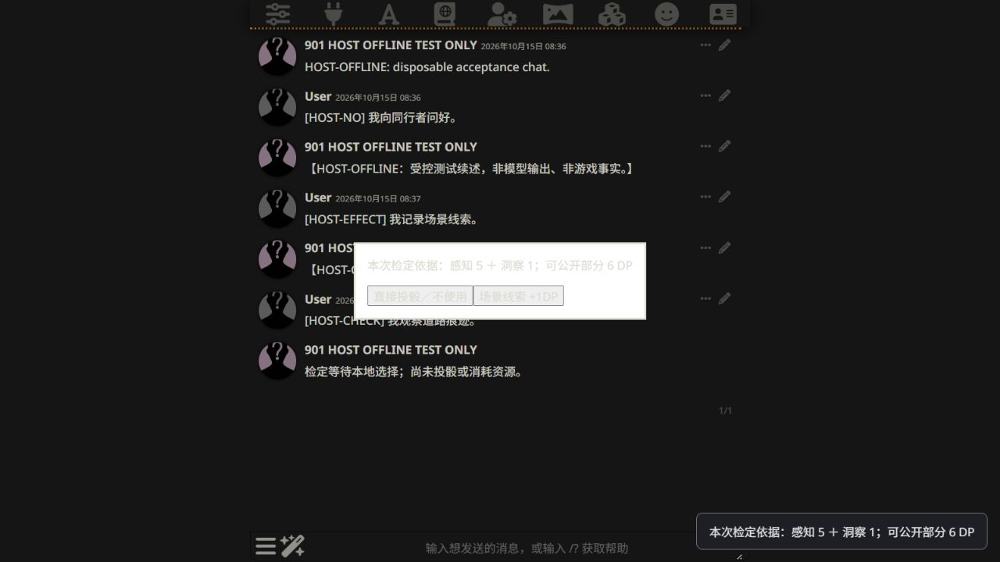

# Actual-host offline acceptance — 2026-10-15

## Scope and isolation

Executed the installed SillyTavern 1.19.0 (`06bde939f`), TavernHelper 4.11.3 and MVU (displayed build `2026-10-07 01:40 d804275`) in a separate, disposable profile on loopback port 8010. The new card/chat was named `901 HOST OFFLINE TEST ONLY`. Existing profiles, cards and saves were not used or edited. However, the installed host auto-updater ran at startup and updated the shared TavernHelper extension from 4.11.2 to 4.11.3 (confirmed by shutdown logs and installed manifest). Auto-update is now disabled in the disposable configuration. The extension installation was therefore not fully isolated. Canon, formal GM card, worldbooks, willpower rules and the demo effect's scope were unchanged.

`host-offline-responses.mjs` served three exact test adjudications and visibly labelled test narration on loopback port 9020. It has no upstream transport or credentials and rejects unrecognized requests. Actual TavernHelper generation and SillyTavern transport used this endpoint; this was not the earlier host shim. Final counters: 9 classifications, 8 narrations, 0 rejected requests, including diagnostic runs before fixes. No external LLM API calls were made. MVU's existing CDN loader was used. No simulated normal-play fallback was installed.

Disposable configuration, chat and per-stage disk evidence remain under:
`C:/Users/pit/.codex/visualizations/2026/10/15/01a13e33-d582-7a41-9789-c60def6ebce0/host-acceptance`.

## Confirmed offline functionality

34 tests passed in the existing adjudication-gate, replay-check and MVU-adapter suites. One focused test was added in this pass: carrying initialized state without a saved operation across an empty host floor. Both the gate script and test response server passed `node --check`. Other preexisting/concurrent rules changes were left intact.

The earlier [offline acceptance](OFFLINE_ACCEPTANCE.md) records trusted attribute/main-skill/subskill calculations, public disclosure boundaries and controlled narration-failure recovery. Those specific subskill and forced-failure cases were not repeated in the actual host.

## Confirmed actual-browser functionality without an LLM

| Scenario | Observed in actual host and saved chat |
|---|---|
| NO_CHECK | Initial revision 0, no operation. A later NO_CHECK carried revision 2 and the same two operations without changing mechanical state. |
| DIRECT_EFFECT | Existing `demo.scene-cue` committed revision 1 with one effect/operation. Native regeneration retained the identical operations hash and did not duplicate it. |
| Active choice | CHECK_REQUIRED displayed trusted 感知5 + 洞察1 = 6 public DP. Dialog offered skip or the existing +1 effect. Pending state remained revision 1, with the effect unconsumed and no committed check. Panel exposed no DC, success counts, hidden modifiers or NPC mechanics. |
| Refresh while pending | Reload, reopen the disposable chat and use native Regenerate: same player floor 5/swipe 0, pending request and operation ID; dialog reopened without another classification. |
| Cancel | Escape preserved the pending request, revision, effect, operation hash and resources. Native Regenerate reopened the choice without another classification. |
| Choose +1 | Public pool became 7 DP; revision 2, two operations, effect consumed once. |
| Committed regeneration | Native Regenerate retained the identical complete operations hash, revision and resources. Refresh followed by native Regenerate did the same, without another classification. |
| Automatic check | A subsequent explicit check with no active effect completed at 6 DP without a choice interaction: revision 3, three operations. |
| Chat turns | Choice, cancellation, refresh and regeneration preserved the original three player turns. Only two deliberately sent subsequent test actions increased the count to five. |

The SHA-256 of the persisted operations map after effect commit and replay was `C22FFB38523F2D7F0A7377508282EBE54763C9430D4702C03179A30BF4EA29D0`. After choosing +1 it was `9B104C5D0E0C6766086E0E65880B5C72B0CE687EA187C19F310282E509DD4798`; both committed regeneration runs and the following NO_CHECK retained it. This verifies saved-result reuse, not merely a matching operation count. Pending-stage disk snapshots likewise retained the earlier map and resources.



## Host integration defects fixed

- Actual MVU did not automatically inherit this namespace onto empty new floors. The existing guarded adapter carry operation now also carries an initialized namespace without requiring a prior operation. The gate uses this for missing-state anchors and NO_CHECK continuations.
- TavernHelper runs scripts in a zero-size iframe. The existing pool and dialog now mount in the host document and clean up on script unload.
- Native regeneration deletes the latest assistant floor before the hook. Pending requests are now also saved in the original player floor's metadata, with unchanged player text, readback verification and an awaited chat save before opening the modal. Recovery validates the original text/swipe and reuses the request; committed operations still take precedence. Assistant notices remain in place.

## Remaining acceptance and limitations

Live-model classification quality, appropriate rule selection, DC reasoning, worldbook context, private-safe narration and provider failure behavior still require a working subscription. Arbitrary swipe switching and multi-writer atomicity were not established by this bounded pass. The existing theme gives the native dialog low text contrast (see screenshot); the separate public-pool status remains legible. Styling was not expanded in this persistence-focused pass.

## Files changed in this pass

- `replay-gate-script.example.js`: actual-host state carry, host-document UI and durable player-anchored pending recovery.
- `../mvu_poc/adapter.mjs`, `../mvu_poc/adapter.test.mjs`: guarded carry without an operation and one focused regression test.
- `offline-browser.mjs`: existing shim compatibility with chat save/message-update callbacks.
- `host-offline-responses.mjs`: isolated loopback test responses/static assets only.
- `host-offline-choice.png`, this report, and the cross-reference in `OFFLINE_ACCEPTANCE.md`.

From `TRPG outputs`:

```sh
node --test work/rules_engine/gm_runtime/adjudication-gate.test.mjs work/rules_engine/gm_runtime/replay-check.test.mjs work/rules_engine/mvu_poc/adapter.test.mjs
node --check work/rules_engine/gm_runtime/replay-gate-script.example.js
node --check work/rules_engine/gm_runtime/host-offline-responses.mjs
```

For future reruns, use only a disposable profile pointed at `http://127.0.0.1:9020/v1`, model `901-test-only`, streaming off. Never point an existing game profile at these responses. The exact test actions and asset relocation are defined in the response server. The disposable host's saved configuration and scripts document the setup used here.

