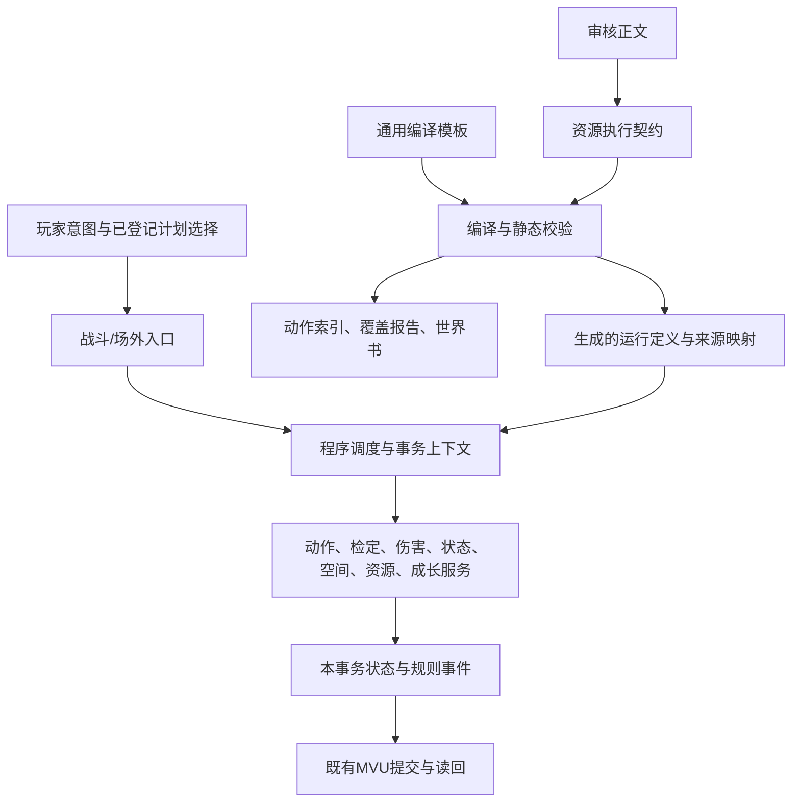

# 901 通用规则执行器与资源模块详细设计

初稿：2026-10-24；最新规划：2026-10-25。范围：两个仓库中的资源双版本、普通动作、人物实际取得、JS执行、分类器、状态及六书接入。

**文档状态：详细设计，供后续实施。**用户已选择“共享机制＋声明式资源组合”的方向并要求开始详细设计；下面的接口、目录和迁移安排是工程设计，不表示已实现，也不构成新的游戏规则裁定。初稿只修改设计文档和接续入口；后续实际实施及验证记录见末节，各段设计不自动视为已实现，安装版本仍单独记录。

## 1. 目标、边界与验收原则

资源增加时，增长的主要是审核正文、结构化配置和必要的行为样例；已有机制能够表达的新资源不再增加资源同名JS分支。新机制可以增加JS，但增加的是可复用的领域操作和消费者，例如“带恢复价格的伤势”“一次身体动作减费”“按来源保存每日回复量”。

引擎不负责从自然语言自行裁定规则。自然语言审核版与执行契约继续是两份资源表示；分类器、运行数据和世界书都是生成视图。配置中的公式、操作和策略须通过编译校验，不允许任意JS、`eval`、任意状态补丁或模型提交的执行代码。

必须保持的边界：

- 已有明确规则直接实现；原语缺失属于 `implementationGaps`，不转嫁为用户缺参数。
- 后期人物模板不是取得记录。T0、D3、后期可选资料分开，不自动获得属性、物品、能量余额或学习资格。
- 保留旧卡历史隔离断言，不用更新源卡覆盖历史夹具。
- 观澜成长减费与悟法XP支付用途执行已存档规则，不在架构迁移中重新解释。
- 脆弱诅咒与报偿的跨施法者效果按用户采用独立结算；该采用不自动扩为所有同名效果的通则。
- 未决规则仅阻止依赖它的执行路径，不阻止无关功能开发；禁止通过原始状态写入绕过。
- 本地开发、验证候选、实际部署分别记录。没有外部模型调用、资料外发、推送或部署的新增授权。

不追求把一切内容压成少数算术操作。伤害、防御、行动、治疗、空间移动各有规则顺序，应该各有共享服务。也不建立全新游戏框架、数据库、网络服务或资源插件下载系统；沿用浏览器ESM、Node本地测试、Python作者/构建工具和现有MVU接入。

## 2. 已有实现与具体问题

初稿时基线来自 [检查点](../replay_research/six_books_20261023/checkpoint-20261024.md) 末节及现有审计报告，不是本设计新跑出的测试结果：270契约、104注册动作、76合法法术基础程序、132合法法术无基础程序、fullyVerified=0。最近完整JS回归535/535；作者解析Python 3/3。六书候选443条＋1主持锚点，仍 `candidate_not_installed`。吸取魔力已有程序但每日口径仍有未决阻挡。

270份契约包括215法术条目（208合法、7禁用）、45资源、3规则、3人物模板、2技艺、1能力组合及1普通动作规则。76个法术和全力防御共77项资源已有 `programs`；这不意味着其余193份都是缺法术程序，人物模板、被动资源和规则应按自己的条款衡量覆盖。

| 现有位置 | 可复用基础 | 需要改进的具体问题 |
| --- | --- | --- |
| [resource-program.mjs](gm_runtime/resource-program.mjs) | 施法、普通动作、目标、公式、步骤、触发和持续专注 | 编排与各操作实现耦合；仍有施法默认参数；与战斗引擎互相导入 |
| [combat/engine.mjs](combat/engine.mjs) | 已有攻击、防御、伤害事件、动作窗口 | `kind`、角色专用动作分支仍多；部分机制从资源与旧路径同时可达 |
| [resource-effects.mjs](resource-effects.mjs) | 有限公式、条件、同类叠加、当前效果查询 | 字段/上下文类型校验不足；表达式读取与数值消费者还没有完整对应表 |
| [resource-lifecycle.mjs](resource-lifecycle.mjs)、[resource-instances.mjs](resource-instances.mjs) | 来源、持续、解除、等级限制 | 多个存储区由不同函数管理；不能只按“资源＋施法者”推定所有组件都是同一次施法 |
| [resource-pools.mjs](resource-pools.mjs)、[resource-weapons.mjs](resource-weapons.mjs) | 实际池转换、日账本、实际物品、弓装填 | 接口可以继续复用；实际枪械/投掷、全体关键词与部分选择生命周期未完成 |
| [growth-pricing.mjs](growth-pricing.mjs)、[resource-acquisition.mjs](resource-acquisition.mjs) | 已采用计费、用途隔离、逐阶段取得 | 通用化必须保留单独的学习事务和支付限制，不能当成普通计数器相减 |
| [mvu_poc/adapter.mjs](mvu_poc/adapter.mjs) | revision、operationId、复制结算、写前检查、读回 | 复用现有提交边界；补充规则版本/待续操作的可恢复语义，避免另造持久化层 |
| 资源库 `tools/compile_resources.py` | 哈希、标题、操作名、生成数据与索引 | 目前主要验证操作白名单；缺字段类型、引用、策略、消费者与分支可达性校验 |
| `author_spell_programs.py`、`author_companion_programs.py` | 已核查程序的批量写入 | 资源级知识还在逐名称Python分支中；资源契约与作者脚本可能成为相互覆盖的两个编辑入口 |

当前策略选择：采用“受限声明式程序＋规则领域服务＋编译期复用模板”。继续逐资源写回调会重复规则；允许任意脚本的DSL会把同样的复杂代码移进JSON并失去静态核查。这两条不作为目标架构。现有代码逐批迁移，不整体推倒重写。

## 3. 模块边界与依赖方向



依赖约束：入口依赖调度器；调度器依赖操作注册表和接口；领域操作依赖共享事实/状态/规则服务；数据定义不导入引擎。领域服务不导入资源名称、人物名、分类器或世界书。

目前 `combat/engine.mjs → resource-program.mjs → combat/engine.mjs` 的互相调用，逐步改为组合入口注入 `check/defense/damage/actions/spatial` 服务。事件由事务内队列分发，不要求伤害服务反向导入整个资源解释器。先使用现有函数的薄适配器，再迁出函数；一次只迁一条可验证路径。

建议新增文件仅在相应实施阶段创建，现阶段不搭空目录：

```text
work/rules_engine/
  runtime/
    context.mjs          # actor/item/scene事实及规则服务接口
    interpreter.mjs      # 有限程序的编排；不含资源专名
    operators.mjs        # 静态操作注册表及操作元数据
    events.mjs           # 事件身份、阶段、因果关系、触发调度
    instances.mjs        # 对现有多存储区的统一实例访问/生命周期
    expressions.mjs      # 有类型的公式/条件求值，逐步复用resource-effects
  resource-*.mjs         # 现有共享机制继续使用，按边界逐步整理
  combat/                # 战斗入口、地图、窗口、UI及尚未迁出的旧逻辑
  gm_runtime/            # 场外入口、计划选择、分类器、兼容路由
  mvu_poc/adapter.mjs    # 仍是持久化提交边界
```

不要求领域一律一文件或每操作一文件。`operators.mjs`可以把多个操作分派到一个伤害/状态模块；把长 `if (op)` 改成注册表只改善组织，真正通用性仍由操作语义、消费者与复用证据决定。

## 4. 资源格式、模板与编译产物

### 4.1 保留两份资源表示

审核正文保留自然语言规则及采用记录；执行契约使用稳定资源ID、版本、逐条款来源。每个独立可核查条款增加稳定 `clauseId`，记录原文定位、依赖操作、适用版本和执行状态。哈希仅证明文本版本一致，不能证明语义翻译正确，仍须逐条核查。

当前 `901-resource/1` 由兼容转换器继续接受。新增字段先明确兼容规则；出现结构不兼容时才引入 `/2`，不能把全部旧文件只改版本号。下面的接口和示例是目标形状，不能直接当作现行v1输入。

| 契约部分 | 必须表达 |
| --- | --- |
| `identity / reading / clauses` | 资源身份、适用规则与准确来源；完整条款覆盖 |
| `definition.access` | 普通可用、须学习、须实际物品或来源授予资格；不以角色姓名判定 |
| `programs` | 各实际动作、目标、费用、选择、步骤；施法作为一种动作特征 |
| `effects / capabilities` | 被动和持续效果；每个字段须有消费者 |
| `policies` | 冻结时点、叠加/刷新/额度/到期；仅引用已实现且有依据的策略 |
| `acquisition / learning` | 一次取得、升级替换、名额、前提及支付约束 |
| `inputs` | 数据或玩家选择的类型、来源、用途、何时重新选择 |
| `unresolvedRules` | 原文歧义、影响分支、推荐、采用状态 |
| `implementationGaps / verification` | 缺操作/消费者/路径与测试证据，区分编写和验证 |

`actions`等分类器元数据从规范化程序生成。作者可提供显示名、别名及明确的命令绑定，但不再同时手写另一份动作价、目标数量和消耗定义。

### 4.2 有限程序，而不是JSON形式的任意程序语言

允许：顺序步骤、基于明确布尔条件的分支、有限目标集合遍历、已登记事件订阅、定时/行动边界。每个步骤有稳定ID，输出可被后续步骤按类型引用。只允许已定义的上下文读值、整数/合法半XP、枚举、算术与有限聚合。

不提供通用 `while`、递归程序调用、任意属性路径写入、网络、文件、动态导入或JS字符串。随机选择使用可信骰源；模型不能提供骰值、公式、费用改写或执行补丁。

`actor/target/caster/item/event/choice/result`分开命名，不能把计划 `inputs` 覆盖到含真实 `P`、余额、上限、目标类型的内部上下文。缺少必需值返回缺项，不能以0或空列表掩盖。可选字段的默认值必须在操作规范中明示。

有资格读取的存档字段不等于有资格写入。状态修改统一走 `damage/pool/counter/instance/acquisition` 等服务；现有 `counter.path` 迁为可信计数器引用，旧路径仅在兼容器白名单中解析。

### 4.3 两级复用

第一层复用是JS规则操作，如 `damage`、`effect`、`poolTransfer`；第二层是编译模板，如“豁免后施加状态”“下一次攻击附加效果”“持续专注重复生效”。模板只组合已登记操作，不能提供新的执行代码。

模板存资源库的 `resources/execution/_recipes/`，按机制命名、独立版本化。参数有类型，展开后保留 `templateVersion + resourceId + clauseId + stepId` 来源映射。不同资源只填写差异；确有不同结算顺序时使用独立组合或扩展共享机制，不强塞进一个上百开关的模板。

Python作者脚本的资源专名映射要逐批退出：先导出并核对其现有契约，登记哪些资源已转为契约直接维护，再使批量作者脚本拒绝覆盖这些资源。脚本随后负责导入、模板展开和校验，不继续作为手工契约的隐藏上游。迁移期间每项资源明确一个可编辑执行源，禁止双向同步。

### 4.4 编译链与能力校验

`审核正文＋执行契约＋已用模板 → 规范化 → 类型/来源/策略检查 → 操作与消费者检查 → 生成运行数据、索引、覆盖报告及六书投影`。

继续使用 `resource-data.mjs`、`resource-action-index.mjs`、`coverage.json` 和现有候选构建工具。规范化内部表示可记作 `901-program/1`，仅为生成产物，不新增第三份手工资源正文。

操作规范由JS静态注册项描述并由本地工具导出能力清单，Python编译器消费该清单；浏览器包启动时比对能力版本/摘要。清单是构建产物，不能再手写一份可能漂移的操作白名单。每项声明包含输入/输出类型、读写领域、可发事件、支持的策略及具体消费者。

特别检查：未知操作、未知事件阶段、上下文类型不匹配、未定义步骤输出、无消费者的效果字段、未知叠加策略、无范围上界的迭代、无来源的规则采用、模板循环、派生值依赖环。静态检查证明不了的行为进入执行测试，不仅检查文件名存在。

部分实现仍可进入目录/六书候选，但相应程序必须带明确阻挡原因；不能仅因 `programs.cast` 存在就进入“当前可执行动作”。已支持的独立动作仍可执行，不要求整项资源全完工才开放。

## 5. 运行接口和事务语义

以下为设计接口，不是现行函数签名：

```ts
type Command = {
  operationId: string;
  expectedRevision: number;
  actorId: string;
  objectId?: string;
  operation: string;
  part?: string;             // 已登记、有来源的计划选择器
};

type Operator = {
  op: string;
  apiVersion: number;
  schema: InputAndOutputSchema;
  reads: string[]; writes: string[]; emits: string[];
  inspect(ctx: ReadContext, step: CompiledStep): Readiness;
  execute(tx: RuleTransaction, step: CompiledStep): StepResult;
};

type Readiness =
  | {status: 'ready'}
  | {status: 'needs_input'; fields: MissingFact[]}
  | {status: 'rule_unresolved'; decisionIds: string[]}
  | {status: 'unsupported'; gaps: ImplementationGap[]}
  | {status: 'unavailable'; reason: RuleReason};
```

`inspect`不投骰、不扣费、不注册实例、不消费次数。动作面板和分类器使用它。它可以报告“目标反应尚待选择”；不能模拟一次成功执行，再把结果当成预览，尤其不能重复抽取随机池或提前触发伤后效果。

`execute`获得本事务的工作状态、可信骰源、事实读取、领域服务、事件队列和追踪记录。外部请求只选已编译程序，不传这些服务。每个操作输入固定、输出结构固定；资源可引用输出中的 `actualDamage/drained/recovered/hit` 等数值，不能读取函数闭包或其他资源内部实现。

### 5.1 三类结果必须分开

| 结果 | 状态与费用 |
| --- | --- |
| 输入缺失、规则未决、未实现、不合法 | 尽量在投骰/支付前发现；不提交该动作的部分效果 |
| 游戏内落空、豁免成功、施法失败、空池失效 | 按原规则保留已经支付的动作、能量和已用次数；这是已结算结果 |
| 技术异常、版本冲突、保存未确认 | 不再执行后续步骤；按已有MVU事务/读回处理，不能解释为游戏内失败或自动重投 |

沿用MVU已有 `operationId + request signature + revision`，同一操作的重试返回已保存结果，不能再次收费或投骰。执行在工作副本上完成；最终验证不变量后一次提交。规则允许的中断窗口另有阶段性提交，不声称跨整个互动过程有一个长时间数据库事务。

### 5.2 反射窗口与续执行

待续操作保存：操作/事件ID、程序及规则版本摘要、所处阶段、目标声明、已支付收据、已投骰结果及使用位置、已结算组件、等待谁作何选择。再进入时只推进未完成阶段。窗口中已支付的费用不因暂停被退回，退款只由明确规则触发。

规则版本在等待期间改变时，不静默用新定义重算。使用匹配的旧编译版本或明确迁移；缺少对应版本则报告版本问题。保存原结算所需数据即可，不把全部资源库复制进每个存档。

如果某个后续分支依赖前面随机结果，`inspect`只报告条件依赖，不预投骰猜分支。执行后才出现的合法玩家选择/缺少现场事实，通过待续操作保存此前阶段、骰值和收据；补齐后续执行，不能把“需要输入”当作可重新刷骰的技术回滚。已知必经的未实现操作或未决规则应在支付前阻止。

保存调用异常不一定等于未写入：重试先读取同一operationId的收据及revision。已经提交则返回原结果；状态未知先报告保存状态，不能回灌旧副本或重新初始化人物。

### 5.3 上下文与数值单位

- 角色、物品、场景、双方关系均用实际ID。没有目标种族/效果等级等事实时，按依赖请求来源，不从姓名、耗魔或模板推算。
- 区分 `base / permanent / effective / castSnapshot`；“忽略临时法强”通过查询策略实现，不删除减值。
- 公式明确单位：DP、成功数、米、AP、轮、分钟、XP及各池点数；不同单位不得隐式相加。XP按既有0.5单位规则，AP按已采用映射，等级是受控枚举。
- 选择明确 `onAcquire / onCast / eachActivation / onReaction`。吸取魔力每次维持重选池，不能被施放快照冻结。
- 规则事实可供引擎读取，不代表全可展示给模型；继续按当前可见性/知识边界生成分类器视图。

## 6. 各领域的责任与扩展接口

| 领域 | 保留/扩展的共享操作 | 规则重点与首批消费者 |
| --- | --- | --- |
| 检定 | `save`、`attack`、普通check；后续受控检定替代 | 爆骰、自动成功、RE附加成功、上限分开；祝福类掷骰替代不能混为直接加成功 |
| 动作 | 支付、转换、失去、预留反应；后续一次减费 | 基础AP/实际动作分别保存；加速术只折身体行动、每轮一次，不能生成额外标准动作 |
| 数值效果 | `effect`、条件修正、备选类别、能力资格 | 同类取高、减值、派生值、冻结/实时；现有全防御、法师护甲、法术抑制 |
| 伤害 | `damage`、多段预算、事件性质、阶段性修正 | 同类型/独立类型、额外/反伤/不可避免；元素诅咒、猎人印记等按不同阶段接入 |
| 治疗与伤势 | `heal`、恢复价格/限制与伤势来源 | L伤按A价治疗仍显示L；升级/容量迁移后限制须跟随实际伤势，生命分流依赖此机制 |
| 状态 | `status`、来源选取消耗、移除、等级免疫 | 点数、忽略点数、重度门槛、永久后果分别处理；不能用一个总数代表全部来源 |
| 实例与周期 | `trigger`、`aura`、持续专注、解除、到期 | 周期时点、缩短补结、离区暂停、受术者局部解除、保持剩余额度 |
| 池与计数器 | `counter`、`poolTransfer`、额度账本 | 支付与强制扣除不同；实际池分类、随机、上限、独立日历 |
| 物品与武器 | 实际装备、`weaponEffect`、装填/消耗/持握 | 修改物品实例；收纳/转移/摧毁使旧选择失效；后续枪械和投掷不能免消耗 |
| 空间与感知 | 距离/效果线、区域、移动计划、传送资格 | 球/锥/立方体、路径与碰撞；传感器/知识事实不自动揭露未知信息 |
| 成长与取得 | 计价、支付、逐阶段授予、升级替换 | 权限与一次性收据独立于战斗；观澜减费和悟法支付分别核查 |

新增操作的准入：先指出当前哪些条款不能用已有操作正确表达；解释为何组合或类型化策略不够；定义输入、输出、阶段、来源、状态与重复执行语义；给出当前资源中的复用场景和行为测试。确实只有一项资源需要的新机制仍可实现，但操作名称和接口应描述规则本身，不能用资源名掩饰专用解释器。

### 6.1 首批操作的最小输入/输出规范

类型表中的“上下文”都是解释器提供的受控引用。`steps[].when`由调度器统一判断，操作实现不再各写一套条件求值。返回值有固定步骤ID，后续步骤只能引用其声明输出。

| 操作 | 关键输入 | 必须返回 | 写入/发事件边界 |
| --- | --- | --- | --- |
| `attack` | 攻击者/目标引用、真实武器或法术攻击参数、防御声明、适用规则路径 | hit、检定追踪、伤害候选量、上限与攻击事件ID | 只经检定/响应服务；不自行扣伤势或制造取得记录 |
| `save` | 受术者、豁免类别、实际修正、对抗或难度来源 | 检定成功数、是否通过、费用收据 | 已选意志增强由统一支付处理 |
| `damage` | 受术者、整数数量、kind/energy/severity、nature、段分组、来源与等级 | 实际伤势变化、临时吸收、各防护预算变化、事件ID | 统一伤害服务发对应阶段事件；不能绕过来源额度 |
| `heal` | 目标、治疗点、伤型价格、治疗方式、合法顺序 | 各伤型修复数、消耗点数、剩余点数、恢复限制变更 | 治疗与伤势锁同步；不靠直接加intact实现 |
| `effect` | 绑定对象、修正列表、公式时点、叠加/刷新/到期 | 实例ID、采用或被覆盖的来源、有效修正 | 通过实例服务安装，派生值由查询/同步服务更新 |
| `capability` | 已登记能力类别、等级/范围、绑定、生命周期 | 实例ID及消费者标识 | 只提供受控资格，必须有攻击/移动/状态等实际消费者 |
| `trigger` | 事件、条件、有限步骤、来源策略、次数/额度、生命周期 | 订阅实例ID及额度引用 | 注册并不立即触发；触发由事件队列调用解释器 |
| `temporaryHealth` | 来源份额、伤型过滤、刷新策略、生命周期 | 来源余额、当前生效选择、实例ID | 不默认跨来源并用；生命服务负责实际吸收 |
| `poolTransfer` | 源/目标实际池、选择策略、扣除量、转换公式、日额度 | sourcePool、drained、requested、recovered、实际额度变化 | 两边和额度同一事务；未知分类不推断，零池不换池 |
| `counter` | 可信计数器引用、变化量、支付或扣除方式、合法上下限 | before、after、实际changed、阈值变化 | 不创建不存在计数器；阈值后果带独立来源 |
| `weaponEffect` | 真实物品ID、附魔修正、施法来源和期限 | 物品/实例ID及实际修正 | 修改该物品，不修改持有者的所有武器 |
| `dispel` | 受术者实际选择、目标实例/组、允许等级、选择来源 | 解除组件、保留组件、成员排除记录 | 通过结束服务；不删除学会资源或不可移除后果 |

现有 `status / removeStatus / statusSource / consumeStatusSource / aura / loseAction` 同样登记类型与读写领域，逐项保持当前已有语义。新操作上线前必须先在能力清单中暴露这些信息，编译器才允许相应资源分支进入可执行集合。

### 6.2 数值修正与领域服务接口

`queryStat(actorRef, stat, context)`返回 `{base, contributions, applied, suppressed, total}`；贡献携带来源实例、条款、类别、正负值与适用条件。`suppressed`也保留原因，便于判断“没有资格”“同类被覆盖”“已被旧新去重机制接管”。生产UI可仅展示必要摘要。

对同类取高、明确相加、负修正、备选防御分别使用类型化策略；不把所有负值加到最大正值选择器里丢失。备选防御需按一次完整攻击比较，不能分别取每一项最大值后拼成不存在的组合。`permanent`查询只过滤来源性质，不忽略合法负修正。

`instances.install/refresh/suspend/resume/end`接收实际绑定、规则策略和原因，统一维护关联组件。`end`返回需入队的规则后果，例如剩余周期结算，不能在删除过程中隐式递归施法。

`actions.quote`依据实际动作类别、基础AP、可用动作槽和可用优惠返回报价及将占用的额度；`actions.pay`在同一事务重验并生成收据。减费时点、失败是否消耗优惠由明文策略指定。名称相似的法术/身体行动不能仅靠中文关键字归类。

`spatial.inspect/select/commitMovement`分别核查现场、构造有限目标/路径和实际移动。移动中的响应窗口、碰撞与中断要保存路径进度；普通传送、移动、被迫位移不合并成未经核查的同一种费用/触发行为。

这些接口首先包装现有函数；领域正确性验证后再迁出旧实现。接口代码不得通过任意 `patch(path,value)`逃避领域约束。

### 6.3 对抗、豁免、效果等级与免疫的统一协议

本节补充用户关于“对抗豁免、免疫某级以下”的问题。等级免疫是效果适用性判断，豁免/对抗是检定方式；二者组合使用，但不合并成“统一过一个DC”。当前代码已有 `oppose`、`saveProfile`、`save`步骤和部分等级免疫，下面是统一接口的目标设计，不表示组件级免疫及全部生命周期已经实现。

来源边界：901快照第2节及资源库《00-施法通则》13–15行确定普通主动对抗同值主动成功、三类常用豁免及成功来源；《07-状态与特殊机制》规定状态抵抗。RE《能力等级与对抗》20–40行明确等级免疫的同级覆盖、部分组件免疫和持续效果与免疫的区别；该原书还分别列有不比较等级的免疫、矛盾效果与可选弱效免疫，不能把全部RE条文因这个接口存在而升级为901通用已采用规则。具体资源引用所采用的对应规则。

#### A. 三类检定，加一个独立的等级冲突判定

| 类型 | 输入/比较 | 结果如何消费 |
| --- | --- | --- |
| 固定难度豁免 | 某豁免检定的成功数与有来源DC比较 | 按该条款选择成功无效、减半、改伤型等，不默认所有豁免都是完全抵消 |
| 主动检定对抗豁免 | 攻方实际检定成功数 vs 目标实际豁免成功数 | 返回胜负及非负胜出数；目标骰池不是固定DC |
| 按成功数抵消 | 目标作指定豁免或状态抵抗，无需虚构攻方检定 | `remaining=max(0,incoming-successes×明确抵消率)`，再按条文处理上限/取整 |
| 等级免疫/矛盾能力 | 两个实际效果的等级与明确比较规则 | 不投抵抗骰；返回挡住、放行、部分组件受阻或缺少实际等级 |

豁免的 `profile` 为受控引用：`will / fort / reflex / status:<type>`，由901适配器提供现行骰池。意志＝意志＋风度，强韧＝力量＋E(求生)，反射＝敏捷＋E(运动)；普通状态抵抗走关键属性与求生的独立公式，不能把所有状态默认改成强韧。资源有明确替换公式时，通过有来源的类型化配置覆盖。

检定结果保留 `rolledSuccesses / automaticSuccesses / gatedExtraSuccesses / total / eligible`。901自动成功和RE附加成功不混计；需要只看掷骰成功的专注等检定用独立策略，不能复用总成功数。被动豁免本身不耗动作，玩家选择的意志增强仍单独付费且只计算一次。

普通主动对抗使用已确认的 `active.total >= passive.total`；同值成功但 `margin=0`，若效果按胜出数给点数，则得到0点，不能擅自补1。`margin`与`success`必须是两个输出。等级免疫采用同级覆盖时则是免疫方生效；法术互相冲突的同级规则另由对应比较域提供，不能借普通对抗或其他法术冲突规则改变免疫的同级边界。

同一次抵抗返回引擎生成的 `resistanceReceipt`，包含事件、目标、效果组件和检定结果。后续 `status/damage`消费这个收据，不再次套默认状态抵抗；如果来源明确允许第二次抵抗，应声明第二阶段而非偷偷重复投骰。范围术分别记录各目标收据，一次攻方判定是否共用由来源明确声明。

#### B. 等级是独立数据，不能由P或角色总体强度推出

`resolveEffectGrade(sourceRef, gradePolicy)`返回明确等级、来源版本、计算依据或 `unknown`。等级区分：资源实际取得阶段、此次施放版本、直接作用组件的效果等级，以及免疫本身取得时的等级。它们不能合用一个 `actor.grade`。

例如D版恐惧术本身为D，其心灵效果按条文为法术等级＋1，即C；增加P只改变明确以P为变量的点数/修正，不使这个效果变成B。同理，人物后来升阶不使旧C级取得的免疫自动升级，除非对应资源写明升级。物品、招式与自我增益有不同等级时，比较直接产生该效果的来源；不能统一取身上最高装备等级。

等级使用规则表中的有序枚举和`shift/min/max`等受控操作，不能比较字符或用XP/魔力价格反推。无支线、等级不适用、资料缺失是不同状态；资料缺失不默认为D或最高级。D/C程序之外的更高版本仍须实际实现，不能因为等级比较器能识别S就声称已有S版法术。

“C级及以下”规范化为 `effectGrade <= C`，“低于C级”规范化为 `< C`。RE该条的“C级以下”例子明确包含C；其他来源出现含糊用词时保留依据，不靠字符串搜索猜比较符。

#### C. 免疫契约与查询结果

免疫规范最少需要：匹配对象、作用范围、比较方式、阈值来源、例外/穿透依据、生效条件，以及持续效果处理策略。以下为目标配置片段，不是当前v1可直接导入的契约：

```json
{
  "kind": "immunity",
  "matches": {"effectFamily": "mind"},
  "scope": "matching-component",
  "comparison": {
    "domain": "graded-immunity",
    "mode": "up-to",
    "maximumGrade": {"from": "acquisition", "field": "effectGrade"},
    "inclusive": true
  },
  "sourceRef": "actual-acquired-feature"
}
```

统一查询 `evaluateApplicability(effectComponent, recipient, context)` 返回：`applicable / blocked / partial / unresolved`、命中的防护来源、效果与免疫等级、受影响组件、余下强度及规则出处。`partial`必须有条文定义的比例或组件结果，不能自行猜折半。

`comparison.mode`至少区分 `up-to`（比较等级）和 `ungraded`（适用条款不比较等级），其他矛盾效果走各自登记的比较策略。不能把任何“免疫”都写成 `immunity.level >= spell.level`。适用类别也不同：免疫毒素、免疫属性伤害、免疫心灵影响、免疫精神伤害和能量抗力不是同一个开关；法术抗力减P、普通防御扣DP同样各自有消费者。

类别关系由已采用规则的类型表提供，不从名称里出现“精神/恐惧/诅咒”等字自动推断。复合效果记录独立组件及其类别：物理伤害＋恐惧状态，可以只挡住恐惧；毒素伤害＋属性伤害，可以只挡住属性伤害。仅对命中的组件比较等级。

多个类别属于同一不可拆效果时，还须声明组合政策：侦测思想原文免疫心灵或探知任一即可阻止对应读心/定位；法术抑制原文免疫变形或诅咒其中一类只减半、两类都免疫才无效。前者用 `any-blocks`，后者用条文明确的部分作用策略；没有定义时不按标签数平均削弱。当前 `immunityMode: fraction-unblocked`只可用于有这样明文的资源，不能升级为全局默认。

穿透免疫必须是一项真实来源规则，明确针对何类别、何组件、何等级条件；禁止分类器提交 `ignoreImmunity: true`。RE神权例外和可选“弱效免疫”只作为规则库条目，未有本项目适用/采用依据时不启用。免疫等级不足也不自动赠送豁免加值。

#### D. 结算顺序、持续性与信息边界

逻辑顺序为：确定本次真实效果及作用组件 → 按所属阶段检查目标适用性/免疫 → 对未被挡住的组件执行其指定抵抗 → 按胜负/差额/抵消公式处理 → 记入状态或生命周期。它不是让所有免疫都提前发生在攻击前：伤害免疫位于伤害流程，接触攻击免疫影响防御适用性，心灵效果免疫检查心灵组件。

已施放动作的费用按原规则支付；目标免疫属于本次效果没有作用，不能因引擎内部已知目标免疫就默认免费试探或退款。攻方检定如果还服务其他目标、专注或其他组件，不能因为一个目标免疫就全部跳过；不需要的额外抵抗骰也不能为凑流程补造。

即时后果在其实际作用时判断；被免疫的即时伤害/状态点数不排队等待以后补发。持续场/持续效果按来源维护“实例存在”和“当前被免疫阻止贡献”两种状态：若相应规则允许失去免疫后恢复作用，应挂起贡献、继续正常计时，不删除来源或重新满额创建。重新豁免的时点使用来源规定的onApply/eachPulse等声明，不能因免疫切换任意重投、清额度或补发已经过去的周期。主动放弃/取回免疫只在适用规则允许时由玩家选择，不由模型替选；不能从RE原书直接向所有901角色新增这个动作。

引擎的内部追踪可以说明命中哪项免疫；对外结果按观察/知识规则裁剪。精神护甲条文明确对方不会自动知道被免疫，分类器与玩家视图不能把内部等级/来源无条件公布。“免疫不生效”也不等于目标因此获知施术者能力详情。

#### E. 迁移落点与必测边界

现有 `program.effectTypes + effectGradeBonus` 先经适配器转为组件元数据；现有 `resourceCapability(type+'Immunity').level`转为明确免疫查询。`core.oppose`、`saveProfile`和`check`继续作为底层计算，调度器显式编排比较/抵消与抵抗收据。

当前程序级免疫会整项跳过，持续免疫和组件拆分也未全部接通；这些是实现缺口，不能把现有等级字段视作完整免疫系统。只在规则确认作用于整个程序时才允许继续使用程序级短路；含多个作用域的程序必须拆组件。

定向回归至少覆盖：D术＋1作为C效果；C免疫挡C不挡B；不符合类别不阻止；P增加不升级；实际效果等级缺失不猜测；普通对抗同值成功/差额0；同级免疫优先；按成功数抵消且状态不二次抵抗；范围多目标各自判定；复合伤害只免疫对应部分；法术抑制单类半效/双类无效；持续实例免疫切换不重置期限/次数；免疫结果不自动泄露；无需比较等级的免疫按对应规则路径处理。测试依据来自实际已采用条款，设计支持的其他规则不作为已自动开放的游戏能力。

## 7. 事件、伤害阶段和来源额度

### 7.1 事件身份与排序

事件记录至少包括 `eventId / rootEventId / parentEventId / phase / sourceActorId / targetId / sourceInstanceId / nature / ruleProfile / payload`。`sourceInstanceId`指实际效果；伤害的攻击来源与效果施法者分开，报偿仍可保留施法者出处而没有再次反伤的攻击来源。

事件采用有序队列。基础领域服务完成当前阶段后才分发订阅；多个订阅按规则规定的顺序处理。规则要求玩家或目标选择顺序时进入选择窗口；没有规则顺序且效果可交换时可采用稳定排序作为技术顺序。对会改变结果的未规定顺序，不以资源ID字典序冒充裁定。

处理订阅时按实例ID重新读取当前事务状态，不能持有前一次状态复制前的旧对象引用。资源触发不能自行递归调用整个行动入口；额外伤害、反伤等继承因果关系，是否可触发由相应事件性质与明确规则决定。

### 7.2 伤害流程

以下为适配层阶段命名，具体PHB/RE路径保持已采用顺序，不借统一接口重新统一所有规则：

1. 攻击声明、响应、防御与命中检定；先记录命中结果，不提前分发当前已有 `attackResolved`。落空进入相应完成路径，仍会消费声明为“下一次攻击”的实例。
2. 按该规则路径确定伤害量、上限和伤型；在“上限后、防护前”挂接对应修正。
3. 按实际规则形成伤害段、分类和共享预算；普通PHB调用不自动改为RE独立单类型流程。
4. 防护/忽略/转换/临时生命/生命槽按当前已采用路径执行，领域服务返回逐阶段追踪。
5. 关联段完成后，按当前路径的结束顺序分发实际损失与攻击完成事件。现有普通攻击先 `settleDamageReactions`，再 `attackResolved`；首次结构迁移保留这一顺序，不能把后者提前到刚投完命中骰。额外段是否共享防护、是否属于必须等候的关联段，以来源为准；发现来源要求不同顺序时单独修正并加交互回归，不把现有全路径都声称已验证。
6. 同步专注、状态、死亡/昏迷和派生值；不可避免伤害仅执行原文允许的直接后果，不触发普通伤害反应。

`rootEventId`用来标识共同因果，不等于所有子伤害永远共享一次额度。分别定义“独立伤害事件ID”和“共同攻击ID”；独立单类型流程、同类型A/L/B分段及追加段按来源取得正确的预算键，防止一次事件变多次反伤或多事件被误吞。

核心预算包括 `defenseBudget / conversionBudget / triggerQuota / actionDiscountUse`。资源引用预算，不在每个伤害段重新创建同名额度。不得让“共有2点忽略”在DR、吸收、硬度各花2点。

### 7.3 频率、叠加与重施分开

设计字段分离为 `stacking / refresh / quota / expiry`，避免一个 `sameSource` 同时承担所有含义。

额度键根据条款明确包含资源或特性、施法者、受术者/物品、事件或轮日等身份；实例ID不是默认额度键。否则同施法者重施生成新实例便会清空同轮次数。

脆弱/报偿的采用配置明确跨施法者独立；同施法者重施保留本轮用量。伤害实例不套数值加值的“取最高”。其他资源按自己条款，不继承这项局部采用。

临时生命跨来源与每日容量口径仍未决，策略必须允许“未决”并在依赖路径报出对应decisionId；不能为了状态模型完整而默认相加、最高值或当前容量。

## 8. 实例、生命周期、派生状态和存档

### 8.1 三种身份与一个绑定

- `definitionId + definitionVersion`：资源定义。
- `acquisitionId`：具体人物取得记录与版本/选择；装备使用可由实际物品资格获得，不强造学习记录。
- `instanceId`：一次实际施放或启用的持续实例；普通重施如何合并由刷新规则决定。
- `binding`：效果附着到哪个人物、物品、区域或观察记录，不能由“目前谁持有武器”替代物品身份。

设计中的实例公共部分：

```ts
type EffectInstance = {
  instanceId: string;
  definitionId: string; definitionVersion: string; clauseId: string;
  casterId?: string;
  binding: {kind: 'actor'|'item'|'area'|'observation'; id: string};
  groupId: string;             // 同次施放的关联组件，解除时使用
  activeState: 'active'|'suspended'|'ended';
  grade?: string;
  captured: Record<string, TypedValue>;
  expiry: ExpiryPolicy;
  quotaRefs: string[];
  componentState: Record<string, JsonValue>;
};
```

迁移首先统一访问接口，不立即把所有现有字段搬进新大对象。`activeResourceEffects/resourceTriggers/resourceCapabilities/resourceAuras/resourceChannels/temporaryHealthPools` 由适配器提供统一实例视图；领域服务保持唯一写入点。迁移完成一类后再切它的持久化形状，不能同时维护两份可写状态。

现有按来源/施法者聚合的解除逻辑需补同次施放身份；缺少历史身份时保留现有明确分组并标记证据缺口，不编造施放历史。区域成员局部解除保存排除记录，不能靠删掉一个成员效果、随后刷新又自动发回。

### 8.2 生命周期和时钟

生命周期事件：创建、刷新、挂起、恢复、正常到期、主动解除、被驱散、依赖失效。统一入口触发清理及关联后果，资源不能绕过它直接删除订阅。

时间维度分开：战斗轮、人物行动边界、场外实际经过时间、场景ID、真实游戏日ID。场外六秒轮用已有明确换算，不能把累计1440分钟自动当成跨日。到期与周期顺序按来源记录，剩余持续与已结算周期读档后不重发。

“痛苦诅咒缩短持续后补结余段”应作为结束原因＋待结算周期的共享策略。先保存原计划和已发生次数，再按结束原因执行剩余段，不能在通用删除函数中硬编码法术名。延长但不产生新伤害、缩短而补结、普通到期无补结必须可区分。

### 8.3 派生值与伤势

派生值查询由基础属性、已取得被动、实际装备、当前有效实例和实际情境组成。依赖顺序可核查；禁止“力量由HP计算，同时HP又由力量计算”的未处理循环。首期按事务边界和指定查询重算，避免先引入复杂缓存。

临时力量改变容量使用已采用D11迁移现有B/L/A，不把容量增加当作治疗、不按模板补满。`resourceHealthBonus`等已计入差额保留，读档不重复增加。属性伤害与临时加值结束不是同一种调整。

带治疗价格或恢复限制的伤势要有真实数量和来源关联；当前 `actor.recoveryLocks` 及 `combatCarry` 由适配器保留。目标设计将伤势增减、升级、治疗和容量迁移统一经过伤势服务，保证锁定数量不会超过仍存在的相应伤势。生命分流的L伤按A价治疗是这个领域工作，不能直接把L改成A，也不能只附一个永不随治疗消耗的标签。

### 8.4 保存、迁移和不变量

沿用现有MVU命名空间、角色记录、操作收据和revision。存档迁移另有明确版本与纯转换函数，运行前核对来源形状；不会因为加载新资源定义就修改角色当前余额或取得记录。

迁移保留XP、悟法XP、伤势、池当前值、物品实例、装填、冷却、额度、持续快照、授术名额及待续操作。定义升级不重算旧施放威力；需要变更旧实例时必须有具体迁移说明。无法可靠还原的事实阻止相关能力，不用成熟模板补齐。

事务提交检查：余额与额度在其合法范围、重复操作不重复计费、关联实例引用有效、伤势限制数量一致、旧新效果贡献不重复、普通展示查询不改变状态。仅针对实际结构和已知风险建立检查，不另做无边界异常输入工程。

## 9. 代表资源如何组合

以下均为设计映射，待接入字段用“拟”标明。已有程序继续按v1执行，不能把本表替换成新的资源原文。

| 资源/行为 | 配置组合 | JS需要负责的共同语义 |
| --- | --- | --- |
| 全力防御＋防护 | common动作→实时修正/标签；法术条件读取有效格挡与标签 | 行动到期、当前可闪避事实、同类取高；不加同名战斗分支 |
| 脆弱诅咒 | 施法→订阅实际损失→事件资格＋每轮来源额度→腐蚀伤害 | 因果/额度、extra不递归、独立施法者、重施保留用量 |
| 报偿 | 施法→订阅敌对来源实际损失→圣伤反应 | 攻击来源与效果来源分离，关联段后触发、禁止反伤循环 |
| 吸取魔力 | 持续专注模板＋实际通用池选择＋poolTransfer＋日额度 | 本次选择、可信随机、实际扣除、回满钳制；日口径仍pending |
| 强化/弱化的生物分支 | 接触模板＋属性修正＋符号/下界策略＋到期 | 最低属性值和派生生命更新；物件分支不能因生物分支完成而计入 |
| 加速术（拟） | 范围选择＋速度修正＋每轮一次身体行动减费 | 明确身体/心智/施法分类、AP映射、消费时点、无额外标准动作 |
| 痛苦诅咒（拟） | 六轮伤害序列＋行动开始触发＋缩短补结策略 | 周期身份、已结算账本、结束原因与逐段防护 |
| 澄心相关观察（拟迁移） | 有来源观察检定＋场景/迹象记录＋目标条件修正 | 证据身份、尝试去重、记录有效性；不把场景事实当数值buff |
| 普通武器及NPC专长 | 实际物品参数＋技能/条件修正＋消耗声明 | 共用攻击画像；旧人物贡献逐条替换，不能按姓名发技能 |

脆弱诅咒的目标配置片段示意（仅展示触发条款，不是完整v1契约；威力P在施放时冻结）：

```json
{
  "clauseId": "damage-after-qualified-loss",
  "template": {"id": "on-event-with-quota", "version": 1},
  "parameters": {
    "event": "afterLifeLoss",
    "condition": {"test": "eq", "left": {"context": "event.allowsExtraDamage"}, "right": true},
    "sourcePolicy": "independent-casters",
    "quota": {
      "period": "round",
      "keyParts": ["definitionId", "clauseId", "casterId", "targetId"],
      "maximum": {"op": "floor", "args": [{"op": "div", "args": [{"op": "mul", "args": [2, {"context": "captured.P"}]}, 3]}]},
      "onRefresh": "preserve-used"
    },
    "steps": [{"id": "extra-acid", "op": "damage", "amount": {"context": "captured.P"}, "energy": "acid", "severity": "L", "nature": "extra"}]
  },
  "adoptionRef": "user-20261024-independent-casters"
}
```

此例展示少量参数复用共同执行语义；跨等级刷新仍按相应原文/当前已核查规则定义，不能因为示例没有展开就默认任意版本叠加。

## 10. 学习、人物模板和旧逻辑去重

成长报价的“如何优惠”和“允许用什么支付”分成两项策略。已确认观澜规则保持：六属性与白刃/运动/学识及其子技能每升一级减1、最低1；整门本树D技艺只减一次；本体、进化、专长、其他资源不享该减费。悟法XP仅整门本树D技艺，应用减费后一次独立付足，不混付、不分期、不付属性/技能/专长。免费成长不返XP。

通用成长服务先判断成长类别、资格与合法报价，再计价，再选支付来源，完整支付后才授予取得及一次性组件。阶段应用收据防止重复授予；保持现有学习分期身份，不能改变进行中方案。规则缺价格是实际输入/采用问题，已有价格未编程则是实现缺口。

旧逻辑迁移以“机械贡献”为单位：

1. 指出旧文件/分支、实际影响的统计或动作、T0适用规则和现有证据。
2. 把贡献映射到一个稳定特性ID和来源；不能把整个人物标记为已迁移。
3. 为该实际贡献设置唯一提供者：`legacy`或`declarative`。有明确来源的同一贡献迁移后，旧贡献停止，新的贡献接管；没有实际取得的后期资源不能接管T0。
4. 比较同一真实状态在迁移前后的结果、费用和来源追踪。引入新规则确需改变结果时，记录规则依据，不拿“保持旧结果”压住已确认修正。
5. 通过专项与受影响回归后删除相应兼容分支。角色标签保留身份/显示用途，不继续决定新资源的强度和权限。

唯一提供者映射放现有兼容适配代码和资源迁移元数据中，不另建独立人物规则数据库。资源名/人物名可以出现在显示、夹具、明确兼容映射和采用记录里；不能作为新领域算法的分派条件。

## 11. 分类器、世界书与运行版本

分类器取得从相同程序生成的动作说明、输入需求、可用性原因、来源和实现状态。先由引擎确定哪些计划具备实际资格，再让模型识别意图/选择已登记计划；模型不提交费用、效果点数、程序、策略或伪造的现场事实。

场外与战斗调用相同 `inspect/execute` 操作规范，仅由入口提供不同的时钟、空间和行动窗口。面板显示使用实际武器、余额、已知目标和生效实例；不展示未取得的后期卡能力，不把不可见角色完整状态发给分类器。

错误到现有UI映射：`needs_input → NEEDS_INPUT`；`rule_unresolved / unsupported → UNRESOLVED`并携带不同reasonKind；`unavailable`说明规则上的不合法。`partial`是整项完成度，不是“本次动作必可执行”，也不是“本次动作一定不可执行”。

六书仍由既有 `kit_catalog.py → build_candidate.py --plan / --runtime → verify_candidate.py` 生成。保留原UID、条目分工、精确触发词、禁用模板和T0分期；资源规则放能力条目，人物条目不复制一份技能实现。新增接口依赖进入浏览器ESM闭包核验。

在既有候选manifest及安装记录中增加/复用：代码版本或内容摘要、契约集合摘要、模板摘要、操作能力版本、存档版本、来源核对和测试证据。分别展示 development / verified-candidate / installed-readback 身份。安装读回未完成，绝不把生成时间当运行更新时间；设计阶段不运行 `--export` 或修改实际安装快照。

## 12. 分批实施顺序与退出条件

不按资源名称逐个开专用代码。以下阶段有依赖关系；每阶段交付一个可执行的纵向切片，避免先搭完抽象框架再寻找资源验证。

| 阶段 | 具体改动及路径 | 退出条件 |
| --- | --- | --- |
| A：真实覆盖与单一编辑源 | 扩展既有 `audit_execution_coverage.py` 与契约条款字段；标记作者脚本控制范围、已迁移资源；逐条登记操作/消费者/证据/未决 | 270契约按类别列条款；禁止/模板不误计主动程序；每条缺口能定位文件和所缺消费者 |
| B：操作接口与编译校验 | 提取元数据/类型规范；规范化v1；从 `resource-program.mjs` 提取effect、damage、poolTransfer等现成操作；领域服务注入 | 全力防御、一个伤害法术、吸取魔力的隔离测试共用接口；无循环依赖新增；游戏失败与技术失败有明确测试 |
| C：实例、事件与额度 | 在现有字段之上统一实例访问、事件身份与队列；迁移反伤/额外伤害/领域/专注 | 脆弱/报偿跨来源、同施法者重施、JSON/MVU恢复和关联段次数通过；未决策略仍不会默认生效 |
| D：修正、动作与成长 | 统一当前事实/数值消费者、动作价和有限次折扣；保留成长/支付领域隔离 | 加速类身体动作与施法区分；全力防御条件不变；观澜属性/技能/专长/资源支付边界通过 |
| E：物品、伤势和空间 | 实例选择/收纳、枪械/投掷消耗、伤势恢复限制、几何/路径/碰撞/传送接口 | 实际携物及额度守恒；不能产生幽灵武器或模板库存；伤势锁跟随实际伤势；几何只用实际现场 |
| F：资源族批量迁移 | 使用机制模板补剩余合法法术、变体、关键词及NPC动作；移除被替代旧分支 | 新的可表达资源仅新增配置/正文/行为样例；未完成条款仍明确阻挡；分类器同步 |
| G：候选到部署核验 | 重新编译、目录、六书、ESM闭包和完整回归；随后按现有授权/安装流程安装并读回 | 候选验证与真实运行版本分别有证据；未部署保持not_installed |

A先对全部条目建立可追踪清单，但不要求读完所有规则才允许B的已知机制迁移；继续按受影响资源补来源核查。F可随B–E已有机制逐批推进；每日口径或临时生命未决只阻止对应部分。没有额外的架构批准门槛，也不因一个未决条款停掉所有工程。

首批纵向切片明确为：全力防御/防护（普通与资源入口）、脆弱/报偿（事件与额度）、吸取魔力（池转换及未决阻挡）。它们复用既有测试，能检验接口是否真正共享。接下来优先动作减费、来源伤势/治疗、物品生命周期、空间；其余资源按覆盖收益与风险排序，不以凑程序数量选项。

## 13. 验证、覆盖度与“新增资源不改JS”的检查

每个已迁移机制至少有：来源规则对照、一个明确输出场面、一个与相关机制交互的场面，以及它实际依赖的费用/来源/时点/持久化证据。无需为每个常数复制一套测试；同一机制的不同参数用数据样例，真正不同语义保留独立回归。

| 必要验证组 | 具体不变量 |
| --- | --- |
| T0与实际取得 | 只读定义、渲染面板、加载后期卡不发放任何数值/物品；实际逐项取得不重置当前值 |
| XP与作用域 | 观澜四类成长边界、悟法独立足额、不重复折扣、无跨人物/跨资源计费 |
| 事件与费用 | miss仍消费下一击；普通/额外/反伤/不可避免正确隔离；共享预算不重复；游戏内失败不错误退款 |
| 来源与生命周期 | 跨施法者、同施法者重施、离区/返回、驱散、物品转交、到期/周期顺序与配额 |
| 持久化 | 同操作重试、revision冲突、待续窗口、骰值续用、已支付收据、迁移后不回满 |
| 新旧去重 | 同一真实贡献只能出现一次；其他合法独立来源按原规则叠加 |
| 编译与投影 | 操作/字段都有消费者；派生图无已知环；索引、世界书、浏览器依赖、规则/数据版本一致 |

复用 `core.test.mjs`、`gm_runtime/resource-program.test.mjs`、`combat/declarative-actions.test.mjs`、`resource-*.test.mjs`、`gm_runtime/companion-replacement.test.mjs`、现有MVU和成长测试；变更最终定稿后运行相关检查，共享行为修改再完整回归。文档改动只检查文档，不重跑游戏测试。

沿用 `recovery-coverage.json` 作为生成报告，扩展逐条款字段：

- `declared`：确实有结构化对应。
- `supported`：操作/策略/消费者均存在。
- `verified`：本版本适用路径有实际证据。
- `blockedBy`：规则未决、缺现场事实、未实现分别列出；实例就绪度不混入资源静态覆盖。
- `implementationKind`：declarative、legacy或unsupported；记录转换后的来源贡献。

这些是独立维度；文件有程序不能推出supported，测试总数不能推出verified，生成包不能推出installed。`fullyVerified`只有该资源当前声明支持范围的所有适用条款、版本和交互证据齐全才可提升，并明确尚未支持的范围，不能用缩小统计口径隐藏正文条款。

每一批选实际的新资源做“零引擎改动”检查：如果全部语义已在操作规范内，diff应只有正文/契约/必要样例及生成视图；若仍需改角色名分支或资源名分支，说明共享接口缺口尚未解决。未知机制允许扩展JS，但须带复用接口及来源，而非给资源塞任意回调。

## 14. 未决事项与实施约束

| 事项 | 当前事实与处理 |
| --- | --- |
| 跨施法者脆弱/报偿 | 用户已明确采用独立来源分别结算；保留采用记录和已用额度，不再重复提问 |
| 跨来源临时生命 | RE《生命值》“一般无法叠加”未给出本项目的选择/续吸方式；原推荐仍待答，不默认启用 |
| 吸取魔力/生命分流每日上限 | 正文分别给魔力上限、生命槽容量×法术等级，容量时点及D/C累计方式仍待答；契约pending，不把测试规则当采用 |
| 旧传送实际等级等历史事实 | 只在实际需比较时要求有来源输入，不能从消耗或角色强度反推 |
| 生命分流治疗价、枪械/投掷、空间接口、其他132基础法术 | 均为工程工作，按机制实现；不得列为用户缺规则 |

架构本身不需要用户逐项裁定类型名、文件名或算法拆分。实施可按本设计推进；只有真正改变游戏结果而现有来源无法决定的事项进入集中未决列表。

## 15. 设计核对记录

本轮核对了两个AGENTS、资源编写规范、最新检查点、当前契约/操作统计、程序/战斗依赖、MVU提交、成长支付、实例解除、生命周期和候选投影入口。发现并在设计中明确处理了：相互导入、双编辑源、聚合实例身份不足、动作预览与真实执行边界、日历/轮次混用风险、恢复限制跟随伤势、事件排序不能冒充游戏裁定、旧角色与新资源双计。

本设计没有把现有代码描述成已经具备上述全部接口，也未改变资源规则。只核对文档引用、示例语法、目录事实与既有采用约束；535/535是前一开发检查点的结果，不是本次文档工作的新增运行验证。


## 16. 首批实施记录：抵抗与组件免疫

本节更新§6.3中的实施状态；其他章节仍为分批目标。`resource-resistance.mjs` 实现纯抵抗结算，`resource-applicability.mjs` 实现直接等级、包含/严格阈值、明确无等级免疫及组件适用性；`gm_runtime/resource-program.mjs` 调用它们并提供逐目标收据。恐惧/虚弱/睡眠/嚎叫等已经从“公式后再走默认状态抵抗”改为消费同一收据；主动平手成功与零胜出数分别保留。魅惑的来源等级+1和S上限不因状态分支丢失。

法术抑制的持续数值实例保留原始效果，查询时再应用免疫比例；不重建期限或来源。组件、收据和声明式公式由资源契约维护，分类器索引及六书候选为生成视图。编译器检查当前支持的组件引用、抵抗收据和暂停消费者；没有宣称实现完整静态类型系统。

工程边界：状态/触发器/领域的全部暂停恢复、未接通的伤害等级例外、旧抑制实例缺原始数值的迁移均未完成。通用接口不表示所有资源均已迁移，基础法术数量仍76，132个合法法术无基础程序，fullyVerified仍0。验证和候选版本以检查点末节为准，实际运行环境没有随生成文件升级。


## 17. 第二批实施：持续来源、已取得点数与有效贡献

已把§6.3的生命周期边界落入通用消费者：持续数值effect与trigger订阅使用 `suppress`，数值aura按成员读取当前免疫；status使用 `suppress-existing`，只暂停已取得点数，初次被免疫的点数不入账。槲寄生诅咒、脆弱诅咒、祝福术及已有类型的恐惧/睡眠/虚弱/魅惑等通过契约配置迁移。

`resource-status-applicability.mjs` 查询有效状态子集；阈值/减值、动作限制、恐惧关联防御、魅惑指令和专注消费者共享该视图。原始记录负责衰减、恢复、到期和持久化，永久后果不回退。失效的魅惑指令不能取得compelled资格来绕过另一有效状态。分类器读取原始点数和只读 `statusContributions` 两种视图，动作索引公开生命周期政策；读取不写MVU。

触发器保持来源与实际承受者绑定，真正匹配事件仍按既有计次规则消耗次数/轮额度，免疫只阻止该次后果。无过去周期补发，无免疫切换重置额度。领域实例独立于施法者是否免疫，按成员分别过滤；离开/返回及解除排除继续由实际位置和持久化数据决定。

仍未支持：比例状态/触发器、带临时生命分配的领域免疫、旧无类型记录的自动迁移、全部旧角色与其他法术消费者。对应编译限制与完整本地验证结果见最新检查点。接口类型增加不提升 fullyVerified，也不证明实际安装更新。


## 18. 第三批实施：有限模板与身体动作计费

§4.3首个模板 `opposed-status@1` 已实际展开四份直接维护契约；作者脚本跳过 `executionSource: contract`，单资源不再同时由脚本与契约写入。编译记录保留模板版本/哈希、资源版本、阅读条款与stepId，动作视图从展开程序生成，覆盖审计和六书构建均读取同一规范化结果。操作能力元数据已在§19继续实现；完整表达式/派生环静态检查及全部资源迁出仍未完成，不能把这一模板称为整套编译器完成。

`resource-action-pricing.mjs` 给出只读报价、实际支付后的额度消费与真实轮键；`spendAPAction`覆盖既有1—12AP动作档。普通移动和持武攻击已接入可选优惠，动作资格仍使用原行为，待定防御恢复保留选择且只计费一次。额度保存在人物 `resourceActionUsage`，与持续实例寿命分开。未登记行为、心智/施法动作及更高版加速不自动取得优惠。

加速术C级按契约组合速度效果和动作定价；选定范围的共享目标校验使用实际坐标，未选人物不受益。跨施法者独占来源取舍已获用户2026-10-24答复“采用，请继续”：受术者选择保留或替换，新施法均照常付费，替换使用新参数和期限，同轮额度不重置；共享exclusivePolicy消费者已接入，缺实际选择返回NEEDS_INPUT。来源见维护正文《03-变化与创造》加速术及《00-施法通则》动作价表。采用记录保存在阅读正文、契约与动作索引中。

来源伤势机制的只读核查已确认生命分流的L伤按A价治疗、暗夜之型的同类伤势/独立暗伤账本可复用下一共享服务；暗夜之型周期边界与跨次暗伤是否清零另有原文歧义，尚未实现或默认采用。既有每日上限和临时生命问题继续单独保留。


## 19. 第四批实施：能力ABI、来源取舍与数值忽略（2026-10-25）

`program-operators.mjs` 是18种现有操作及支持策略的共用能力清单，实际分派先检查操作登记；离线导出器供资源库编译器读取。编译器按清单验证操作、生命周期、抵抗/免疫模式、独占策略及已接入动作，再输出资源数据ABI，运行时加载定义前拒绝不一致包。它解决接口版本错配，不证明任意声明组合可执行，不代替源码版本/候选一致性核验；解释器主分派和旧相互导入仍待后续拆分。

`exclusiveResourceChoice` 是无写入预检，只接受实际受术者针对当前旧实例的有来源取舍。保留在正常施法支付后记录结果；替换只移除该旧实例并保存新来源参数，角色动作额度账本独立保留。加速术已采用这项共用策略，不以新施法者自动取得决定权。

`resource-penalties.mjs` 实现类型化数值减免和按类型一次使用额度的状态专注难度。core、战斗、肢体、施法/持续专注与可信环境修正复用这些查询；伤痛抑制仅以契约声明三种效果和持续时间。数值减免、状态免疫、原始点数、严重阈值、伤势昏迷例外分别处理，读档和到期均从实际实例重算。分类器显示原始贡献和penaltyPoints，不能据减免删除状态或解除硬性限制。

新增专注回归最初缺少恐惧感知事实，被资格检查提前拦住；补齐场景后明确复现DC10而非2，再修复共用消费者。没有删除原检查或放宽断言。测试及候选投影证据见检查点末节；本批不是全部资源实现或实际安装完成。


## 20. 下一批来源伤势：证据与事务边界（设计，尚未实现）

核对PHB `content/PHB/01_rules/生存状态.md:22–25`，只有完好/B/L/A转换和多伤型先轻后重的顺序；RE `content/RE/01_rules/02_战斗与动作/生命值.md:40–44` 也没有同伤型内部来源优先级，且其L转换与PHB有差异，901不得借此替换已采用的PHB路径。生命分流原文 `content/RE/02_resources/技艺/技巧/施法类型/通用魔法/D级通用魔法/变化.md:91–92` 规定“不可避免的严重伤害……受到的伤害在回复时视为恶性伤害”，维护正文《03-变化与创造》119行保留L入账、治疗按A价。没有同级来源选择规则。

当前具体缺陷：`core.applyWounds`只返回from/to/severity，升级未同步actor.recoveryLocks；唯一受限L升级为A也可能留下原L锁，之后治疗价格错误。这是确定的工程缺陷，不须用户补参数。`resizeHealthCapacity`按既有D11重放伤势、恶化入口和两处治疗消费者也必须统一，不能只补生命分流法术分支。此问题尚未修复，本批577通过的既有测试不表示已覆盖来源伤势迁移。

后续共享服务按以下事务推进：

1. 在实际人物的伤势状态维护来源份额/恢复限制，health聚合值由同一事务同步；不得同时维护两套可独立修改的锁。现有actor.recoveryLocks/combatCarry只作旧存档适配入口，明确迁移后才切换权威字段。
2. 伤害先走已有防护/临时生命/不可避免判定，再取得真实from/to变更；把受影响旧份额的限制迁到新伤型，保留旧来源与本次升级事件来源。新限制只能由可信资源操作附加，不能由分类器自定治疗价格。
3. 单一可选来源或恢复限制相同的候选直接结算；同级候选限制不同且影响结果时的取舍正在请用户裁定，不能按数组顺序或默认普通优先代替规则。若采用明确选择，选择记录必须指向实际份额；实际随机伤害后才出现选择时沿用已有待续事务保存骰值/费用，不能重投。
4. 恶化、生命容量缩减、治疗均调用同一份额转换；每伤型份额合计与health一致，锁定数量不得超过实际伤数。治疗同时消耗价格预算和对应份额；不把L按A价恢复写成造成A伤。
5. 旧存档只有可靠伤型/数量/限制时保留这些事实，缺来源不伪造取得记录；数量已与伤型冲突时须报告迁移缺口，不能删除锁制造一致。现有普通份额先治的实现不自动升级为统一新裁定。

推荐的最小新裁定仅限第3项：有歧义时明确选择来源，其余自动处理。已于2026-10-25集中提问，尚未获得答复。每日容量时点、D/C共享和临时生命跨来源仍是各自独立未决项；不能因为本项通过就视为一并采用。


### 20.1 后续答复：治疗A优先已采用并实施

2026-10-25用户答复“有严重和恶性，开启恶性治疗的情况下，优先恶性”。按明确内容落实治疗优先级，不将其外推为受伤升级的来源优先级。healWounds在允许A且A价格有效时把A置于允许顺序首位；不添加伤型资格、不改价格、不清除恢复锁。旧战斗heal改为共用healWounds，分类器参考与能力ABI同步。新增来源伤势迁移仍未实现；§20第3项的问题不得用该治疗裁定代答。


## 21. 后续实施接口与待续事务细化（2026-10-25，设计）

可逐项执行的路径、接口、验证样例和继续顺序见[下一批实施计划](resource-engine-next-steps.md)。本轮只推进设计、证据核对和既有记录；580/580仍是上一批代码结果，不把文档写入描述成新机制已实现。

### 21.1 来源伤势采用份额账本，不为每种法术另写锁

拟以state.woundLedger作为已迁移角色的伤势来源权威，health为同一事务更新的聚合；新模块不导入core，core将已有PHB转换结果传入。限制指向实际份额，数量可拆但来源不可丢；所有升级、恶化、治疗和容量变化经过同一写入口。actor.recoveryLocks与combatCarry只是旧输入，迁移后不得两份独立写入。只知道旧总量的角色保留legacy-unattributed标记，不伪造历史施放。

三种结果分开：无歧义直接转换；可供合法主体选择的实际来源返回needs_choice；旧锁数已超过真实伤型返回migration-input-required。最后一种不是“应取哪个来源”的裁定，不能以用户选择将不存在的伤势造出来。真正需要的治疗资格与价格按已采用规则取值；L按A价恢复仍显示L，不擅自当作实际A来改变新采用的治疗顺序。

### 21.2 抵抗收据、投骰收据与来源选择不是同一种收据

抵抗收据防止同一组件重复豁免；投骰收据防止续算重投；操作收据防止同一命令重复扣费；伤势来源选择只选择现有份额。四者互相引用，不合并成一个可由分类器填写的result对象。

现有pending主要在掷骰前声明反应，已经投骰后的选择必须保存程序游标与实际结果再让步。原事务保留parentOperationId，续算选择有独立操作ID并指向它；重复原命令只能读取当前收据。等待期间更换规则包不能用新公式重新解释旧骰值。此设计仍复用既有revision、复制结算、写前检查和读回，不增加第二个存档系统。

### 21.3 操作能力、语义类型和覆盖报告分工

当前18操作清单仅保证能力/策略登记与ABI相符。下一批为已迁移操作补字段与输入输出类型，检查公式参数数量、上下文可见性、结果引用、组件收据和实际消费者。旧v1中尚未严格检查的字段继续标明范围，不能只改版本号批量提升为完整校验。

条款覆盖至少回答：来源哪句话、哪种版本、哪个操作、哪个消费者、哪条行为证据、还有何缺口。读到标题、生成JSON、操作被登记、代码路径被一次调用都不能单独证明完整实现。资源模板没有主动法术程序不算缺法术，但其取得隔离和实际效果仍须单独验证。

## 22. 已有明确条款的下一批通用消费者

以下资料已核对维护正文；实施时继续与直接原文及901采用表对照。接口名称是规划，算法缺口不提交用户定规则。

| 服务 | 目标接口/输出 | 对照条款与确定边界 |
| --- | --- | --- |
| 回合排序 | queueInitiativeChange(root,{sourceId,targetId,delta,applyAfterActorId})；在指定行动结束消费，使用本轮已行动记录 | 《05-精神与幻术》415–431振奋：先攻＋floor(2P/3)，条件攻击士气＋3P，施法者行动结束调整；越过且未行动才接着行动；每目标每场景一次 |
| 动作附着 | attachActionEffect(actionId,itemId,component)；一次已付款行为的局部贡献 | 《03-变化与创造》281–295武器变形：攻击/格挡用法、本轮用法锁、无额外攻击/格挡动作；多目标分别计算实际防御 |
| 指定位移 | inspectDisplacement/resolveDisplacement；返回目的地、阻断依据、携带对象和实际位移事件 | 同上73–87闪现：D迅捷/C可反射、1轮冷却、空间阻断、不携非自愿生物；不是走过中间路径的普通移动 |
| 移动方式与余高 | resolveMovementMode；结束事件创建有限缓降，再按余高请求坠落结算 | 同上387–401飞行术：正常版飞速与时长明确；结束后P轮/每轮20米；只有尚在空中者进入缓降。B旅行版单独列版本，不冒充C程序支持 |
| 物品位置/持有 | transferItemLocation(itemId,{from,to,cause})；原子移除持握并保存实际落点 | 《02-咒法与附魔》25–39除你武器：只取实际手持物、无通常攻击伤害；失衡提前解除不归还物品 |
| 观察者知觉 | queryDetection(observerId,targetId,sense)→existence/location/precision与等级依据 | 《05-精神与幻术》231–247隐形术：反侦测与措手不及等级各自计算，其他感官能否发现分别结算，不做全局隐身布尔判定 |

地图阶段只引入这些条款真正需要的高度、容纳、移动方式和物品落点。不把未知场景事实转成资源参数缺失，也不为了通用性先建完整物理引擎。振奋的顺序调整、武器变形的已支付动作附着可先推进，无需等待临时生命或每日回魔口径。

旧角色迁移同时核对engine内的攻击速度/攻击修正、先攻防御、无视高速与有效意识查询。兼容替换的身份是实际来源＋条款＋消费者，不是角色名；同类取高只能实现游戏叠加，不能证明重复路径已经移除。完整卡数字已经含加值但无分解证据时，不直接减去猜测数值后重新应用资源。

## 23. 集中决策批次（2026-10-25已答）

用户要求“除非积攒数个问题决策否则不要停下”。本批5项已获用户答复“Q1 优先普通；Q2采纳；Q3采纳；Q4采纳；Q5采纳”。Q1按用户修订，Q2–Q5按推荐采用；已采用的A治疗优先、加速取舍、脆弱/报偿独立、观澜XP规则不重开。

| ID | 原文依据与缺口 | 影响 | 已采用口径 |
| --- | --- | --- | --- |
| Q1 同级伤势升级来源 | PHB《生存状态》22–25只定伤型升级；生命分流原RE D变化91–92只定L治疗视为A。没有普通/受限来源顺序 | 普通L先升A或受限L先升A，之后总治疗价格不同；A优先治疗并不能决定此前升级哪一格 | 同伤型优先升级普通份额，再取受限份额；升级保留原限制。用户后续明确：普通耗尽后随机特殊，按实际份额格数等概率，不再要求玩家选择，见§28 |
| Q2 每日回魔上限与版本 | 维护《03-变化与创造》119生命槽容量×等级、151自身魔力上限；原RE D变化91–92、114–117未说容量取值时点及D/C分账 | 临时增加容量、切D/C可能增额度；累计必须跟实际回魔走 | 每人物、每术、每日一账，D/C共用；每次以当前合法容量/所用等级算上限，减当日已实际回复量。上限降低不倒扣已回复，也不清账；提升可用新增差额。此为两术明确采用，不引入整套影片变量冻结规则 |
| Q3 普通临时生命跨来源 | RE《生命值》190“一般无法叠加”，192默认耗尽为止；天使之障壁维护329–331、天堂575–577给各自期限/耗尽联动，未定跨来源替换 | 多池顺次扣会变成总量叠加；替换原因还影响天堂硬度/法术清理 | 普通跨来源仅保留一份：受术者明确保留旧份额或替换。替换的旧份额终止并移除其依赖效果，不当作伤害耗尽触发；不留备用池自动接力。天使仅处理该成员份额，不取消其他成员或重分配；正常离区暂停仍保留余额，已被明确替换的份额不因刷新/返区自动复活。来源明示的叠加例外另行声明 |
| Q4 暗夜之型首轮及周期 | 维护《03-变化与创造》463–471、原RE C变化1 67–73仅写“每一轮”与自由开关，未定首扣时点 | 只在后续轮扣会容许同轮开关取得收益而不付周期代价 | 启动当次先付1L不可避免伤害＋1暗伤，随后每次自己行动开始且仍开启时付；每次重新启动均付首轮代价，开启/关闭不另赠行动。维持到原行动开始照付，不因本轮已启动而免下一边界 |
| Q5 暗伤关闭/恢复 | 同上只写累计达到力量则昏迷8小时，未写关闭清零或平时恢复 | 关闭清零可短开规避昏迷；永久不恢复又把资源变成终身额度 | 关闭不清暗伤；完整连续8小时休息后清零，包含由本术导致的8小时昏迷；普通治疗L伤不同时消除暗伤。8小时恢复是本批新增建议，不是原文已有规则 |

Q2补充来源：RE FAQ《一些常见问答》139–141另有“每影片首次固定不可主动选择变量、后来只降不升”的通则；它不是每日取值规则，不能在未采用时偷换成“每日首次固定”。若用户选该通则，须单独明确其在901及这两术的范围，不能顺带改变现有施放威力快照。

Q3也不改变伤害最高严重度先处理、不可避免/自我转化不吃临时生命等已有条文。Q4/Q5一并约束暗夜之型，但不改变其增强/洞察数值、A价恢复或达到力量昏迷8小时这些明确规则。

不受这些问题阻止：来源伤势无歧义迁移、待续事务、类型校验、旧贡献去重、振奋/武器变形/空间物品消费者、逐条覆盖及六书候选一致性。尚未实现不记成待裁定；代码及实际部署状态继续以最新检查点和真实证据为准。


## 24. Q1–Q5实施记录与剩余边界

来源伤势模块已使用state.woundLedger份额账本，核心伤害升级/恶化/容量缩减及共用治疗接入；actor.recoveryLocks/carry由实际旧数据迁入并投影兼容。未出现限制的旧状态不凭空建立历史来源；新来源不明事件和历史无来源标记分开。普通优先已实施，源限制迁移、JSON读档与A价治疗有回归。不同非等价受限来源仍存在需要选择的少数分支，完整待续事务尚未完成，不宣称来源伤势全部路径完成。

吸取魔力采用当前容量及跨版本共账；生命分流新增damage(recovery)+poolRestore组合，使用同一日预算服务。临时生命共享预检与替换服务，受术者选择、正常费用、无备用接力及领域成员不复活均有实际行为用例。之前Q2/Q3的规则阻挡已解除。

暗夜之型C新增on/off程序、通用accumulate与有时限的来源条件，周期和首轮按Q4，计数与8小时恢复按Q5。属性增强及实际通用池付费的资源检定洞察已接入；旧角色攻防/对抗的能量支持消费者、B以上版本仍是实现缺口。没有新增同名JS分支。未把“解除昏迷”当作治好伤势，A恶化继续。

长时间推进测试复现并修复六秒分段在浮点余量处的无进展递归；定时条件使用稳定精度。面板回归夹具曾有1份L恢复锁但无实际L伤，已补齐夹具真实伤势，保留原展示断言及数量一致性检查。验证结果、计数和候选版本以最新检查点为准；本节不是部署声明。


## 25. 先攻消费者、场景额度与顿悟资格（2026-10-25）

振奋C已按原RE《C级通用魔法/精神1》112–125行接入。资源只声明currentInitiative数值、higherInitiative条件攻击士气、targetSceneLimit和after-caster-turn策略；共享resource-turn-order持久化排队、受术者场景额度，combat/initiative统一数值查询。数值立即生效，施法者行动结束才排序；本轮已行动记录不重置，越过施法者且未行动者才接着行动。普通/法术攻击共享比较，旧timeHaste覆盖值避免重复加新效果；新召唤插入既有顺位，不提前执行他人的待排序。

额度按受术者＋本术共账，跨施法者/驱散/战斗切换不能重置，只由真实sceneEnd清理。队列与额度经JSON和MVU跨楼层保存验证；换战斗时按实际数值初始化顺位，丢弃已不适用的旧战斗队列。初次同级心灵免疫阻止生效且不消耗受术次数；已生效贡献随免疫暂停，额度保留。A级多目标版本仍是实现缺口。

观澜顿悟入口原先只检查health.coma，直接资源调用可能漏掉来源条件昏迷。已改为共享lifeStatus及实际睡眠事实，在取骰前核验；纯B伤沿原行动前意识检定，已通过的结果传入而不要求再掷。移除core对kit-state中单层属性包装的依赖，属性仍走原resourceBonus。成长减费和悟法XP用途没有变化。

本批完整JS596/596、Python17项通过；六书443条＋1锚点及运行时依赖重新投影核验通过。270契约/110动作/81基础程序/127合法无基础程序/fullyVerified=0，均为未安装开发候选。规则明确的强化术体调门槛已修正阅读版及契约来源；物品反转扣单生命无需新造生物伤型。安定心神两类各减2P已明确，内部状态类型及同类型多来源扣点仍待集中决策，记录于其契约unresolvedRules；不为这单项暂停其他工作。


## 26. 共享公式检查及下一批真实决策（2026-10-25）

`rule-expressions.mjs`登记运算参数数量、数值结果及条件必填字段，并随实际引擎ABI导出；资源库`tools/rule_expressions.py`读取同一导出，不维护另一份运算白名单。编译检查已覆盖270份规范化定义的公式结构、数值字面量、引用形状、条件结构及已列明步骤数值字段；定位到resourceId与字段路径。运行时使用同一参数数目约束，拒绝sub/floor多余参数、空min/max，不再静默丢弃参数。显式false条件及not:false现按布尔含义处理；缺省条件仍生效。

这不是完整静态类型系统：state/context路径存在性与运行值类型、所有操作字段、事件与消费者覆盖、完整续算仍须继续实现。现有引用只证明语法合法，不证明实际角色有该资源或现场有该参数。未把结构校验通过升级为fullyVerified。

本批JS598/598、Python15编译＋4作者共19项通过，81基础程序/127合法无基础程序/110动作/fullyVerified=0。投影及安装状态仍须以检查点最新实际结果为准。

### 26.1 Q6–Q7已采用（2026-10-25）

| ID | 原文及影响 | 已采用口径 |
| --- | --- | --- |
| Q6 安定心神内部类型与同类来源预算 | 维护《02-咒法与附魔》425行明确情绪异常与魅惑各减2P；RE《不良状态总述》34行来源分别解除，106行忽略全部同类并不等于永久扣点。不同类型/多个同类来源的总消除量未定 | 恐惧、沮丧、亢奋、魅惑各一份2P；每类型内多个来源共享，由受术者分配实际份额。用户“可以”采用此推荐，不采用每来源另给2P |
| Q7 飞行术缓降首个结算时点 | 维护《03-变化与创造》401行及原RE C《变化1》7–19行规定结束/解除后P轮、每轮20米；未定结束瞬间还是满一轮首次下降。影响结束当时高度与反应时间 | 结束时建缓降，满1轮（6秒）后首次下降20米，共P次；触地停止，第P次后仍悬空从余高坠落。用户“可以”采用此推荐，结束瞬间不首降 |

已确定且不提问：改变体积原文没有额外一笔“到期未知伤型伤害”，使用901既有容量缩减/伤势服务；不另造受伤事件。PHB《生存状态》100–102行给出普通坠落计算与吸收资格，剩余工作是高度/时钟/事件接线。RE《侦测与定位》49–58行规定逐感官对抗，侦测方一次成功即可、反侦测须全成功；视觉/听觉/盲视的定位与视线资格分别保留，不能统一成invisible布尔。闪现无行走路径要求，通用施法默认视线/效果线仍需在目的地资格服务落实，不从法术名称追加穿障豁免。


用户对Q6/Q7答复“可以”，上述两项均按推荐采用；不再作为待答阻挡。接续实现及测试结果另记，采用本身不表示消费者已经完成。


## 27. Q6–Q7执行器接线（2026-10-25）

用户“可以”已采用§26.1两项推荐。安定心神通过通用removeStatus(budgetScope:type)、对抗收据和capability声明实现；resource-status-budget按实际同类来源分配，不按当前生效最高值吞掉隐藏来源。不能自动分配时，在费用与取骰前要求受术者的来源选择，受术者ID、来源身份和实际可扣量逐项核对。恐惧/沮丧/亢奋/魅惑各2P，不给每来源重复额度。无争议的单来源/可全清场景自动执行。新取得的心灵免疫暂停已有情绪/态度能力，期限继续；新状态点数不被无依据地永久免疫。resource-social只对真实有来源的敌对态度应用一轮冷淡转换，整场压制强烈情绪不等于强制停战；未知态度保留为现场事实缺口。

飞行C只声明movement(mode:flight, maneuverability:perfect, speed:(rank−1)×P×30)、持续INT×rank分钟和onEnd(descent, P次, 每次20米, 间隔0.1分钟)。共享movement-modes、map和combat处理三维目的地、实际距离、有限高度障碍、合法飞行来源、动作费用及借机反应；分类器给出实际来源的移动选项。取得飞行效果不自动起飞，也不把法术知识送给受术者。地面尚未使用的效果到期不要求虚构高度；实际起飞时存verticalPosition及supportInstanceId，MVU保存/读档和重复命令去重保留它们。

resource-descent处理到期/驱散/主动结束的共同后果：结束时不下降，经过完整6秒才降首个20米；分段时钟保存余数，只累计到期后的时间。接地结束；P次后仍在空中才产生pendingFall，未结算时不能行动。resource-falling按PHB生存状态100–102的敏捷＋运动每成功减2米、每3米1L、上限20L、忽略DR但保留适用吸收结算，昏迷者不执行主动运动减伤判定。已完成坠落不会读档重掷。

PHB生存状态319及RE零散规则43–47明确完美机动不受失速影响，可悬停、全速爬升；已在可信的实际来源查询及动作资格中接入，模型不能用自报布尔值获取豁免。定身/昏迷仍阻止主动移动。原文没有赋予昏迷自动驱散该术的规则，当前生命周期不会凭失去意识自行删除飞行；“昏迷时魔法悬停是否继续”保留为后续集中裁定候选，不扩展为所有飞行方式的默认。

明确工程缺口：B旅行版本、空中牵带/擒抱联动、场外主动飞行路由、完整三维地形/领域路径交互；已有明确规则的部分继续列implementationGaps。完美机动不为携带他人提供资格。来源伤势投骰后待续事务、完整静态类型/消费者覆盖和其余旧资源迁移仍未完成。此次仍使用20种操作，新增字段/共享服务，不为这两术新增专用操作。


## 28. 伤势来源默认随机与事务边界（2026-10-25）

用户原话：“升级伤势永远默认先是非特殊，然后再是随机特殊。开始”。补全Q1，取代§20/24及旧计划中多受限来源等待选择的分支。伤型路径按已有PHB转换；同伤型内普通优先，普通耗尽后特殊份额逐格等概率，候选批次按count加权，每次转换后重算余量。唯一候选直接处理，旧choice/recoveryChoice不能强制选特殊来源。

实际接口为transitionWoundShare(state, from, to, {restriction, origin, drawDice})，返回选中批及随机收据；applyWounds、advanceDeterioration、容量缩减重放共用。共用rule-random由宿主可信骰源或本地crypto提供D10，采用拒绝采样避免取模偏差；既有缠斗权重抽签也复用该服务。限制、来源与伤型总数在同一状态副本中更新。容量缩减保持D11的B/L/A重放，同伤型内先重放普通份额，避免旧批次排列隐藏普通候选；恢复限制仍合入实际接收份额。ledger.lastSelection记录最近随机收据和递增序号，逐步伤害/恶化结果保存各次完整选中收据，结算写MVU后重复operationId直接取原收据，不重新抽签。

该伤势分支不再产生needs_choice，不需要通用待续帧才能执行。通用投骰后续算仍保留为其他真实中途选择的接口设计，只有具体资源确实产生中途选择时才接入；不能为已经自动结算的规则虚构选择。下一步规划重点转向操作字段/消费者契约与旧贡献逐条替换。未将这次来源随机实现当作完整运行器、全部伤势迁移或全部资源完成。


## 29. 操作契约、消费者检查、来源贡献三个接口（2026-10-25）

### 29.1 操作输入与输出

实际入口：program-operators.assertOperationInput(step, path)、assertOperationOutput(name, result, variant)、assertProgramInputs(program)。rule-contracts保存字段/输出签名并随PROGRAM_ABI离线导出；JS rule-schema与Python operation_contracts读取同一份声明，Python不复制字段白名单。首批save/status/effect/heal关闭顶层未知字段，校验必填字段、布尔、数字、枚举、治疗比例和效果列表；其余操作仍只有既有策略校验，不能冒充完整输入类型系统。部分复杂嵌套对象仍开放（例如properties/actionPrice），沿原有专项校验，完整state/context存在性和依赖环尚未全部检查。

执行资源前先校验整个程序结构，早于费用与投骰；四类操作的实际输出接类型检查。save按roll/opposed/threshold/subtract分别输出，成功布尔和数值差额不能互换，平手仍主动方成功且margin=0。抵抗结果与普通数值别名分开：每目标独立，使用必须在生产步骤后，跨组件及缺少相同/更强条件保护的引用拒绝；字段不存在或把success放入数值公式同样拒绝。事件的hit/actualDamage只来自引擎导出的triggerContexts，条件内覆盖已有无条件事件值时保留实际可达的旧值，不凭空创造掷骰结果。

### 29.2 效果到消费者

requireEffectConsumer(stat, scope)检查实际读取域；actor效果和item武器附魔分别登记，防御备选ignoreAP另属defense-alternative，不能写入普通effect后假装自动生效。资源数值读取走此入口，编译器拒绝新程序中没有接通消费者或作用域错误的effect。inspect_definition_consumers输出带字段路径的consumerCoverage，接动作索引、覆盖审计、分类器参考与六书901_resource扩展。registered-consumers只表示已登记读取链路，测试和所有关键词覆盖仍另算，不提升fullyVerified。

现有被动数据中的明确缺口直接报告而不抹掉资料：澄心玄鉴defenseBypass；帝国法师craftTimeMultiplier/walkingMultiplier/selfProtectionDefense；风游涉世步runningJump。它们仍是实现任务，不变成缺规则。这些项目的其他已接通消费者继续可用，不把整个资源关掉，也不把未读取的字段说成已产生效果。

### 29.3 按来源和条款消除重复

resolveContributions(rows)在游戏叠加前按sourceInstanceId＋clauseId＋consumer＋stat＋group＋实际itemId识别同一贡献，现代实现接管相同身份的旧贡献；不同来源/条款/物品保留，之后再按原类别取高或相加。若同一现代身份给出不一致值，返回CONTRIBUTION_CONFLICT，不用取高掩盖数据冲突。stackEffects复用该去重并返回replacedSources；collectEffects只从实际取得或仍有效实例产生带身份的贡献。

resolveResourceContributions与combat/mechanics.compatibleContribution已接真实高速忽略和先攻防御。旧传奇躲避保持5、实际子弹时间开启时8；同一有条件资源在防御和反射读取相同上下文，避免旧反射补偿再加一次。黄泉/布莱特精通先攻防御条款在真实取得后替换对应旧贡献；旧opening黄泉基线是2，新RE专长是5，不改写原基线为5。原legacyProfile对先攻数值的已有减除保留，不重复扣除；非opening的未分解合计先攻不拆掉。实际武器的器械攻击/速度贡献标实际物品身份，仍沿原消费者使用一次，模板或资料存在不产生装备取得。

真实行为证据包括：旧贡献9换新5后另源2及另一旧条款1合计8；删除新取得后恢复旧兼容而不遗留重复；新资源在任意实际取得者上生效，不按姓名授予；T0没有取得记录不生成后期装备；持物切换/转交沿现有实例用例；输入非法在真实施法扣费/掷骰前阻止。接口已接入范围不等于所有旧人物/资源都已迁移，完整静态类型、全部条款消费者和其他真实中途选择继续按实际需求推进。


## 30. 操作契约扩展与本人施法消费者（2026-10-25）

用户要求继续实施，积攒数个真实决策后再集中提交。本节续接§29，不能以接口数量或注册状态代替全资源验证。

### 30.1 实际接线

20种现有操作全部提供closed-fields-v1顶层输入声明和普通成功输出声明。新增attack/damage、poolTransfer/poolRestore、statusSource/consumeStatusSource、dispel、weaponEffect/temporaryHealth、loseAction/accumulate/counter、removeStatus、aura/trigger/capability。数组、有限数字、布尔、枚举及部分嵌套字段共用JS导出的schema；触发器steps递归校验，movement/onEnd/daily/temporaryAllocation拒绝未支持字段。编译器保留原专项策略检查和原拒绝断言。poolTransfer.daily.key按原运行逻辑可省略并使用资源ID，poolRestore仍须明确共享日账键。

实际普通输出进入assertOperationOutput；免疫跳过、保留已有独占效果等既有分支不冒充成功应用。复杂输出载荷（例如roll/defense/active）及properties/byGrade/senses等部分对象仍开放，state/context完整路径类型、条件推理及所有操作组合尚未完成。statusSource.asValue也加入目标局部生产顺序/组件/条件检查；不能先消费后选择来源。consumer检查覆盖effect、weaponEffect、temporaryHealth附带效果、aura，而非仅普通effect。

本人施法资格通过resource-specializations查询有效贡献，并核对真实instanceId/casterId及资源法系、施法程序。collectEffects保留实例身份；旧无施法者实例不推断为本人。未取得帝国法师或专精选择不符，不产生收益。

护身训练按帝国法师正文89–91行，在原有最有利合法防御方案选择中比较“未增强”与每个单独增强来源；先把+3并入所选盔甲/力场贡献，再做同类取高和破甲。法师护甲可改选力场时增强该力场，选抵消破甲则不给该源+3。多个法术最多增强一道；实例与选择收据保存在实际防御结果，不新增状态或能力。保留原有最有利备选模式策略，没有新增玩家选项默认代选。

变化步法按正文113–115行，当前接入本人仍有效的变化系速度效果（包括加速术）；比较现有普通步速和基础速度×最高有效倍率后的候选，其他加速、旧速度加值、landMultiplier不与倍率相乘。基础速度按901快照“力量＋敏捷＋体积”；伤势、状态、肢体限制照常结算，飞行等其他移动方式不获倍率。真实move仍检查路径、额度并支付动作，读档后仍从现有来源求值。沿墙/液面资格及其来源程序尚未接入，不能由倍率凭空授予；变化运动判定、预言探测来源仍属工程缺口。

### 30.2 下一批集中裁定（未采用）

以下是继Q1–Q7后的独立问题，不重开已采用伤势、治疗、跨来源、日额度、安定心神或缓降时点。

**Q8：昏迷后的完美魔法飞行支撑。** 来源：资源库resources/imperial-magic/03-变化与创造.md:399–401，仅在“结束或被解除”时缓降；PHB生存状态:283禁止昏迷行动，:319完美机动不受失速影响；RE一些零散规则:43,47悬停无需动作。原文没有明确说明昏迷会不会失去被动支撑。推荐：非专注且仍有效的完美魔法飞行继续原地悬停，昏迷/定身禁止主动移动；实际结束才按已采用Q7缓降。其他需主动维持或肢体支撑的来源依其条款。当前没有因昏迷自动删除来源，也没有将推荐标成正式采用。

**Q9：901是否采用RE跳跃数值基线。** 来源：资源库content/RE/01_rules/01_建卡与属性/运动.md:125–129、145–149，实际助跑每米+1增强DP、上限力量；未助跑最终成功数减半；跳高0.4米/成功、跳远1.6米/成功，远跳顶点高度为距离/4。PHB非战斗行动与战斗行动:125允许短跳并入移动，但901快照未找到采用整套RE距离的记录。风游涉世步:18只明确视为已助跑、不给极限助跑DP。推荐单项采用上述基线，以力量＋E(运动·跳跃)检定；风游仅免减半，实际助跑才提供对应DP，不因能力存在自动给满。未采用前不能把资格标志当成已结算距离。

**Q10：跳跃跨动作的901接续。** 同一RE运动原文121、131–137规定跳跃计入移动距离，动作距离耗尽须后续移动动作补全；本轮不能补足则下轮继续，中间浮空。这里牵涉901离散动作而非RE通用AP，不能静默照搬4AP扣费。推荐：跳跃占用真实已支付移动距离；起跳前显示本轮可支付动作及预计剩余距离，按既有移动动作支付规则接续，不能自动免费补足；必须跨轮时保存剩余距离和空中状态，下轮以合法移动动作完成。若采用，此项接通用持续移动事务，不新增可储存AP。与Q9可分别决定；未采用前不生成跨轮跳跃结果。

### 30.3 仍属工程工作

defenseBypass的2点共享额度、炼金制备半时已有明文；还需来源分配、伤害防护各阶段及完整制备流程消费者，不请求补参数。runningJump实际距离消费者受Q9/Q10边界影响。其余125个合法法术无基础程序、变体/关键词、NPC、旧合计基线、武器附着/空间感知及完整续算仍须继续。候选生成不更新实际安装。


## 31. Q8修正、Q9/Q10采用后的实施（2026-10-25）

用户答复Q8自主能力魔法飞行在昏迷后按物理继续前进并坠落；Q9采取；第二个Q9“合理”按此前第三题Q10跨动作接续理解。§30.2中的Q8悬停推荐作废，Q9/Q10不再待采用。新的停顿门槛为至少五个独立问题或两个相关问题。

已实施resource-jumping.jumpCheckContext/resolveJumpDistance，接现有rule check而非资源专用分支。场景objects的checkContext持实际起跳与助跑事实；分类器只选objectId/part。输入须力量＋运动·跳跃，实际可支撑表面、kind与runUp来源齐备后才取骰。core.check新增通用modifierGroups基线接口，实际助跑增强DP与资源同类增强取高。结果保留rawTotal与减半后total，DC结果按最终成功数判断，高/远距离和顶点高度按已采用数值计算。runningJump消费者读取真实风游取得、甲类及当前合格池，不能把视为助跑当作满额DP。

jump.movementApplied:false是当前接口的明确边界；跳跃距离检定不写坐标、不自动扣移动动作，也不宣称已越过障碍。实际起跳、途中碰撞、短跳未过岸与Q10位移接续必须使用后续轨迹消费者。现有MVU保存检定及助跑来源，读档重复operationId不重骰。旧人物/T0不因新资格接口取得资源。

### 31.1 两个相互关联的待决点（未采用）

**Q11：失控运动的时间模型及初速度。** Q8已明确坠落方向，但当前移动仅保存路径终点，没有耗时或瞬时速度。RE伤害类型:104、108采用每轮180/360/720/1000米且行动结束坠落；PHB生存状态:100–102仅给伤害。二者都不能证明“飞速÷6秒”就是当时速度。推荐连续无阻力简化模型，g=9.8m/s²，按实际经过秒数积分；明确悬停为零初速度，正在运动须有可信速度/方向记录。已有离散动作不倒推速度；缺记录时登记场景事实后继续。非默认重力环境须有实际来源。此推荐尚未实施或写作已采用。

**Q12：跳跃轨迹与首次接触处理。** RE运动:145–149给最大距离和顶点高度，未给完整曲线，成功不足以过岸不能自动原地不动、抓边或过岸；PHB坠落规则并未定义一般水平撞墙的冲量/反弹伤害。推荐游戏跳跃用由本次检定距离及顶点确定的抛物线；失控飞行使用Q11弹道。均在首次接触实际地形时停止穿越，地面落地沿用已采用PHB坠伤；墙面碰撞按无反弹、法向速度归零、切向速度保留并继续受重力；建议以法向撞击速度换算等效落高h=v²/(2g)，再使用既有PHB坠落伤害/减伤，而不套击退每米受阻伤害或赠抓边。等效落高映射是新增建议，未采用前不执行。该推荐的接触行为会改变落点/伤害，须用户采用后才编程，不由程序员暗定。

这两点共用时间/轨迹/接触语义，达到用户“两个相关”集中提交门槛；不再重问Q8自主支撑丧失、Q9跳跃倍率或Q10动作支付原则。已知坠落伤害算法可继续复用，澄心共享忽略、炼金制备等仍是工程项，不要求用户补规则。


## 32. Q11/Q12采用后的实际弹道接线（2026-10-25）

用户“采用，继续”已采用§31.1两项。旧“未采用”文字只记录提案时状态，以本节及两库规则快照为准。没有额外采纳跳高计费或主动跳跃免伤。没有安装酒馆、调用外部模型或向外发送资料。

### 32.1 共享消费者与状态

- combat/ballistics为纯几何消费者，输入真实xyz/速度/秒数；解析平面交点覆盖平地、抬升地形、斜坡、实体侧面与顶面、开闭门及现有实体结界，不用逐帧采样穿过薄墙。未知墙高或出有界地图须补实际几何。墙面投影去法向速度，保留切向并继续推进；首次落地停止空中轨迹，不模拟地面滑动。
- capability.movement新增control:autonomous/external声明，飞行术C明确autonomous；没有按人物姓名或魔法名称授予支撑。伤害导致失控、行动前昏迷及行动后状态同步建立physicalMotion，移除实际支撑但保留未被驱散的法术实例，不进入正常到期缓降。
- move/step可明确flightEnd:hover，或record并选择已有motionContext的motionObjectId/motionPart。选择记录须有source、适用actorIds、实际终点及三维velocity。分类器只选事实、不传速度。历史缺速度创建needs-velocity状态；补充事实须匹配lossId和失控位置，不能以另一位置替换轨迹。
- physicalMotion保存lossId、sourceId、casterId、instanceId、position、velocity、elapsedSeconds、phase和contactSequence；MVU保存实际xyz、场景位置和接触收据，重复operationId不再推进／扣伤。普通时间、延长判定和带耗时机制接共享推进；战斗整轮每人物只经过一次6秒，不按每个小动作追加6秒。
- resolveImpact复用PHB坠伤及真实防护，分离物理位移与伤害。advanceTime按接触／期限分段；有物理运动时advanceActorsTime先让参与者到达同一事件时点，更新领域，再结算撞击，避免施法者遍历顺序影响受术者防护。准确匹配到期的效果先到期再结算接触；沿既有计时到期边界，不重新赠送一段保护。

### 32.2 实现边界（工程工作，不请求补规则）

Q9数值检定仍明确movementApplied:false；实际跳跃支付、投骰后移动／借机反应帧、跨动作续算尚未接入，不能把ballistics已有轨迹内核说成跳跃可用。普通缓降余高仍走旧pendingFall伤害入口，没有伪装为新的连续运动。场外主动飞行、空中牵带、旅行版、非标准重力场的规则来源接口、动态地图几何到期与其他空间事件的统一队列仍需工程接线。当前碰撞使用该时间段内的实际静态几何；不能宣称所有移动／领域／场景事件都已统一排程。

动作能力ABI、飞行术契约2026-10-25.4、生成工具、阅读版、分类器及规则快照均同步。sourceHash随阅读文件的真实修改更新，其他条款不因此视作重新实现或完全验证。全资源覆盖仍是270契约／112动作／83合法法术基础程序；125个合法法术无基础程序，fullyVerified=0。

### 32.3 集中提交Q13–Q15（尚未采用）

**Q13：跳高下降段的移动额度。** 资源库RE运动:121,131–149明确跳跃属于移动、跳远按水平距离扣除，并给跳高高度，但没有规定跳高下降是否再次扣额度。影响跨动作中途状态和后续动作成本。推荐只按主动上升高度占额度；上升不足须后续合法移动动作，达到顶点后的重力下降不再收第二次移动费，不能转化为可支用额度。Q10既定的真实支付与跨轮保存不变。

**Q14：主动跳跃正常落地与Q12伤害衔接。** RE伤害类型:100“主动进行跳跃时，坠落从超过跳跃距离之后开始计算”；运动:151“往下跳：视为坠落规则”。未明示跳远的免计距离取水平距离还是垂直顶点，PHB生存状态:100–102也未补充。影响正常跳跃是否自伤、低处落点及途中撞墙。推荐正常跳跃回到起跳面不因自身抛物线下落受伤；地面接触的垂直等效落高扣本次实际达到的跳跃顶点高度，只计额外下落；墙面碰撞不扣此额度，直接主动往下跳仍走坠落规则。不能拿水平跳远距离作为巨额坠伤豁免。此处是待用户采用的901口径，尚未编入伤害。

**Q15：正常魔法缓降结束的瞬时速度。** 飞行术原RE变化1:18仅“P轮，每轮20米……从剩余的高度处跌落”。每轮位移不等于结束时速度；Q7已采用满6秒一次位移，不能直接倒推20/6。推荐保留Q7步进式魔法缓降，转自由运动时垂直初速度置0；水平保持已有真实有效速度记录，无记录须补事实。该置0为新增魔法交接口径，不是物理定律，也不适用于Q8自主飞行突然失控。采纳前不替换旧余高坠伤入口。

Q13与Q14同属实际跳跃结算，已达到“两个相关”门槛，Q15一并提交。无需用户裁定的防护共时推进问题已通过实际失败用例修复，不列待定；其余基础程序、变体、关键词、NPC迁移仍是工程工作。


## 33. Q13—Q15采用后的动作、落地与资源接线（2026-10-25）

本节取代§32的待答及实施状态。用户采用Q13下降不扣移动额度；Q14明确免计坠伤的基准为无助跑、无外力的高度，取代此前“本次实际顶点”的推荐；Q15采用正常缓降结束时垂直0、水平实际记录的交接。两库规则快照保留用户原话及本轮回应口径，未给外部飞行或普通位移虚构初速度。

### 33.1 已接通的共享路径

combat/paid-motion保存paid-motion/1轨迹帧。jump先验证实际起跳点、支撑、方向和助跑来源，再按现有动作报价付费、取一次真实骰；实际检定与排除实际助跑/外部临时强化的基线计算复用该骰流，不新增第二次投骰或意志支付。初始检定决定能力距离，continueJump只支付后续移动动作并保存实际剩余距离。跨轮空中状态不由时间推进免费完成已欠动作的位移。跳高仅上升耗额度；顶点后交连续重力下降，不产生可另花的移动点数。

轨迹以首次地形接触截断。地面撞击以法向速度换算的等效落高扣无助跑/无外力基线后交PHB减伤；同刻墙面/地面分量分别保存，墙面能量不借地面额度减免。低处落点、碰墙切向运动与昏迷中断保留实际状态。当前几何沿已采用的点轨迹，不宣称具有完整人物体积扫掠或地面滑行。

投骰后实际借机反应复用battle.pending，kind:paid-movement保存原命令、已付动作、检定、段落与等待者。现有MVU原子事务保存，重复operationId不重付、不重骰；选择返回后重新检查实际位置/当前地图。水防御范围的进入/离开用抛物线与球的交点，不能将两端直线当轨迹。实际中断保留接触点和当时速度，丧失控制转physicalMotion。

Q15正常缓降按满6秒时点切分时间；最后一次20米后有余高，建立descent-end连续运动，垂直速度0，水平采用实际来源记录，无记录为needs-velocity。补事实须匹配lossId/位置且vz=0；不在缓降结束瞬间直接结算整段余高伤害。自主失控仍保留实际xyz速度。旧未标记pendingFall的历史兼容入口保留，不把它当新正常缓降实现。

元素诅咒C接声明式对抗强韧、受术目标effect和incomingDamage读取器：在原伤害上限后、防护前增加一次相应能量伤害，仍走实际抗力、吸收、生命及触发链；不生成第二次伤害事件，不增加普通物理伤害。同等级诅咒免疫可抑制当前效果。来源、持续、同施法者重施均沿已有实例机制，未新增元素诅咒专用JS分支。

### 33.2 仍属工程工作

投骰后借机选择已持久化，但完整通用“任何操作中途报错/新增裁定后续算”尚未完成；若反应链临时遇到未决伤害组合，目前不得宣称可无损续算所有异常。当前伤害预检覆盖已识别的直接法术/电击武器潜在分伤；仍需把其余反应与新状态变化接到统一续算帧。跨场景、场外主动跳跃/飞行、空中牵带、B旅行版、全空间事件时序也未接完。

元素诅咒A级永久版及自由动作解消尚待编程；猎人印记等其余已有明文基础程序、变体、关键词、NPC机制、defenseBypass共享额度及craftTimeMultiplier制备流程继续为工程缺口。当前合法基础程序84、尚缺124，动作113，契约270；fullyVerified仍0。动作数不包含普通jump/continueJump，不能把动作注册数当资源完成数。

旧角色和T0未改取得/能力/装备或数值，现有来源去重、XP用途隔离与伤势来源账本仍沿共享接口。后期模板不写入T0。候选生成与本地验证不是实际部署，installed快照和真实聊天状态不在本次写入范围。

### 33.3 集中裁定Q16—Q19（尚未采用）

**Q16：元素诅咒遇到同类型L/A并存的原伤害。** 原文资源库resources/imperial-magic/06-预言与诅咒.md:451：“伤害增加……不计入该次伤害上限，再按适用防护结算”；RE C级通用魔法/诅咒1.md:56同义。RE伤害处理流程:93的“取最轻”明确针对防御方处理完毕后的同类额外伤害，FAQ:208–209的无严重程度默认L也未说明如何改动已有L/A混合量。影响能量武器等分伤时增量的实际伤型。推荐整份增量加到该次同类型中最轻的已有伤型，不因分成L/A而重复增加。当前仅此组合返回damage.incomingSeverity，不把普通单伤型阻塞。

**Q17：视为助跑资格是否提高Q14免伤基线。** RE运动:125–129及风游涉世步:18明文是免未助跑成功数减半，不赠极限助跑DP；用户Q9已采用，不能重问普通检定收益。Q14新要求免伤以无助跑高度为基准，未说明此人为资格与免伤基线的交互。推荐保留本人实际有效的视为助跑资格，只排除真实助跑DP；即有风游者原地可达到的高度也是其自身免伤高度。若不采用，实际跳跃能力仍按Q9，免伤单独按未助跑减半。当前带资格的实际起跳先返回jump.baselinePolicy，数值check仍保留全部已采用收益。

**Q18：本人临时强化是否算Q14排除的外力。** 依据用户Q14原话及RE运动:125–149，现有跳跃检定会读取实际力量与有效加值，但原文没有“无外力免伤基线”的自施法术/临时强化分类。影响自施身体强化、流风加速或自身爆发后的免伤高度。推荐本人产生的有效身体/跳跃强化计入基线；别人施加的强化、外部发射/抬升不计入。永久已取得属性/技能不另扣除。当前明确外部临时强化从基线排除，本人相关临时强化影响实际跳跃时在骰前暂停；无casterId属于实际来源事实缺口，不由分类器猜测。

**Q19：同名同级元素诅咒跨施法者的数值增量。** RE FAQ:64–69允许不同角色各有实例，但“是否叠加取决于该效果本身”；此前用户独立来源裁定的原问题明确是脆弱诅咒/报偿的伤害事件。元素诅咒修改一次原伤害的量，没有进一步叠加条款，不能自动扩展旧裁定。推荐各自保留来源，同名同级数值只取最高；高值来源失效后低值恢复，不删除其他来源。不同等级按FAQ独立；同施法者沿现有覆盖/刷新规则。当前同名同级多施法者增量为damage.incomingStack，不擅自相加。

Q17/Q18同属落地基线，Q16/Q19同属实际伤害增量，已达到用户“两个相关”集中提交门槛。四项推荐未写作采用；明确部分已经实施并验证后再提交，不因裁定暂停而把工程遗漏说成缺参数。


### 33.4 本地验证与交付边界

最终JS659/659通过，Python22＋5项通过；六书443条＋1锚点与依赖闭包静态核验通过，source-contract-runtime-index-consistent。Q15另以真实失败用例修复旧位置速度被误用：水平样本须匹配实际平面位置及起始高度，否则等待实际事实。原有T0、XP、资源作用域、来源去重和MVU保存回归保持通过。详细日志与当前状态见checkpoint-20261024.md末节。未安装运行环境，fullyVerified仍0，不宣称资源全部实现。


## 34. Q16—Q19采用后的执行与资源接入（2026-10-25）

用户明确四项均采用，§33.3对应推荐成为本次规则。当前将四项落到真实JS消费者，继续接镜枪水箭、龙翔术和元素诅咒自由解消；没有为了技能流程另开批准环节。未安装实际环境、未发送外部资料或调用模型。

### 34.1 共享策略、旧保存与跳跃基线

效果声明damageAllocation:lightest-existing，防护前增量整份加入同类型最轻已有伤型；不以分段数量倍增，也不构造第二次伤害事件。stacking:highest-source-grade按真实来源ID、等级、stat取最高，保留所有来源实例；不同等级分别贡献。免疫/期限/暂停先判断有效性，再选最高，较强者失效后较弱者可重新生效。

精确旧版本的effectPolicyMigrations只允许更新stacking/damageAllocation，不接受value、余额或任意状态字段。JS/Python读取同一字段签名；元素诅咒旧2026-10-25.1实例读入新政策但保留实际强度/来源/期限/余额，不重施法。未知来源等级不从当前人物强度猜测。

Q17/Q18解除此前实际起跳的规则阻塞。落地基线沿同次检定骰流，保留本人实际有效的视为助跑资格与自身强化，排除实际助跑增强及外部正向强化；真实外部减值仍保留，不能把诅咒也过滤掉。无来源施加者仍需现场事实。状态保存仍为paid-motion/1，跨动作不再次取骰、不重复付费，不提升T0模板或取得记录。

### 34.2 新接入的可复用消费者

**实际施法成分。** program.requiredItems声明key/tag/held，计划itemChoices只选择实际库存ID。施法前核对携带、持有、标签，失败不扣费或投骰；使用镜子不自动消费或生成镜子。JS/Python共用签名，不把“材料已满足”的模型布尔值当库存。当前实现非消耗物品条件，其他消耗型施法材料仍需明确的库存消费者。

**按伤害来源过滤临时生命。** damageEvent把执行器的damageNature/ranged事实传入生命结算，普通武器和法术攻击真实路由提供事实。镜枪水箭C2026-10-25.1声明⌊3.5P⌋临时生命、仅attack且ranged，使用既有同源刷新与受术者跨源替换。近战、非攻击固定伤害和不可避免代价不消费该份额；防护、临时生命、生命损失顺序不变。实际法术攻击与固定法术已分别回归。

**本人来源主动终止。** program.endEffects:own-selected只用于明确授权自由解消的程序，预检所选目标及本人当前来源，按免费动作结束该来源，保留其他施法者实例与目标伤势。元素诅咒C2026-10-25.3接此操作；不要求再次施法、不付魔力、不投豁免。动作索引读取变体自身步骤，解消不继承施放的对抗/免疫提示。A级永久版本仍未实现，不能因新增end就宣称全部等级完成。

**动态移动倍率及直接坠落。** capability.movement可声明speedBasis:current-land与speedMultiplier；按当前普通步速求飞速，不能从已有飞速递归倍增，也不把状态减值重复结算。龙翔术C2026-10-25.1为⌊2P/3⌋倍、E(神秘·变化)小时，仍付实际移动动作。onEnd:fall使用当前真实高度和可信速度转连续物理运动；不赠飞行术的P轮缓降，不把垂直速度置零。缺记录须补事实，Q15的垂直0仅适用于正常步进缓降交接。翼部损伤、牵带和场外主动飞行仍需后续工程。

### 34.3 覆盖核查与未完成工程

全库仍270契约，当前116注册资源动作，86合法法术基础程序、122合法法术无基础程序，fullyVerified仍0。镜枪水箭与龙翔术是本批新增基础程序；其他契约元数据或哈希更新不记为新增实现。旧人物合计硬编码、完整投骰后异常续算、NPC/关键词/变体和安装环境仍未全部接通。

只读源核查确认：猎人印记应在“防护后仍造成伤害、但排除全部转成其他效果”的正确边界产生同类额外伤害，不能拿最终生命损失代替，也不能仅看最早防护后量；同类型复用已经花掉的防护，额外伤害不再触发额外伤害。以上有RE明文，需工程实现，不列新裁定。痛苦诅咒缩短时逐段结清六轮中尚未发生的伤害也有明文；冰锥术需实际锥形选人、受术者自选反射/强韧及附加晕眩消费者。裂魂术明确禁用，不纳入合法帝国施法数量。

次元锚的“目标无法使用空间效果”已可按字面实现，不应把“是否另赋予被他人传送免疫”包装成基础执行缺规则；该项移到scopeNotes。旧下位/上位传送缺等级是实际来源事实，只在真实等级比较时要求，不在无锚情况下增加门槛。

### 34.4 集中待采用Q20—Q23

**Q20：仇恨点数的机械后果。** 灼热之痛维护正文01-塑能.md:159及原RE D级塑能:135只写剧痛/仇恨点数和意志抵消，没有仇恨的机械定义。PHB生存状态:267–277有亢奋原型；901快照普通情绪异常关键属性为意志。推荐采用亢奋机械后果并保留“仇恨”来源名称：每点对防御、先攻、社交和延长判定施加1士气减值，超过意志按亢奋重度规则限制冥想/充能及分钟以上延长动作；不强制攻击某人。短休重抗、长休按意志去点已有默认，不另问期限，不赠每轮衰减或场景清零，不新增永久后果。当前只记仇恨点数，剧痛分支可执行；此推荐未采用。

**Q21：分配光箭后的目标法术抗力。** 刺目光箭原RE C级塑能1:140–142先产生P箭，再按分配数决定伤害、目眩、留箭躲藏减值。法抗通则物品关键字:82–83和维护07-状态与特殊机制.md:49只说降低对目标有效P，没有把分配份额等同P。P6、分配2箭、目标法抗2时，min(分配数,P-X)得到2，max(0,分配数-X)得到0，实际效果不同。推荐每目标整份份额扣一次法抗，生效箭数max(0,分配数-X)，伤害/目眩/留箭减值共用，削去箭不退回或再分配。不把这一建议冒充原文；无抗力时的分配消费者仍是工程工作。

**Q22：奥术冲击递增何时清零。** 原RE C级塑能1:56–57、维护01-塑能.md:471–477规定每次再对同目标使用时基础伤害加P、费用加基础耗费，但没有清零时点。推荐同一施法者按目标分别记账，跨轮和换目标不清；真实场景结束清零。否则永久累计与场景累计会产生不同的后续费用/基础伤害。本次不先选永久或场景规则。

**Q23：奥术冲击已付费但未成立的尝试是否推进。** 原文“每次对同一个目标使用”未定义护甲/专注失败。RE施法规则:16、FAQ:172–173及维护00-施法通则.md:50只规定投入动作/能量损失，不定义其他效果计次。推荐法术成立并进入目标结算才推进；目标强韧把伤害全抵消仍推进，之前的护甲/专注失败不推进，但当次动作/费用不退。无资格而根本未开始当然不计次，不另设问题。

Q22/Q23是同一个递增记录的生命周期与提交时点，达到用户两个相关问题的集中门槛；Q20/Q21一并提交。四项已写入对应契约，来源明确，推荐均未当作已采用。没有把动态速度、额外伤害、缩短结清或目标几何的编程工作移入裁定清单。


### 34.5 本地验证记录

最终完整JS667/667、Python23＋6共29项通过；六书443条＋1主持锚点及运行时依赖闭包静态核验通过，覆盖审计source-contract-runtime-index-consistent。两库格式检查通过。详细证据及接续在checkpoint-20261024.md末节，实际部署未更新，fullyVerified=0。


## 35. Q20—Q23采用、目标预算与锥体接口（2026-10-25）

用户“全部采用，继续”对应§34.4四项。此前pending仅为历史，不再作为本批阻塞。继续使用现有工作区；只读研究代理核原文，主线程独占编辑，没有外部模型、网络发送、push或安装。

### 35.1 本批实际执行

`resource-target-budgets.mjs`提供两类共享策略。`targetAllocation`在扣费前校验实际目标和全部整数份额；施法预算只分一次，每个目标按其真实法抗扣一次，结果收据记录allocated/resistance/effective/refunded=0。刺目光箭把同一份allocatedArrows用于光伤害、不可豁免可叠加目眩、场景留箭躲藏减值；effect.instancePolicy:append保留各次实际施放，单调序号随保存延续，不因治疗目眩删掉留箭。

`targetProgression`当前为单目标声明，字段有initial/next公式，预览费用但不写状态；成立进入目标结算才提交。每施法者state.resourceProgressions按资源/key/目标保存值、次数及版本，不能由分类器直接传数值。奥术冲击存实际上次baseDamage/manaCost，不用当前P乘次数重算历史。跨目标、轮次、JSON/MVU carry保留；真实sceneEnd清除scene账本。护甲/专注失败已扣费但不提交，强韧全抵消仍提交。重复请求的防重仍沿既有MVU操作ID。

Q20用状态机械原型映射接通旧存档仇恨；不改写原类型/来源，不引入强迫行为。与亢奋取同机械最高有效点数；安定心神预算将两者归到同组，但选择和消耗仍指向原始来源。水之抚慰排除心灵异常列表补入仇恨，避免旧列表漏治边界；恢复使用原有短/长休消费者。

`resource-targeting.mjs`支持自身为顶点、实际朝向、轴向长度与完整顶角的三维锥体，默认爆发型效果线。全部实际范围目标自动选入（含友方、非可见者），不信任请求中的片面目标名单；场外位置须有来源，缺位置或朝向是现场事实缺失。`save.type`可声明recipientChoice及允许配置，由实际受术者有来源地选择；缺选择在扣费投骰前停止。冰锥术与龙息术共用一次施法检定、各目标豁免收据、剩余伤害防护和实际生命伤害后的晕眩；冰锥自选反射/强韧，龙息仅反射。新增共享签名从JS导出给Python，不在两端手写两套规则。

分类器读取同样的分配/递增/区域/自选豁免元数据；replay-check暴露当前账本及效果序号。生成器保留本批契约、采用记录、版本及下游字段，候选模块闭包包含新模块。此为开发接入，不代表已安装。

### 35.2 下一批明确工程

痛苦诅咒需有限六段定时伤害及来源被缩短/解除时逐段结清；猎人印记需防护后但排除全转换的伤害触发边界、同类防护已消费收据；均有原文，不是缺参数。传送与召唤的实际空间/角色实例消费者仍未完成。时间魔术原文明确豁免对应等级时间法则的**来源对象**所带来持续伤害正常计算，维护正文已补齐，不将这项遗漏作为新裁定。

### 35.3 集中待采用 Q24／Q25（两个相关问题）

**Q24 首次与中途开启的伤害周期。** RE C级通用魔法/结界1.md:17仅写持续伤害结算速度为原本1/等级，未规定当前周期相位。等级2、已过半个周期时，保留原到点、重置完整双倍周期和只放慢剩余半周期会给不同首次伤害时间。推荐保留已经完成比例，仅将余下时间及后续周期乘等级。尚未采用。

**Q25 结束后的未完成周期。** 同段明写侦测反馈在到时或结束后返回，没有给伤害补结同样条款；FAQ:105的持续效果结束也不确定延后伤害是否已发生。推荐减速仅改触发时钟，不产生待补伤害债务：伤害来源结束取消未触发周期；减速结束保留完成比例、恢复正常速度，不立即补伤。明确规定结束结清的痛苦诅咒等仍优先。尚未采用。

两项均已记入时间魔术契约；消费者尚未实现，推荐未当作规则。四项已采用决策与两个新待定事项分开存档，不重复索要确认。


### 35.4 最终本地验证

JS678/678、Python23＋7共30项通过；六书443条＋1主持锚点核验pass，依赖闭包已含新增共享模块。覆盖审计为270契约、120动作、90合法基础程序、118合法缺程序、fullyVerified0；source-contract-runtime-index-consistent。实际部署candidate_not_installed，没有更新聊天状态。细节、命令边界和下次接续见checkpoint末节。


## 36. Q24按回合起点修改、Q25采用与持续伤害时钟（2026-10-25）

用户将Q24明确改为“战斗中那一轮开启一并算作六秒周期的开头”，并采用Q25。战斗不保留开启前连续秒数比例；§35.3的旧Q24推荐不是已采用规则。

### 36.1 已实施的公共接口

resource-periodic-clock.mjs的installPeriodicRate将实际激活轮/battleId和单调epoch存入capability.periodicDamage。periodicDamageTick将每个伤害步骤/真实状态来源的完成比例保存在源实例periodicClocks，不建立脱离来源的伤害债务。首次开启按当前轮首重置；回合开始和结束为不同采样点，避免多等一轮。C级轮末燃烧在开启轮末完成半个周期、下一轮末伤害；轮首法术在两个后续轮首达到完整周期。重复读取同一边界不二次推进；JSON/MVU保留起点、完成比例与来源。

同P时钟按较新epoch选择，沿当前C同级后施覆盖依据；较新来源消失后较旧来源恢复，保留已完成比例，不能误认为又开启一次而清零。Q24的清零只用于战斗新启用，场外已有进度不受其强制重置。Q25结束减速保留比例、恢复速度；来源删除连同其未完成周期删除，不当场补伤。特殊结束结清仍必须有自己的消费者，痛苦诅咒尚未编写该消费者。

持续伤害只在trigger.turnStart中的damage步骤经过此时钟；heal/其他步骤、原elapsed/count/持续期仍正常推进。攻击附伤、反伤不套这个时钟，不可避免维持伤害也不延迟。腐蚀术等已有有限次turnStart来源现在可被真实持续效果接口选中解除，结束不会补未触发伤害。

燃烧/流血真实来源保留sourceActorId或明确timeSource环境事实；自然燃烧衰减继续按原速。战斗轮末的两类伤害传递真实来源并标为fixed。只在确实需要时间免疫比较时，未知旧来源要求补实际事实，不能从名字、角色kind或空占位施术者断言无免疫。场外advanceResourcePeriods使用当前完整root；存在时钟时多人时间推进采用共同六秒片段和来源免疫快照，避免同一边界因人物遍历先后而结果不同。

能力操作签名已支持periodicDamage并从JS导出给Python；ABI登记周期消费者边界，分类器及replay摘要说明scope。仍未注册时间魔术的整套cast，不增加90基础程序的覆盖计数，不向T0赠授。完整施放尚需强制身体动作加价、延迟侦测反馈、全模式来源覆盖/恢复及加速代价；这些工程部分不冒充缺规则。

旧角色布莱特timeHaste仅耗导力改变先攻顺位（catalog:54、engine旧时间加速分支），与本术敏捷/动作价格效果不同，不能仅凭名称去重删除；当前没有重复叠加本术的新角色硬编码。

### 36.2 两个相关待采用事项 Q26／Q27

**Q26 加速的首轮计数。** RE C级结界1.md:16只说“维持加速的每一轮”承受1点不可避免恶性伤，结束时处理。规则术语解释:90–97不定义首末不足轮计费；Q24只规定减速伤害时钟。自由启用、享受收益又在同轮关闭，完整维持轮口径可为0A，启用轮口径为1A。同轮开关/跨轮解除是同一个计数问题，不拆两问。推荐启用即记1轮，其后每到本人下一回合且加速实际生效再记1轮（不能行动不免除计费），该实例真正结束时合并结算。尚未采用。

**Q27 被覆盖时是否继续累计加速代价。** RE结界1:19只最高P生效，FAQ:68同名同级后施覆盖但两效果仍存在、后施结束旧者恢复。施法规则:17仅规定有维持动作的法术，不补本术代价。加速被减速覆盖3轮，按实际生效新增0A，按仍存在新增3A。推荐覆盖期间暂停新增，旧债保留；恢复后继续按Q26边界记账，真正结束时结清。尚未采用。

Q26和Q27是不同变量（首轮/首次计数；被覆盖持续期是否新增），共同决定加速的结束债务，达到用户两个相关问题的集中门槛。两项已写入时间魔术契约，推荐没有进入执行代码。


### 36.3 最终验证与交接

JS689/689、Python23＋7项通过；六书443条＋1主持锚点核验pass，来源/契约/运行时索引一致。基础程序保持90、118合法法术缺基础程序，fullyVerified0；本批只完成周期公共消费者，不将未装配整术计数。实际环境candidate_not_installed。完整证据和接续在checkpoint最新末节。


## 37. Q26／Q27采用：统一来源选择、记债与侦测收据（2026-10-26）

用户Q26要求遵守回合制：即便先做标准动作再施放，当轮仍是1轮；同类计轮不再提问。Q27采用覆盖暂停、旧债保留、恢复继续、真正结束结清。此前§36.2两个pending已经解决。

### 37.1 已实施消费者

resource-ongoing.mjs以selection.group/power/order选择实际最高P、同P最新实例。各实例追加并独立保存，不合并数值、期限或债务；collectEffects、动作报价、周期伤害、侦测延迟与记债共用选择。endCost声明有效轮计费，accruedCost保存金额/轮键；普通源终止、所选解除、到期、sceneEnd共用settleOngoingEnd。不可避免代价直接经过核心生命处理，绕过临时生命、防护和伤害反应，不走减速伤害时钟。场外长推进分成六秒片段，先到期再对存续来源计下一边界，避免漏中间轮或在到期边界多记一轮。

attributeCheck是通用属性相关判定消费者，覆盖核心check及真实战斗攻击属性、反射/强韧/意志的实际关键属性；同组数值与既有攻击/豁免加值合并取高。时间加速不改敏捷属性、不授自动成功，不给力量攻击加敏捷收益。旧导力timeHaste保持独立，不因同名删除。

resource-action-pricing统一选用减费与强制加价，先报价再原子支付/消费额度。没有选优惠也必须付加价；报价不扣次数、失败不改原状态；重施/覆盖/JSON/MVU不重置同轮额度。已知原价：901持武5、移动4；原RE肉搏6，拔武器/普通格挡4，上箭2；特定免费或水形态格挡不能冒用普通格挡原价。来源为RE辅助动作10、18–22、防御类动作18–31、常用动作40–46。其他动作的政策缺口见下，工程漏接与政策分别记录。

resource-perception保存观察者、实际感官来源/等级、采样轮/时间、到期轮/时间、当时信息及源实例。低于本术等级且非视觉才延迟，来源的实际时间免疫正常比较；同级/视觉正常。到期或该减速源真正结束时送达原快照，不重查位置、不重骰；已结束侦测不取消记录。观澜知微察理D级非视觉已有明确正文，接入sense。地图风感接收历史收据但不把历史坐标当当前可见/攻击定位；原本仅风感的旧人物不会因此自动获得视觉。普通视觉与灵视保持其原遮挡，只有实际登记视觉可用才与风感并行。以风为眼旧卡只给专长等级、未给效果等级，不能推定；仅相关比较时要求来源事实。

时间魔术2026-10-26.1有cast/end，声明式组合以上消费者；加速术已知动作价格同步。partial/runtimeFullyVerified=false保持；不授T0学习、能力、物品或余额。作者工具、能力ABI、分类器、摘要和MVU同步。

### 37.2 两个相关待裁定：身体动作原价与免费动作范围

Q28：PHB/901开门、收武器、五尺步、药品、盾推等仅有动作类别，另有瞄准原RE4AP与现行PHB动作不一致。当前持武5AP是已采用个例，不能冒充原RE所有攻击价（原书6）。推荐仅在调价时使用当前实际占用槽对应档位上界：迅捷2、移动4、标准6、标准＋迅捷8、标准＋移动10、三槽12；明示且一致的原价及个别901适配优先，未调价时行为不变。这里PHB full实际占标准＋移动，为10，不因中文“整轮”误计三槽12。依据901快照§4和00施法通则30–44。尚未采用。

Q29：原本免费的身体动作（含免费格挡、既有借机近战攻击）是否参与调价、消耗首动作额度，转换表未定义0AP；00施法通则42/44禁止自行把0AP变额外行动。推荐保持免费、不参与加减价、不消费额度，额度留给首个适用有价身体行动；既有借机时机与次数不变。尚未采用。

两者独立：Q28决定正价身体动作的计算基准，Q29决定免费行动是否进入该机制。未知政策下强制加价不能绕过；已明示其余消费者继续实施。没有重问计轮、旧Q1—Q27或将代码缺失伪装为缺参数。


### 37.3 最终本地核验

JS705/705（31.7秒）、Python23＋7项通过；六书443条＋1锚点静态核验pass，来源/契约/运行时索引consistent。270契约、122动作、91合法基础程序、117合法无程序、fullyVerified0；仍为candidate_not_installed。证据及后续边界见checkpoint-20261024.md的2026-10-26末节。Q28/Q29未采用；不重跑整段作者脚本覆盖contract-owned资源。


## 38. Q28／Q29采用与动作、定时伤害、追加伤害、定向法抗接口（2026-10-26）

用户最新明确“采用Q28，Q29，继续”。§37的pending仅为历史；本批无新的重复确认、外部模型、网络发资料、push或实际安装。

### 38.1 动作调价已接实际支付

resource-action-pricing的actionSlotAP只为调价提供当前槽位上界；兼容明确原AP与901特例优先。combat/action-prices从实际能力、武器装填、药品和格挡状态选择价格身份与实际槽；spend统一报价、原子付费、消费额度。五尺步、开门、收持、药品、盾推和旧专用身体行动不再绕过加价。doubleStrike／roar等复合动作一次报价与支付，不按子动作重复用额度。免费格挡及既有借机攻击保持免费且不占额度。未选优惠仍强制加价。时间魔术的专注限制按00施法通则补齐，free不意味着免专注；两个调价契约版本2026-10-26.2。

### 38.2 有限触发计划与特殊结束结清

trigger增加append、caster-grade来源选择及endPolicy:settle-remaining，resource-trigger-lifecycle保存有限原始次数和待结清队列。被覆盖源继续推进原次数但不生效；恢复不重置、不回溯。源真正结束才收集未经过原段，每段独立经过当前免疫、防护、临时生命与伤势；不把普通Q25取消周期改成全局伤害债务。JSON/MVU保存队列，正常结束路径即时消费，重读不重结。

痛苦诅咒以目标六次真实回合开始推进，施放当下不补已经过去的开始；共同轮末不提前删第六次开始。法抗只在生效前扣一次P，伤害序列冻结。缩短、选定解除和sceneEnd走共享结束接口；减速已跳过的历史段不回补，缩短时尚未经过原段按明文立即逐段结清，不再延迟。这不是所有外部持续期修改器都已实现。

### 38.3 防护后回执与声明式同类追加

damageEvent保留原数值返回，另产生damageEvents：原防护后分段、转换量、是否造成伤害、临时生命吸收、原实际伤势／附伤实际伤势和已使用附伤源。先准备原伤害及转换资格，再收集纯additionalDamage声明；追加与原伤害一起按伤型进入C段临时生命／生命处理。复用同类型已经消耗的硬度、水防、吸收、DR／抗力；追加本身不递归，不套原攻击的伤害转化，来源自己的魔法属性和等级独立，不继承武器破防标签。共同旧攻击流程复用追加来源账，不能因代码分两次damageEvent重触发。

attackDamageCaused仅允许additionalDamage操作；JS导出事件作用域，Python使用同一ABI校验，不允许夹带状态改写。攻击前additionalDamageOrder只选择真实来源实例，多个来源在投骰扣费前验证；分类器/动作面板暴露候选。猎人印记用attackSource:caster、探知等级＋1及same-type声明接普通武器和声明式法术攻击。临时生命全吸收仍触发，全转换否决；若仅附伤造成实际伤势，不向脆弱诅咒等继续谎报原攻击实际伤害。旧角色专用附伤保持其来源，防止新通用订阅因分段重复。

### 38.4 定向法抗与受控信息查询

resource-spell-resistance统一读取实际casterId/sourceId/schools并将法抗钳制最低0，所有预检、目标分配、递增、一般施法和领域刷新共享。program.spellResistance:ignore为明确免法抗条款，不能由分类器传布尔绕过。inspectStat只开放登记的spellResistance查询，返回真实信息收据，接既有recordPerception；低阶非视觉延迟保存当时值，免疫不泄露信息。

解析抗力声明本人范围的负spellResistance，不改目标对别人的法抗，也不把负值变额外P。本术忽略法抗，仍受探知等级＋1免疫。已测试JSON恢复、光箭分配、持续领域与不同施术者。

### 38.5 当前仅一项新增待裁定，未到集中提问门槛

Q30：旧901单次共享防护的物理／电击分段，已确认只产生一份同类附伤，但尚无分配规则。依据901快照:80、原卡雷鸣剑:822—824、RE伤害处理流程:59、89、91、93—95。推荐保持一份总额，按防护后各类型量比例分配整数点，先向下取整，再按小数部分从大到小分余点；并列按攻击前声明类型顺序。各类型取自身最轻伤型并复用同类已使用防护。推荐未执行，受影响路径明确RULE_UNRESOLVED；其余工程继续。附伤是否继承全部武器特性已有类型定义与来源边界，不另凑第二问。

### 38.6 状态边界

新三术均contract-owned、partial/runtimeFullyVerified=false；只提升已实现和实际测试的接口，不将全部变体、NPC、114个左右尚缺基础程序或实际安装视为完成。当前数值以本批结束后的coverage及checkpoint为准。既有T0、观澜成长减费／悟法XP隔离不作资料授予。开发、已验证候选、实际部署分开；candidate_not_installed。


### 38.7 已独立完成的耗尽回执与新增两个关联决策

consumeTemporaryHealth只在有来源的实际临时池被伤害吸收到0时返回一次depleted，含池实例、施术者、资源/版本/等级、容量及phase:temporaryHP。不可避免代价不消耗该池，替换、驱散、场景到期不产生伤害耗尽。core.resolveDamage及damageEvent保存回执；MVU实际操作收据保存并复用，重试不重发。这里只记录确实已经发生的事实，尚未自动执行寒冰护体的新星，不宣称已接完整护体。

**Q31 自动新星的数据时点。** 原RE结界1:61—63和塑能:97—109要求低一级新星及一次新施法判定；FAQ:150—151不让“新星单项强化”自动作用引用者。但智力、技能及通用修正取护体建立时还是耗尽时未规定。推荐护体建立时保存最小实际施术数据快照，触发时新掷骰；半径所需施术智力同快照，目标位置/当前免疫/豁免用触发时状态。C护体新星D基础P3、无额外动作魔力，不能借快照导入未取得能力或成熟模板。尚未采用。

**Q32 耗尽触发的插入边界。** RE伤害流程:45—52确定临时生命第16步、余伤生命损失在后；原护体仅“触发一次”，维护“立即”没有说明是否嵌套中断。反射/准备动作的中断条款不能自动套用。推荐第16步当场锁定一次，先完成本笔原伤害事件（含已声明附伤），再按耗尽顺序执行自动效果；已锁定触发不因后续余伤致死取消，不回滚原攻击。普通死亡结束、到期、驱散和替换不算伤害耗尽。尚未采用。

Q31与Q32共同决定同一个自动伤害来源的数据与时序，已达到用户两个相关问题的集中门槛。连同此前Q30一并提交；不重新问无额外收费、清醒要求、死亡结束不触发等已有明文事项。寒冰护体契约保留pending和无cast，数量不虚增。


### 38.8 最终本地验证

JS732/732（32.1秒）、Python24＋7共31项通过；六书443条＋1锚点静态核验pass。270契约、125动作、94合法基础程序、114合法缺程序、fullyVerified0，来源/契约/运行时索引一致。两库格式检查通过。开发及验证候选未安装；最新checkpoint明确Q30/Q31/Q32、源依据、已完成接口和后续恢复边界。


## 39. Q30—Q32采用：混合附伤、自动事件与次数冷却（2026-10-26）

用户“全部采用，继续”取代§38.5／§38.7的待答状态。两库规则快照、阅读版、契约与分类器采用记录同步；不重复询问Q1—Q32。

### 39.1 同一总额的跨类型分配

resource-additional-damage按原伤害防护后各类型存量计算一份额外总量的整数份额，余点用最大余数法，并列用攻击前additionalDamageTypeOrder。每种取本类型最轻存留伤型；combat伤害处理为附伤保存按类型实际使用的硬度、水防、吸收、DR和抗力，不能将物理已用的防护视为电击也已用。旧攻击原有共享防护保持原结构，附伤不增加触发次数、不继承攻击的破防标签。测试覆盖1:4分量分配、并列选择及各类型不同已用防护。

### 39.2 最小施术快照和声明式耗尽引用

temporaryHealth.onDepleted为关闭字段的引用：resourceId、operation、grade、power、snapshot:installation、boundary:after-damage-event。编译器核对实际引用程序；当前只开放自身中心、全员球形区域的save/damage/status，不暗示全部程序均可自动引用。checkProfile和rollCheckProfile将实际骰池准备与新骰分开；保存最小属性/技能/通用修正、原程序及版本，不复制整个人物卡或后期模板。触发时重新选取现场所有目标，并检查当前法抗、免疫、防护和豁免。自动执行不走再次学习/动作/能量支付路径。

寒冰护体C契约2026-10-26.2注册，引用D基础P3新星；高阶版本显式UNSUPPORTED_OPERATION，属于工程缺口。原RE塑能:109明确“可叠加”，已修复寒冷新星声明遗漏的stacking:add并同步作者工具；不改变已冰封后新冻结转伤害的既有特殊规则。

### 39.3 持久化的自动事件与续算接口

实际临时池在第16阶段因伤害耗尽才锁定事件；池和关联护体效果结束。resource-automatic-events的队列、序号、跨人物发生顺序与已取骰流保存在实际actor.state。原伤害与附伤完成后统一执行；旧武器关联分段等待settleDamageReactions。已锁定事件不因余伤致死取消，替换/到期/驱散不伪造耗尽。

每个自动事件用独立工作副本结算；缺实际事实时保留队列和已投骰，撤回该事件的部分写入，随后续算复用原骰。连锁耗尽入队、不得递归插队。场外resume_effects与战斗resumeEffects只消费已保存事件；不消耗动作或魔力，昏迷/非主动人物也可完成强制续算。MVU operationId重试不重执行。该接口当前仅覆盖已登记自动程序，不声称所有投骰后异常均支持恢复。

### 39.4 达到每轮次数后才冷却

流电弧D/C契约2026-10-26.1用六个声明式程序组合迅捷/移动/标准与减耗/增幅；效果档独立于实际支付动作，不按名称写JS。cooldownAfterUses:{uses,rounds}由统一ABI导出，resourceUseWindows按实际资源跨所有操作共用，施放达到等级次数才接既有冷却。战斗只在整轮推进时清六秒窗口，先标准再移动不另开一轮；场外按实际经过时间。使用记录在动作与费用支付后形成，护甲失败仍计真实施放；读取/保存/场景切换不免费重置。麻痹按普通状态抵抗且仅持续1轮。

### 39.5 验证与未完成边界

本批完整JS749/749、两库Python24＋7项通过。覆盖混合伤害、锁定后死亡、昏迷触发、连锁顺序、缺事实保存续算、MVU幂等、冻结叠加、六种流电弧及同轮先标准后移动。T0/成长XP/资源作用域/历史隔离断言保留并参与完整回归。六书候选及覆盖数量见本批checkpoint最终核验；开发验证不等于安装，fullyVerified仍0。传送/召唤实例、物品统一目标、反侦测消费者、变体关键词及NPC取得链仍是工程工作。


### 39.6 新增两个关联问题：死亡排序与跨目标区域边界（未采用）

继续核查印记斩、腐蚀之种后，印记斩“下一次攻击即消耗”、反侦测按实际效果等级比较及剩余期限均可由原文/通则处理；反侦测消费者尚未编程，不能算缺参。腐蚀之种按实际生效轮而非伤害成功次数计数；覆盖期间不增加、恢复保留旧数，沿既有Q26与FAQ66—69，不重问首轮。

**Q33 同时死亡触发的顺序。** 种子原RE C塑能1:79—82要求生效期内死亡爆发，生命值:99又要求死亡结束持续效果，故须先确认真实死亡、锁定触发再清理来源；已有致死前救命机制先结算。没有找到多个同时死亡效果的排序条款。Q32已锁定的新星不因余伤死亡取消，但不能自动推定一切死亡效果的并列顺序。影响为爆发互相杀伤、现场状态随先后不同。推荐实际触发先后优先（耗尽在前、死亡在后），确实同一时点的死亡触发按当时战斗先攻，再按同人物来源建立顺序；场外由主持在结算前登记一次顺序并保存。推荐尚未执行，种子仍无cast；缺失的死亡/轮数消费者继续列工程缺口。

**Q34 定值区域的自动链插入边界。** FAQ236—242只对“多个目标的攻击检定”写了初始阶段同时、随后由受攻击者选择/先攻/攻击者决定顺序；不能套成所有定值区域同步。伤害流程91“分别同时”是同一目标不同类型，术语解释30“全部目标”只是选人。新星D塑能109与种子C塑能1:82都是施法判定/定值区域及逐人豁免，没有明确跨目标自动效果边界。当前目标循环若单目标后立刻派发，会使较早目标爆发改变较晚目标的防护或生存；Q32只解决一笔原伤害及附伤，未界定整片区域是否为一批。

推荐固定本次区域受术者，先完成全体本术伤害/状态并锁定触发，再处理自动队列；连锁新区域也按批次完成。仅适用于定值区域的耗尽/死亡自动链，不改变FAQ已有多目标攻击检定顺序。未采用前assertAutomaticAreaBoundary只阻止“多个目标＋可能自动耗尽”的依赖组合，普通区域及单目标耗尽继续可用；前置拒绝不投骰/收费，已锁定自动事件则保存为RULE_UNRESOLVED pending，等待采用后续算。两项为同一自动链调度的相关决策，达到用户集中提交门槛。

补充修复：耗尽时移除池后，临时生命吸收回执仍保留原真实池实例ID，不错误落为saved-legacy；复现断言后修复。最终回归/投影以checkpoint最新末节为准，前节749为中间完整验证。


### 39.7 最终本地验证

完整JS752/752（32.1秒）、Python24＋7项通过；六书443条＋1锚点、来源hash与运行时依赖静态核验pass。270契约、132动作、96合法基础程序、112合法缺程序，fullyVerified0。当前Q33/Q34待采用；开发/已验证候选/真实部署分离，未安装。详细可恢复状态见checkpoint最新末节。


## 40. Q33/Q34采用：区域批次、死亡提交与腐蚀之种（2026-10-26）

用户“采用 继续”确认§39.6两项推荐。旧pending文本保留为历史，实际契约已迁入adoptedDecisions；Q1—Q34不重问。本批未安装、未外联、未外部模型测试、未push。

### 40.1 自动事件批次及稳定顺序

withAutomaticBatch围住定值区域的全目标伤害/状态循环；先固定本次目标，批次内只锁定自动事件，批次结束后drain。自动引用和连锁区域同样走该边界；多目标攻击检定仍遵FAQ既有规则。旧Q34拒绝断言随采用改为正向验证：两个护体必须都由原区域伤害耗尽，再分别爆发；原费用只扣一次，原输入保持不变，存档续算不重复原攻击。

耗尽事件保持阶段内实际发生顺序；批次内死亡事件在原伤害后锁定，按当时战斗order、同人物来源创建序号排序。场外多个同点死亡须已登记ruleScene.automaticOrder:{source,actorIds}，这是实际现场选择事实；缺事实时队列保持pending，不凭对象遍历顺序执行，不重问已采用排序政策。排队/序号/骰流仍保存于实际人物state。

### 40.2 死亡确认与真实入口

resource-death统一锁当前生效死亡来源，保存源版本/施术者/等级/生效轮/公式，再结束有持续期的资源；保留异常点数、已取得资源、持久能力和场景次数账。resourceDeathHandled/health.dead防止重复锁定及容量重算误复活，后续真正复活接口须显式结束死亡状态并开启下一次生命阶段，不能用普通治疗改数冒充复活。未声称完整手持物品掉落、尸体装备受击或全部救命资源已实现。

普通damageEvent、实际deterioration、药剂直接死亡与持续属性到期造成的生命容量缩减均接同一提交。旧场外周期使用resourceSourceUnavailable来源占位，它没有人物生命状态；死亡服务明确跳过该占位而非放宽真实人物数据检查。其原十次腐蚀断言保留并通过。

恢复MVU事务给可信reducer传实际根状态，允许返回现存人物affectedActors；药剂致死爆发改变的所有实际人物一次保存，operationId重试不执行。只更新既有状态，不根据模板授予能力/库存/余额。药剂致死后，声明序列中后续休息不执行，已发生用药/死亡正常保存，避免后续不可休息异常回滚真实致死结果。

### 40.3 声明式死亡区域与生效轮账

trigger.onDeath:{radius,excludeCaster,steps}由JS导出ABI，当前限制为turnStart来源及save/damage/status；Python同签名校验，并为死亡步骤单独检查豁免收据。死亡区域复用现有选人、免疫、法抗、强韧、防护、伤势和自动队列，无腐蚀之种名称分支。

effectiveRounds/effectiveRoundKey与周期elapsed分离。开启当轮算一轮，被覆盖期间不增加；恢复旧源保留账本，同轮再次选中不多记；防护或临时生命挡伤不减少生效轮，时间减速只影响伤害周期。场外resourceEffectiveClock跟随实际经过时间，恢复有来源时钟而非新建角色状态。

腐蚀之种C2026-10-26.1注册：标准3魔力、单目标、场景、CD3，目标行动开始⌊P/3⌋腐蚀L；死亡时以寄主为中心球形爆发、排除施术者，伤害min(生效轮×P,4P)，强韧逐点抵消，不再次收费。variables.basePower保留施术来源P，variables.P保留寄主扣抗后的周期P；爆发半径使用来源P，各区域目标分别在生效前扣当前法抗一次。原书无免法抗例外，不能把“公式冻结”用作给新目标免法抗。未实现高阶版与全部关键词，不提升fullyVerified。

### 40.4 原文纠错与两个关联待采用点

防死结界原RE C结界1:132明确“当目标死亡时，将目标的生命值变为只差1点冲击伤害就会死去的状态”，按901伤势转化即1L、其余A。原维护04:539曾写成致死前保留生命、不能复活，没有采用依据；已据原文纠正。焚化D塑能:186明确死亡时重置生命视同复活，而伤害结算前救命仍正常；因此时点分类本身不另问。焚化/防死结界程序仍未注册，不能只实现伤害或挂免疫标签就计作完成。

**Q35 防死结界两个分支是否共用场景额度？** 原RE C结界1:132—134在生命重置之后写“本效果每场景…法术等级次”，再以“此外”写即死免疫；未明确抵挡即死占前述次数。旧维护版自行写了占用，未找到采纳记录。影响：C级已经重置两次后是否还能重施抵挡即死，或先挡即死后是否少一次重置。推荐按同目标/同资源共用额度，每次生命重置或成功抵挡即死都占一次，重施/版本切换不刷新。尚未采用。

**Q36 排到死亡恢复时目标已活，是否继续耗费？** RE FAQ65—69只规定并存覆盖，术语解释308定义确定死亡；FAQ183—184只讨论替代规则，均未规定多个死亡恢复队列。Q33仅采用排序，不能自行补消耗规则。影响为第二来源是否再次覆盖生命及消耗次数/储备。推荐保留锁定收据，执行前重查是否仍死；已活则记跳过、不再次重置、不额外扣次数/储备。来源自身死亡结束规则照常，不重新延长或恢复其持续期；伤害爆发等其他已锁定死亡事件照常执行。尚未采用。

两项共同影响同一死亡恢复模块的额度和执行条件，达到用户“两个相关问题”的集中门槛。契约已列来源、影响、推荐，未将建议写入执行器；不把尚未编写恢复操作、即死消费者当缺参数。

### 40.5 验证边界与后续

专项已覆盖原区域先完整结算、跨人物同时死亡排序、场外顺序保存、覆盖源计轮、寄主/新目标法抗分账、四条真实死亡入口、药剂序列中止与MVU多人原子保存/幂等。完整回归、Python与六书最终数据见checkpoint末节。

剩余独立工程包括全部死亡物品/尸体细节、长时间恢复中缺现场事实时的剩余时间续算统一化、印记斩反侦测消费者、传送召唤/真实物品目标、版本关键词和NPC取得链。开发与生成候选未安装，不将97个左右基础程序当作全部特性适配完成。


### 40.6 最终本地验证

JS762/762（32.3秒）、Python25＋7项通过；六书443条＋1锚点及运行时依赖/来源hash核验pass。270契约、133动作、97合法基础程序、111合法缺程序、fullyVerified0。Q33/Q34已采用，Q35/Q36待采用；开发与验证候选均未安装。恢复入口见checkpoint最新末节。


## 41. Q35/Q36采用：死亡恢复、共享额度与致死限制（2026-10-26）

用户“采用，继续”采纳§40.4两项建议，Q1—Q36不重问。旧pending段落是历史；契约已迁入adoptedDecisions。本批仅本地开发和候选生成，不安装/外发/外部模型测试/push。

### 41.1 通用死亡服务与声明式接口

effect.deathRecovery:{mode:one-impact-from-death,maximum}保存预置生命重置；effect.instantDeathProtection:{maximumLevel}消费同一来源额度。实际生效来源通过已有selectOngoingRows选取，较强/同强后建覆盖，旧源保留计时；死亡按Q33锁定后清持续来源。所有来源读取target.state.resourceSceneUsage[sourceId]，重施、跨施术者或版本不重置，场景结束仍用既有有来源事件重置次数。

即时复活revive与即死instantDeath是共享操作，固定签名进ABI和Python编译器；实际效果等级含gradeBonus，与固有/临时免疫和致死限制作同一等级比较。即死只标记真实死亡，不捏造满A伤害；防死重置才建立1L、其余A。不同有限免疫同时存在时需实际选中的来源实例，消费一次；不由资源名称分支决定。

Q36在恢复入口先判断是否仍死；已活返回already-alive，不改生命或扣额度。被禁复活或额度不足返回明确收据，同样不扣额度。真正成功才清health.dead/resourceDeathHandled及本次死亡限制、写共享额度，保留伤势来源；不恢复已死亡结束的效果，已锁定腐蚀之种仍可随后爆发并再次造成死亡。普通恢复不会被冒充为复活。

### 41.2 致死原因与两术接入

damage.deathRestriction:{maximumLevel}随实际伤害段传入damageEvent，只有该段使活体死亡才保存sourceId/casterId/grade/maximumLevel；在死亡触发锁定前记录。非致死命中、被防护抵消、对已死目标追加伤害不造成该禁复活。限制跨存档及场景保留，不擅造到期时间；足够等级复活成功结束本次死亡阶段。

防死结界C2026-10-26.1：标准3魔力、语言姿势、实际接触、E小时、无CD；生命重置与≤B即死抵挡共用C的2次场景额度。焚化D/C2026-10-26.1：标准1/3魔力，施法判定，强韧DP减施法成功，2rank+2P火L逐成功抵消，CD1，真实致死才限制≤rank复活。原始规则文件不改，维护自然语言、契约、动作索引、分类提示和生成工具统一读取同一执行源。

当前只对无特殊恢复锁的生命重置执行确定结果，保留普通伤势来源，新占槽注明life-reset来源；带特殊锁的组合保存RULE_UNRESOLVED和原队列，不扣额度、不清锁。Q37/Q38下述两项为规则待决，其他等级/变体尚未编程仍列implementationGaps。没有把新增两个基础程序等同整术全部完成。

### 41.3 两个相关的新决策

**Q37 特殊伤势重置与恢复限制。** 原RE防死结界:132直接重置；焚化:186把它列为复活，RE生命值:171—180的治疗点数不是其定价规则。没有找到复活通用清除特殊恢复锁的条款。影响为带naturalOnly或恶性恢复计价的生命能否重置，以及是否因此洗掉限制。推荐：复活依明文改变伤型，但完整保留每份既有来源和恢复限制；A降L后仍按原限制恢复，不能把重置当作解除限制。尚未采用。

**Q38 重置剩余1L应来自哪份A。** 结界原文只给最终生命；901已采用的“普通优先、特殊按份额随机”明确用于伤势升级/恶化/容量缩减，没有说明反向A→L。影响为留在L的来源和后续治疗资格/价格。推荐：规范到A占槽时保留原来源；优先选择普通份额降L，无普通则按特殊来源的实际份额数随机选一份，保存骰流和选择回执，其余份额/限制保留。尚未采用。

二者共同决定同一复活重置的特殊伤势语义，达到用户“两个相关问题”的提交门槛。当前pending仅保护这个组合，不暂停已明确的普通伤势恢复、即死抵挡、禁复活等级或其他自动链。

### 41.4 验证与实际边界

新增用例覆盖共享额度/版本不刷新、已活跳过、普通伤势来源账、即死不伪造伤害、等级偏移、致死前后区别、非致死不污染未来死亡、更高等级复活、复活后仍有已锁定爆发、特殊锁待决保存、实际MVU原子保存及幂等；完整回归和六书最终数据见checkpoint最新末节。旧角色未发现防死结界/焚化专用硬编码，仍走现有资源贡献去重而不叠加第二条路径。

其余未完成：特殊伤势重置待Q37/Q38；其他死亡/复活能力、完整尸体/掉落、长时间恢复的剩余时间续算、印记斩反侦测、物品/空间/召唤、变体/关键词/NPC取得链和所有剩余基础程序。fullyVerified不提升，实际运行环境未更新。


### 41.5 最终本地验证

JS773/773（32.3秒）、Python25＋7项通过；六书443条＋1锚点、来源hash及运行时闭包核验pass。270契约、135动作、99合法基础程序、109合法无程序、fullyVerified0。Q35/Q36已采用；Q37/Q38待采用。开发与候选未安装，详见checkpoint最新末节。


## 42. Q37/Q38采用：特殊伤势恢复与来源感知接口（2026-10-26）

用户“全部采用 ，继续”确认§41.3。普通/特殊来源均复用transitionWoundShare，新增复活操作专门处理的只是明文最终伤型，不写防死结界名称分支。原Q37/Q38 pending用例改为更强的成功恢复/限制保留/续算断言；没有删除有效保护。旧pending记录仅历史。

### 42.1 恢复份额、骰流与保存

resolveDeathRecovery接受可信drawDice，规范伤型及A→L都用已有份额账；普通优先，没有普通时以各特殊来源的实际count作权重，沿已有拒绝采样保存骰流。所有origin/restrictions迁移，不清naturalOnly/恶性计价。resourceLastRecovery保存来源/版本/等级及逐份额变更；woundLedger.lastSelection保存实际权重、骰、选中ID。自动队列向恢复消费者传回放骰，已有待结算事件无需重施、不重收费即可续算。

自动事务提交后从新份额账重投影actor.recoveryLocks及combatCarry兼容视图，避免状态账已A→L、旧恢复锁仍写全A。MVU原事务仍整状态保存，T0不授予来源。已活跳过、禁复活等级和额度判断保持在任何随机/改写/收费之前。

### 42.2 通用反侦测查询与来源压制

resource-detection读取实际antiDetection能力来源（含已取得定义和当前持续实例）及effect.suppression:{family:antiDetection,maximumLevel}；动态压制有效等级内的贡献，原能力和期限不删除，高阶独立来源不受影响。查询按实际侦测等级、敏感/模糊范围、已完成JS侦查/隐藏回执或有来源的放弃隐藏事实执行RE四阶段定位矩阵；未提供的现场事实返回NEEDS_INPUT，不由角色总等级或数组顺序推定。

recordPerception先过滤，再进入时间魔术历史队列；模糊定位只输出位置/精度，不漏出原始身份/数值正文。地图canObserve使用精确资格过滤，普通hiddenFrom和实体视线条件仍先行；观澜知微察理实际sense路径传当前感官事实，输出过滤后的结果，不能保留原detected:true旁路泄漏。该接入不等于自动补齐全部主动/被动感官调度、远程设备、真实物品/全掩蔽生物派生覆盖，相关工程明确保留。

### 42.3 印记斩D/C

契约2026-10-26.1：迅捷1/3魔力，姿势语言，自身1轮，下一次近战白刃attackResolved消耗一次，落空也结束。causedDamage取真正原攻击防护/转换后的回执，不用最终actualDamage；临时生命吸收全部仍能触发，防护全挡或全转化不能触发。另造成P神圣L，独立防护；反侦测压制阈值rank+1，使用triggerRemainingRounds，命中不重开一轮。额外效果在自动链派发前按批次完成。

真实战斗用例已验证先迅捷施术再标准攻击、临时生命吸收下仍压制；专项验证未命中消耗、剩余0.6轮、到期恢复原来源。没有将等级阈值解释为额外心灵/探知免疫类别，没有额外动作或法术授予。

### 42.4 两个相关待决原书冲突

**Q39 透视反侦测的维持能量。** RE规则术语解释:276明说“除非那个反侦测等级本身就是被透视的内容”，例子允许能量透视绕过隐形本身；侦测与定位:133—135反而明确“即便……本身就是被透视的内容”也需同级以上侦测，例子亦相反。901未找到选边记录。影响是低阶能量透视能否绕过高阶隐形。推荐采用专门章节严格版：仍需同级以上侦测，看到能量也不自动授予对生物的取目标资格。尚未采用。

**Q40 心灵隐形的第三阶段。** 术语解释:177明确无相应心灵免疫时第二阶段自动输、第三阶段通常照常，B级以上且侦测不足才使第三阶段也自动输；侦测与定位:38前句保留该例外，后句却绝对说无免疫者无法获得视线和定位。按该章65—72矩阵，第二阶段输但第三阶段赢在敏感范围仍可模糊定位，故确有冲突。影响为低阶心灵隐形下的技能对抗是否仍有取得模糊定位的用途。推荐分阶段版：保留通常第三阶段及B级以上例外，最多模糊定位，不靠提高侦测等级直接获得视线/精确定位；物品间接观测另按既有规则。尚未采用。

两项同属正在接入的感知消费者，达到用户“两个相关问题”门槛。多重观察/幻身咒契约保存原文、影响、推荐；涉及冲突的路径返回RULE_UNRESOLVED，未把建议暗写成规则。它们的完整程序、普通隐形的全路径亦未计作实现；只有印记斩新增基础程序。其他尚未编程保持implementationGaps。

### 42.5 验证及交付边界

完整回归/两库Python/六书最终数据见checkpoint最新末节；所有来源与运行时闭包使用同一生成候选。开发未安装，无外部模型测试/资料外发/push/--export。全部NPC成长、物品、传送/召唤、版本关键词、剩余基础程序及长期恢复续算仍未完成，不将程序计数视为全覆盖。


### 42.6 最终本地验证

JS782/782（32.5秒）、Python25＋7项通过；六书443条＋1锚点、来源hash及运行时依赖核验pass。270契约、136动作、100合法基础程序、108合法缺程序、fullyVerified0。Q37/Q38已采用，Q39/Q40待采用。开发与候选均未安装，恢复入口为checkpoint最新末节。

## 43. Q39/Q40采用与登记感知事件（2026-10-26）

用户明确答复“Q39 不能；Q40 可以”，采用§42.4推荐；此前pending仅历史。多重观察/幻身咒2026-10-26.1保存原文冲突、影响、采用口径，unresolvedRules移出两项；完整法术程序尚未注册，不虚增覆盖。

### 43.1 共用过滤及判定入口

resource-detection实现Q39较低透视一律不能绕过感官反侦测（含其维持能量）；Q40心灵免疫按实际来源等级判断，未免疫层第二阶段自动输，第三阶段照常，B+且侦测不足自动胜；其他独立感官反侦测层继续生效。模糊结果去除身份/数值，不成为视线或精确取目标。

新增resource-observation及resource-observation-state，统一场外status_event/passivePerception、战斗statusEvent。事件仅提供已有targetId、senseSource及有来源的放弃隐藏事实；感官从实际actor.senseSources选择，普通视觉使用901已有敏感距离式。实际位置/障碍/黑暗/失能先检查；实际感官选择检定属性、主/子技能，actorCheckRules与core.check计算技能、修正、自动成功及骰，模板仅供元数据，不能覆盖实际状态。事件请求不接受数值或结果，不额外花费主动动作。

### 43.2 持久化与重复触发

resourceDetectionContests按目标/感官来源保存实际检定、轮次或六秒时间段、已见等级、定位精度、来源和位置。相同周期换eventId复用；达到该感官最高可得定位且未下降时跨周期保留，首次取得更高等级例外每场景只触发一次；降级后再取得同级不能刷骰。遮挡/失能/出范围的事件把已有定位记为失去，场景结束清账。JSON读档及MVU整状态保存沿现有事务，摘要包含该账。

地图按实际感官source匹配，检查当前范围、等级和缓存适用性；过期且未保持最高定位时返回NEEDS_INPUT/perception.contest，要求执行已登记事件，地图查询本身不重掷，也不把旧失败当成新成功。位置变化仍使用本轮同感官一次对抗及当前终点距离，不凭缓存穿墙或越出最大范围。场外与不同战斗的回执不能作为同一周期缓存。

### 43.3 实现边界

完成的是有来源的登记被动事件和消费者，不是全自动感官系统。自动按所有角色/所有感官在回合开始与移动途中派发、半速以上隐藏减值、主动侦查/主动隐藏、声音线索、间接物体设备、装备/全掩蔽派生范围、盲感专门精度上限，以及隐形术/幻身咒的施放和措手不及消费者仍是工程任务。不能声称这些依靠新事件已全部完成，更不能把未编程报为规则缺参。

Q39/Q40专项、真实技能/同周期防重骰、读档、地图源/距离/失效、最高定位保持/下降、更高等级场景去重及战斗非主动事件用例已加入；最终完整回归、六书与数量见checkpoint最新末节。实际部署不变。

### 43.4 历史消费者、等级分离与条件防御

已修复旧transitions.remember仅凭几何路径记录受保护者姓名/精确位置的旁路：路径候选仍须经过实际感知过滤。历史读取遇到尚未进行的侦测只不新增知识，不阻止执行首次登记检定；主动行动自身的目标合法性检查仍维持。原有“走出视线只留下最后可见位置”断言保留并通过。

依据RE能力等级与对抗:12—16、D精神:78—90、D幻术1:49—59，反侦测等级与心灵效果等级分开。capability.level是反侦测强度（可为法术＋1），grade是本源效果等级；mentalGradeBonus只在明确规则另行提升心灵效果时声明。心灵免疫及B+心灵隐形第三阶段例外比较本源心灵等级，不把反侦测＋1自动复制过去。专项覆盖C术/B反侦测仍可被C心灵免疫，以及明确提高心灵等级后的差异；先前B级例外测试使用真正B级效果，断言保留。

flatFootedLevel新增通用数值消费者，资源effects可按defenderLocation（exact/vague/none）声明条件。resolveDefense读取攻击者的有效来源，和已有attack.flatFootedLevel取最高而非相加，将结果交给已有免疫/防御/闪避资格消费者；回执保留等级和来源。locationPrecision是canObserve共用的定位查询，不把所有“非精确”一律称为“从未察觉”。隐形术的“未发现其存在”还需要发现记录和攻击后显露消费者，本批不拿defenderLocation:none偷代，不注册两术完整基础程序。

### 43.5 最终本地验证

JS793/793（32.9秒）、Python25＋7项通过；六书443条＋1锚点、来源hash与运行时依赖静态核验pass。270契约、136动作、100合法基础程序、108合法缺程序、fullyVerified0。Q1—Q40均遵已采用口径，本轮无新增规则问题；开发与候选未安装。详见checkpoint最新末节。

## 44. 持续推进：自动感知、发现事实及攻击暴露（2026-10-26）

用户指出“没有要做的了吗？”后，继续实际实施。沿用执行计划/TDD/验证流程及原工作区；不再将没有新问题的阶段性汇报当作应当停止的理由。本节实现与待裁定分开，Q1—Q40不重问。

### 44.1 历史与位置两个消费者

resource-discovery保存resourceDiscoveries（everLocated及真实首次来源/最近回执）和resourceLocationClues（攻击原位、轮号、战斗ID、移动序号）。有即时实际exact/vague信息才新增发现事实；时间延迟回执直到到期/来源结束实际交付才写入，保留采样旧位置，读档及重复交付不更新为现场位置。无定位不会抹除事实；场景结束清机械账，不代表叙事人物失忆。如何将发现事实用于增强措手不及，等待Q41。

物理strike完成后（含落空、不含等待防御预览）及声明式程序实际attack/contact目标完成后共用discloseAttackOrigin，无额外骰/费用；保留原攻击位置，不因随后位移改写。移动提交记序号及实际路径证据，旧位置即失效，返回原坐标也不复活旧线索。旧借机几何路径缺少精确定位门控的问题已修；尚未实现的盲攻不能在此免费自动触发。

### 44.2 战斗自动调度与持久化

resource-perception-scheduler在runtime初始化/进入战斗、act动作前、finishAction动作结束/换轮后调度。默认处理实际反侦测来源或已经跟踪的目标；普通无保护目标由有来源ruleScene.perception.enabled接入。每观察者/目标/实际感官调用同一resolvePerceptionEvent，正常视觉与已登记senseSources分别结算，遵同周期复用及最高定位规则；目标终点决定当前范围。ruleScene.perception.concealmentWaived须真实来源，不能由模型数值请求伪造。

所有事实/等级/检定资格检查在抽骰前；NEEDS_INPUT只记录具体实际缺项，RULE_UNRESOLVED单列裁定，IMPLEMENTATION_GAP单列程序缺口。resourcePendingPerceptions保存实际事件、周期、字段和原因。未知感官不冒充普通视觉，901只给正常敏感视觉式，不自动把它乘10当模糊距离。相关感官不授予精确定位；防御若依赖未完成定位则返回pending，无关动作仍可完成。队列随场景清理。

真实MVU初始化、动作提交和operationId重试验证保存同一回执，不重投不重复写。地图/决策/叙事以vagueObservations只公开位置和模糊精度，地图画问号，无人物姓名/能力/数值。整账仍属主持机械状态。叙事层和MVU读取共用hydrateBattleActors，从实际root.actors补回分离保存的state；不从未来人物模板填数。原持久化校验与历史隔离断言未放宽。

### 44.3 仍属工程的边界

并未完成所有感官：主动侦查/主动隐藏，声音/足迹等独立线索，设备/物品间接观测，装备与全掩蔽生物的派生保护，战场外同等自动调度、非参战旁观者、移动路径中途跨入又跨出后终点在范围外等仍须实现。非攻击的有表征法术尚须按实际表征元数据接暴露；没有从语言/姿势两字猜测全部法术均暴露。跳跃等路径未捕获速度时明确列程序缺口，不向用户索要本应由JS生成的数值。

隐形术/幻身咒完整基础程序尚未注册；执行器已经具备通用等级、条件防御和发现/位置消费者，但Q41/Q42决定实际资源应填的条件/通道，不能当作已完成。基础程序计数不因此增加。

### 44.4 三个相关待裁定问题

**Q41 invisibility-rediscovery-after-hiding。**

原文：RE D级通用魔法/幻术1.md:59；侦测与定位.md:17、65—70、139；规则术语解释.md:175。隐形术增强措手不及针对“未发现其”的受害者；攻击后会得到模糊位置，移动可使旧位置失效，但没有写移动/重新躲藏会清除已经发现其存在的判定。

影响：决定同一场景中成功重新隐藏能否反复获得法术等级的增强措手不及；不能以当前none定位直接代替从未发现。

推荐：保留发现历史：同场景已发现存在者，单纯移动或重新隐藏不恢复增强措手不及；未精确定位时仍可适用普通无支线隐形优势。明确遗忘/记忆改变另依有来源的效果。尚未采用。

**Q42 ordinary-invisibility-sensory-channels。**

原文：RE D级通用魔法/幻术1.md:58—59；侦测与定位.md:50—56、111—113；规则术语解释.md:181。隐形术叙述为“消去受术者的身形”，机制给未限定感官的反侦测等级；通用流程逐感官比较，条目却未列听觉/嗅觉/盲感等通道覆盖或排除。

影响：决定隐形术capability.channels只含visual还是覆盖各实际感官；不能靠技能名称断言能无视另一类感官。

推荐：按未限定的反侦测通则覆盖实际已有感官，不额外静音、抹除足迹或消除攻击/施法的独立暴露线索；明确写感官限定的其他来源另按channels。幻身咒继续走心灵效果，不据此改成视觉幻术。尚未采用。

**Q43 passive-concealment-movement-accumulation。**

原文：RE侦测与定位.md:59、83；场景与动作.md:20—22；用户Q24/Q26的回合制周期采用记录。被动条款仅写“在自己的行动中”移动超半速，每超1米躲藏−1且持续一轮，未明说单次移动动作还是本行动阶段累计；主动侦查则明确本回合和上回合总移动。这是距离取值窗口，不重问Q24/Q26中多个动作是否属于同一轮。

影响：标准动作转移动等连续移动时的隐藏减值，以及行动者/观察者先后顺序所用的保存期限不同；实际距离已能记录，不是尚未编程冒充缺参数。

推荐：被动检定累计本角色本次行动阶段的主动移动，超过半速的累计米数产生减值，保留到该角色下次行动开始；主动侦查保留原文明示的本回合＋上回合总移动窗口。尚未采用。

Q43目前只保存每次实际移动的长度、速度、轮号、来源及序号。新的躲藏检定若可能受到未决累计窗口影响，返回rule_unresolved/perception.movementAccumulation，不先采用任何推荐数值；同周期复用、明确放弃隐藏及未超出可能阈值的其他事件继续。三个问题同属当前接入的感知/隐形语义，达到用户“两个相关问题”集中提交门槛。

### 44.5 最终本地验证

JS803/803（33.6秒）、Python25＋7通过；六书443条＋1锚点、来源hash和运行时依赖静态pass。新增普通视觉不侦知灵体/地下目标的资格验证，未在T0授予感官。初次全回归的6项MVU分离状态展示失败已按实际读取模型修复，旧断言保留。270契约、136动作、100合法基础程序、108合法缺程序、fullyVerified0。Q41/Q42/Q43待采用，开发及候选未安装；恢复见checkpoint最新末节。


## 45. Q41/Q42/Q43采用与实现（2026-10-26）

用户“全部采用，继续推进”采用§44.4三项建议；该节pending仅为历史。Q41发现事实在同场景持续，普通无支线隐形优势与法术等级增强分开；Q42未限定反侦测覆盖所有实际感官，不抹除独立声音/足迹/攻击线索；Q43被动躲藏累计本角色行动阶段主动移动，超半速减值至本人下次行动开始，主动侦查沿本回合＋上回合总移动。

实现中：用真实beginTurn的resourceTurnSerial区分角色行动阶段，移动证据保留全局round供主动侦查。增强条件读取defenderDiscovered及实际未被压制/心灵免疫排除的保护来源；取最高等级，不与旧角色硬编码叠加。隐形术/幻身咒以契约维护capability＋effect，不增法术名分支。开发及候选未安装，验证结果随后补记。

原测试的Q43未决断言改为实际距离10/速度16产生2点减值的严格回执检查；原模糊定位普通防御断言依术语解释175改为等级0措手不及且增强来源为空。没有删除历史隔离或来源检查。保护与增强以相同资源/施法者实例连接，不能借用其他施法者仍有效的保护。


### 45.1 继续完成的共享消费者

战斗search只支付一个标准动作，所有实际感官从同一次行动前定位快照分别重检；成功提高一级，不能多感官串联在一次行动提高两级；强反侦测/未免疫心灵效果至多模糊，B+心灵隐形例外优先（RE规则术语解释:14、177）。主动结果保存后，最高定位跨回合保留，地图查询不重骰。move.hide只表达重新躲藏意图，按实际保护等级或阻视且有真实size≥角色体积5倍的障碍核资格，不额外付动作。pending付费主动检定保留原模式和先前定位，补事实自动续算，不再收费。

自动感知现覆盖所有实际senseSources与声明式sensory能力派生感官；resource-senses不向T0或原卡写入能力。识破隐形旧程序只存capability、没有感官消费者的缺口已修，侦测潜行的侦查增强也接到实际perception/sub条件。sensory ABI声明既有感官升级、分等级派生范围、自动第三阶段、精度上限及效果线；盲感/盲视不能借此穿墙或捏造既有模糊范围。视觉幻术免疫元数据为后续幻象消费者保留，不等同当前已经识破全部幻象资源。

自动检查会记录移动路径穿入感知范围但终点离开的对抗，终点在范围外仍无定位/发现；保存同轮回执避免重入刷骰。跳跃路径的已付速度预算一并保存，主动跳跃的躲藏减值不再被漏成未捕获速度。Q43减值按PHB基本规则:29—30舍小数，原始米数保留，不能把小数直接传入DP。

resourceSensoryCues只记录实际已发生声音；真实language成分施放写不可抑制声音。主动侦查按RE侦测与定位:80—83原文对全部实际感官应用本回合/上回合声音修正，不擅自限为听觉：不可抑制令隐藏自动失败，可抑制且敏感范围让侦查两次取高；不推定所有效果有声音。该修正仍不能绕过术语解释优先的B+心灵自动胜。

分类器、动作候选、回执/状态摘要和契约均同步；与旧攻防等级取高，镜枪水箭护盾和镜像不是同一资源。尚未完成：场外自动/主动调度、非参战旁观者、完整遮挡/听觉绕障传播、足迹线索、装备/全掩蔽生物的派生保护、设备及分享定位、更多感官/变体及其余法术。它们是工程，不标成缺参数。路径中的遮挡变化尚须进一步沿路径采样；本批完成的是实际轨迹与感知范围交叉。

### 45.2 镜像伤害接口的两个相关裁定（待用户确认）

原文：资源库content/RE/02_resources/技艺/技巧/施法类型/通用魔法/D级通用魔法/幻术1.md:16—17，当前resources/imperial-magic/05-精神与幻术.md:213—229。单体分流按剩余N投1D(N+1)，非1自动命中并消去一个镜像；范围/多目标则各镜像2P临时生命，并“完全适用你的相关判定或结果（如反射或防御）”。没有独立生物身份/法抗/伤害触发授权的细项。镜像基础程序仍未注册，未计为实现。

**Q44 mirror-area-damage-basis。** 范围/多目标下，镜像是否复用真身防御、豁免、护甲、抗性及法抗计算后的本次伤害，还是为每个镜像另建目标、重新计算有效P及防护？推荐复用真身该次防护后的伤害段，再独立扣每个镜像自己的2P生命；不借用真身临时生命池、不重复扣一次法抗、不把镜像注册成完整人物。依据同时见RE生命值:182—192（临时生命在防护后消耗）。影响是多目标伤害管线和镜像池的准确数值，而非缺少程序。

**Q45 mirror-additional-damage-events。** 单体攻击被分流消去镜像、或范围伤害扣镜像池，是否为每个镜像额外产生“对目标造成伤害”的附伤/反伤事件？推荐不产生新伤害触发；原攻击本身的机会照常消耗，真身若实际受伤按现有规则触发，镜像仅承接Q44确定的伤害，不放大触发次数。RE本术只写消散及镜像临时生命；通用临时生命算造成伤害（生命值:184）与附伤通则未明确此幻象目标边界。影响跨目标附伤、印记斩等攻击机会、反伤及资源额度，必须与Q44一起定下，不能按普通人物自动扩展。

只读研究确认未有镜像/分身专用旧执行器；mirror命中为镜枪水箭远程护盾，不合并。两项是同一诱饵伤害接口下的不同决策，达到用户“两个相关”集中提交门槛。Q1—Q43不重问，当前产物未安装。

完整回归发现并修复迦楼罗固定卡的一个接入回归：心智属性占位0不能用来推导零米视野。召唤来源显式保存absentAttributes，通用感官只在真实感知属性存在时推导范围；旧无保护场景的几何可见性保留，若进入受保护目标的数值侦测仍需实际范围。原干扰动作合法性断言保留，并增查没有伪造感知范围。


### 45.3 本批最终本地验证

JS817/817、Python25＋7通过；六书443条＋1锚点、来源hash与运行时依赖静态pass。270契约、138动作、102合法基础程序、106合法仍缺程序、fullyVerified0。测试包括主动跨回合声源窗口、可抑制声音两次取高、不可抑制声音自动失败及B级心灵优先。Q44/Q45待采用；开发与候选均未安装。完整恢复记录见checkpoint最新末节。


## 46. Q44/Q45采用与共享诱饵执行接口（2026-10-26）

用户“接受，继续”采用§45.2两项建议。activeResourceEffects.decoys保存独立来源、镜像数量和各自剩余生命，沿已有持续/驱散/死亡生命周期，不注册actor也不使用真身临时生命池。单体攻击共用可信随机分流；范围/多目标复用真身防护后段，不重复法抗、不产生额外附伤/反伤事件，实际攻击机会照常消耗。测试及后续实施记录继续补充；当前未部署。

### 46.1 通用实现与接入边界

沿现有effect算子扩展闭合ABI字段decoys，资源只声明count/health公式、视觉幻术类别及分流/伤害模式，不新增镜像法术名条件。resource-decoys负责可信随机选择、独立池、实际免疫/感官识破及实例内disbelievedBy记录；RE幻术:15规定相应感官侦测等级足够时免疫，:21规定识破后该幻术对该观察者结束。盲感/盲视依侦测与定位:111/113原文，不伪造普通侦查的自由识破检定。实际视线、范围、意识、灵体/地下限制仍有效；场外依赖该识破时须实际空间资料。

物理攻击、非自愿接触和声明式攻击共用分流；真身选择仍正常防御/命中，镜像选择消去一份并消耗原攻击机会。连射/多目标与区域伤害共用防护后伤害段，各镜像独立消耗；真实附伤只结算一次，复制它的最终段不生成新的事件。武器风盾反射以实际新受击者再次检查镜像。旧角色连击/拔刀/拳气机会经统一recordAttackUse维护；没有把镜枪水箭护盾当成镜像，也没有新增T0能力。

同一实例识破记录、各镜像余量与随机回执沿真实MVU保存；operationId重试不再投骰/扣费。驱散、场景结束、死亡沿已有生命周期移除实例，学会记录保留。分类器不能提供数量/生命/骰值，合法动作预览只显示待结算概率。防御声明等待时不先抽骰/扣动作；真实结果来自续算。

专项测试包含D/C首施、真身/镜像选择、法术射弹、区域防护/临时生命/法抗、实际附伤与熔岩护甲反伤隔离、实际侦测/盲感、识破跨来源失效与读档、反射、连射、防御等待、驱散/死亡、MVU幂等及预览。反射测试曾因直接写入Wizard火形态后未同步真实生命上限而失败，现于断言前调用已有refreshDerived，不删除健康相等断言；预览缺概率的失败已补共享展示。

### 46.2 两个相关的新增裁定（待用户确认）

**Q46 mirror-targeted-effect-scope。** 原文：资源库content/RE/02_resources/技艺/技巧/施法类型/通用魔法/D级通用魔法/幻术1.md:16—17只写“单体攻击”；content/RE/01_rules/02_战斗与动作/侦测与定位.md:8、15、20分别讨论攻击和取目标效果，塑能.md:17—20却将魔法飞弹称为精确攻击；精神.md:60—61心灵震爆为施法对意志豁免。901“无攻击检定定值不产生攻击命中事件”是触发规则，不能自动等同于镜像分流边界。

影响：魔法飞弹、心灵震爆及单体有害状态能否随机击中镜像。推荐仅攻击检定与非自愿接触攻击进入随机分流；无攻击检定的取目标效果直接按真身目标资格、视线、免疫和豁免结算。尚未采用；依赖路径在扣费/抽骰前返回RULE_UNRESOLVED decoy.targetedEffect，首施和明确攻击/范围路径继续。程序未写与真正缺现场参数不混用。

**Q47 mirror-recast-instance-policy。** 原文：content/RE/01_rules/04_附录/一些常见问答.md:64—70明确同名同级覆盖、实例保留、后者结束时前者恢复，不同等级独立；:139—141的刷新持续时间在变量规则语境内，不明确丢失镜像/剩余池如何恢复。幻术.md:21只说识破这份幻术后对观察者结束，未明说重施的新幻术继承识破。幻术1.md:15—17没有重施补充条款。Q41是隐形的发现事实，不能直接代替幻术实例的识破记录。

推荐：每次付费重施建立完整新组；同名同级只最新组生效，旧组保留数量、各自余量和识破记录，恢复不回满；新组重新判断识破，仍在的实际侦测/免疫照常生效。全部镜像消散即结束该组，不同等级按通则独立。影响补充镜像、旧实例恢复与观察者记忆；不是重新询问已明文的同级覆盖通则。尚未采用，现存镜像同来源的再施先返回RULE_UNRESOLVED decoy.recast，避免原effect替换策略覆盖池/记录；包含跨等级同时保留的后续接入一起完成。

这两项同属镜像目标/实例边界，已满足用户“两个相关问题”集中提交门槛。契约status为partial；有基础程序不代表全部变体与交互完成，fullyVerified保持0。未授权外部模型测试、外发或安装。


### 46.3 最终本地验证

JS834/834（38.5秒）、Python25＋7共32项通过；六书443条＋1锚点、来源hash及运行时依赖静态pass。270契约、139动作、103合法基础程序、105合法仍缺程序，fullyVerified0。Q46/Q47尚待采用；开发与候选未安装。完整恢复记录见checkpoint最新末节。

## 47. Q46/Q47采用与共享持续实例、视线遮挡（2026-10-26）

用户“采用，继续”采用§46.2两个推荐，Q46/Q47不再待问。Q46实际不含attack算子且不是非自愿contact的取目标效果直接正常结算真身；不为它们额外抽镜像骰，原目标资格、视线、豁免和免疫仍有效。旧RULE_UNRESOLVED守卫删除，相应测试改为实际魔法飞弹造成伤害、镜像不扣池、不抽分流骰、原输入不变，而非删掉检查。

Q47沿通用effect.instancePolicy=append和selection扩展scope=caster-grade，不写资源名称分支。retainedSelection被普通持续效果与触发实例共用；选择按实际sourceId/casterId/cast grade分组、相同power按建立序号取最新。镜像power为0，故同级新施放覆盖旧组，不会按池大或P高改成另一规则；不同等级独立。每组有独立ID、池和disbelievedBy，覆盖期间原组保存，驱散最新组或组耗尽恢复原组，不回满。一次范围伤害先锁定原来生效的组，耗尽恢复的旧组不在同一事件被再次扣一次伤害。

nextResourceEffectSerial同时核保存计数器与已有实例ID，避免导入旧持续效果但无计数器时覆盖instance/1；历史无selection的同来源实例只补保存选择键，保留ID、池与识破。新组没有继承旧组观察记录，当前仍有实际足级侦测/免疫者会按同一观察流程识破新组；观察到新组不等同同时识破被覆盖的旧组。Q47专项覆盖这些实际状态和JSON恢复，旧基础断言继续保留。

### 47.1 幻雾术及观察者相关遮挡

原文为资源库RE D级通用魔法/幻术1.md:80—94、resources/imperial-magic/05-精神与幻术.md幻雾段、00-施法通则.md:52、58。effect.obscuration声明radius公式、visual通道和none/visualIllusion遮掩方式；D/C首施计划fogMode在masked/ordinary中选择。半径5×实际施法属性×有效P于施放时保存；中心取承载者当前真实位置，因此移动/高度变化随动。不是把雾复制进每个受影响者的能力栏，也不建立NPC或可碰撞地图墙。

clearLine增加实际root/observerId/spatial上下文的视觉消费；普通视线、实际派生视觉、被动/主动感知、武器/地形目标资格与战术预览共用。带幻术时，实际相应感官侦测等级不低于幻术等级或视觉幻术免疫者看见雾，因而受实体雾遮挡；普通低级视觉看穿。去幻术模式遮挡所有视觉。非视觉感官仍用其自己的范围/效果线，雾不提供实体掩体、不阻止行动/射线/声音。

视线段与真实3D球形区域相交，并检查场源到该段的实际效果线，避免隔墙给相邻密室加雾；既有实体墙照常遮挡。感官识破原语抽到resource-visual-illusions，镜像与雾共用实际感官选择但不混淆后果：看破镜像绕过分流，看破雾的视觉遮掩反而看见实体雾。record只在实际观察流程写入，地图查询本身不改状态；识破雾的旧遮掩记录保存于该实例，失去临时侦测后不恢复旧骗局。真正来源结束才移除雾。

相关源文本、契约、ABI、分类提示和生成索引已同步。采用Q46/Q47以及新增幻雾基础程序不代表所有幻象对象、间接观测、派生能力和地形组合已覆盖。虚假幻象、预置幻影仍无基础程序，不因共享感官/遮挡接口存在而虚计实现。

## 48. 后续幻象场景对象接口与两项识破裁定

下一组使用共享场景投影对象：实际来源/施术者/版本、建立序号、形态/位置/附着目标、实际允许的感官表现、有效体积/持续、观察者识破记录；它不是完整角色，不授予属性、攻击资格、生命或远程反馈。虚假幻象D/C的体积来自真实施法检定，操控判定复用实际技能且以该次施法成功数封顶；D标准、C移动心智动作依已采用AP换算。C贴图不改变真实体积、触及、载重或碰撞。预置幻影另保存触发条件、activationId、播放/潜伏时钟和观察者检定账，触发条件只消费有来源、范围内可视/可听事件，不接受模型捏造识破/骰值。上述对象/互动/播放接线仍为工程实现，尚未注册基础程序。

**Q48 illusion-interaction-witnesses（待确认）。** 原文RE D级幻术1.md:72“触碰幻象会直接穿透过去，攻击也一样，这会让人直接识破”；C级幻术2.md:19“任何与该幻象进行的物理互动都会立刻暴露”，均未明确暴露给互动者还是也包括实际目击穿透者。RE幻术.md:15、21只规定各自看破后不受影响；侦测与定位:35—41、94、109的间接观察/定位分享没有授权识破状态传播。因此不能一人触碰便删除全场幻象，也不能把口头告知当自动识破。

影响：互动事件后的观察者识破账应更新哪些人。推荐互动者和以实际感官明确目击“穿透”等反常证据者一同自动识破；仅听人告知、仅收到定位、没有感知该现象者不自动识破。C虚假幻象的触觉异常仍要求实际近战伤害或单次>P伤害，旁观者没有触感，不能仅因看见一次低伤攻击就获得识破；只有实际可见矛盾时才适用见证者规则。此为新增口径，尚未执行。

**Q49 programmed-illusion-recognition-retries（待确认）。** 原文RE C级幻术2.md:17规定反复播放/潜伏10分钟，:20规定看到或听到可作一次感知＋调查（侦查或聆听）DC=P，成功同时看穿影像和听出声音虚假。技能概述.md:136—138默认失败技能可重试，故不能擅自建立“整术失败一次后永久禁止再掷”的锁；但本术没有说明多次播放的免费机会和同次播放主动观察的机会界线。

推荐每次新播放给尚未识破者一次被动机会，视觉/听觉按实际可用渠道选一，共用该次机会；同次播放不逐轮免费重投，可花一次主动观察重试。主动观察按调查.md:51、88的4AP映射901移动动作，本术DC检定与已实现定位search的第三阶段对抗是不同请求，不把其费用或对抗类型混用。成功的实例识破持续，不因潜伏重置。activationId/observerId控制免费机会，真正新主动操作才付费与取新骰，MVU重试仍复用回执。此为新增时序口径，尚未执行。

两个问题同属下一组虚假/预置幻象的观察者识破接口，已满足用户“两个相关”集中提交门槛。其余有明确来源的对象创建/变化/触发/时钟/技能封顶均列工程，不列缺参数。两契约保存原文、影响与推荐，不能用编程未完成证明需要裁定。

另已核清海市蜃楼，不作为多余提问：RE物品和装备位:114—121给同价结构公式，规则术语解释:205给无明示体调的效果按0，C级幻术2:34明确击破整术；原价C+1000对应硬度4、整术生命20，非逐墙单独生命。可按既有陨石术同样的单项规则接入，不把旧货币重引为901通用价表；仍未完成的实体幻境消费者属工程。


### 48.1 本批最终验证

完整JS847/847、Python25＋7通过；六书443条＋1锚点、来源hash和运行时闭包静态pass。270契约、140动作、104合法基础程序、104合法无程序，fullyVerified0。Q48/Q49待裁定；开发与候选未安装。恢复见checkpoint最新末节。


## 49. Q48/Q49采用：共享场景投影、互动与播放

用户2026-10-26“采用，继续”确认Q48/Q49，旧§48待答段仅历史。effect.projection保存实际range/maximumSize/castTotal、感官通道、controlActions、touchReveals、damageThreshold及programmed声明；projectionControl为第25个通用算子。虚假幻象D/C、预置幻影C均由契约编译，无按法术名分支。

场景对象保存在activeResourceEffects但targetScope:scene，不将存储者当受术者；独立实例append，死亡/sceneEnd不会清除尚有期限或永久的外部投影，附着者死亡只结束其身上的贴图。保存真实附着ID、当前位置、外观和三维尺寸，真实人物/体积/触及/载重/HP不变。实际施法成功数限制体积；超限/未选外观保存awaiting-design，complete不重新抽骰扣费。C操控为移动心智动作，D标准；相应操控判定保存原骰并按原施法成功数封顶。已死/昏迷/行动禁止及正常行动预算仍有效。

Q48沿实际互动者、感官/地形可见的穿透证据更新实例disbelievedBy；C纯触感不传播。幻象仅遮视，不添加碰撞/真实伤害，真实路径穿过D幻象可识破。地图/决策输出实际呈现外观而非施法威力。真实视觉仅消费有来源实际senseSources.trueSight、敏感视觉范围与效果线，普通高视觉侦测不冒充真实视觉；实际识破保存，移除感官不遗忘。

Q49用activationId、每观察者passiveUsed及识破账；视听共享免费机会，同次播放不免费重掷，主动每次消耗移动动作。战斗状态变更调度真实被动检查，查询/预览不抽骰；MVU重复operationId不重付重掷。播放至多5分钟、潜伏10分钟再armed，只有新事件重触发，旧cue去重。触发表达式只准视听事件字段，拒绝state、真实actor/source身份与隐藏参数；真实开门、实际施法语言发出cue，视听异常待决记录pendingCues。

### 49.1 两个相关待裁定点（尚未采用）

- **Q50 预置幻影感知能力。** 原文RE C级幻术2:18只给P×智力事件范围，无观察者属性/侦测等级/特殊感官；侦测与定位:22、115说明普通视觉/听觉受墙和黑暗影响。推荐独立按设置点普通视听，不继承施法者特殊感官；黑暗或未显露的隐形不能视觉触发，声音依普通传播。需要确认可察觉性时读取有来源的现场事件事实，不虚构幻影人物骰池或读真实身份。影响黑暗/反侦测/隔墙声音，当前保存pendingCues，不擅自播放。
- **Q51 C虚假幻象受击基数。** 原文D级幻术1:77规定近战伤害/单次>P，未给其防御/豁免；镜像:17另明写继承，伤害处理流程:81–82说固定伤害不以命中为通用概念。推荐独立幻象按攻击方实际结算：攻击检定作静止无防护目标，定值范围按覆盖位置原始伤害，不造豁免/法抗；仅比较识破阈值，不记HP或触发附伤。附着实物真实受伤仍正常结算，与幻象阈值分开。当前C destroy在抽骰/扣费前RULE_UNRESOLVED；早期实验使用零防护的C测试已改为D实际交互并保留命中/落空/费用/无真实伤势断言，另增加C未裁定不得扣费抽骰测试。

### 49.2 仍属工程的缺口

路径进入预置触发范围又离开、完整声音绕障/衰减、全部区域伤害投影、附着同源叠加选择、全取得链/视觉派生及变体组合仍需实现，不是缺参数。场外自动观察尚未全面调度，显式现场事件可用。真实视觉的完整派生能力不因这个消费者存在而已获授。两术保持partial/runtimeFullyVerified=false；六书候选与开发从未等同实际安装。


### 49.3 本批验证

JS869/869（投影22专项）、Python25＋7=32通过；六书443条＋1主持锚点静态pass。270契约、145动作、106合法基础程序、102合法无程序、fullyVerified0。instancePolicy未声明时不写undefined，原保存/重施一致性断言保留通过。开发及候选均未安装；完整恢复见checkpoint最新末节。
